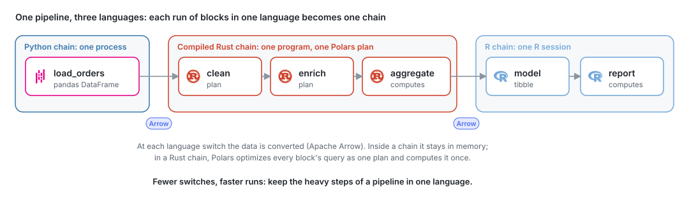

<p align="center">
  <picture>
    <source media="(prefers-color-scheme: dark)" srcset="docs/logo/mageml-dark.svg">
    
  </picture>
</p>

<p align="center">
  Data and ML pipelines in Python, R, Rust and SQL, built for ML engineers.
</p>

MageML is a platform for building, running and shipping data and machine learning
pipelines. Each step is a block, a file of Python, SQL, R or Rust that you run and inspect
in the editor, then schedule. It is based on [Mage](https://github.com/mage-ai/mage-ai)
0.9.79 and builds on the work of the Mage team and its contributors, to whom we are
grateful. It keeps Mage's `mage_ai` package and `mage` command, and runs on Python 3.12
with pandas 3, Polars 2, pyarrow 26, NumPy 2 and SQLAlchemy 2. Support for Python 3.14 is
planned.

MageML was built with machine learning engineers in mind.

MageML is a product by the community, for the community 😸 Feel free to reach out, collaborate, or share your feedback!

<picture>
  <source media="(prefers-color-scheme: dark)" srcset="docs/images/diagrams/compiled-chains.dark.svg">
  
</picture>

## Documentation

The documentation reads on GitHub in **[docs-md/](docs-md/README.md)**, with every page,
image and diagram. The same pages run as a site with search: `docs/docs.sh`, then
http://localhost:3333.

| Start here | |
| --- | --- |
| [Quickstart](docs-md/getting-started/setup.md) | Install MageML with uv or Docker and create a project |
| [Tutorial: a pipeline in Python, Rust and R](docs-md/getting-started/polyglot-pipeline.md) | Build, compile, schedule and document a pipeline, and the same pipeline in Python only |
| [Tutorial: from pipeline to production](docs-md/getting-started/pipeline-to-production.md) | A data contract, a monitor, run records and an export as a service |
| [Tutorial: an ML inference service](docs-md/getting-started/inference-service.md) | Train a model, score in Python, Rust and R, and serve predictions over HTTP |
| [Machine learning tutorial](docs-md/guides/train/train-model.md) | Train a model in a pipeline |
| [Playground](docs-md/getting-started/playground.md) | Try MageML with a seeded shop database and eight pipelines |
| [ColumnAtlas](docs-md/guides/blocks/column-atlas.md) | Explore any block output: profiles, sort and filter over the whole table |
| [Compile pipelines](docs-md/guides/pipelines/compilation.md) | The performance optimization behind production runs |
| [Rust blocks](docs-md/guides/blocks/rust-blocks.md) and [Rust setup](docs-md/guides/blocks/rust-setup.md) | Blocks in Rust with Polars |
| [R blocks](docs-md/guides/blocks/r-blocks.md), [R setup](docs-md/guides/blocks/r-setup.md) and [R packages](docs-md/guides/blocks/r-packages.md) | Blocks in R with packages locked by rv |
| [Export pipelines as a service](docs-md/production/export-a-service.md) and the [service console](docs-md/production/service-console.md) | Run pipelines without MageML |
| [Pipeline performance](docs-md/production/pipeline-performance.md) | Measurements and good practices |
| [Pipeline documentation](docs-md/guides/pipelines/documentation.md) | A README for each pipeline |
| [All pages](docs-md/README.md) | The full index |

## What MageML adds

- **Rust blocks**: loaders, transformers and exporters in Rust with Polars. Consecutive
  Rust blocks compile into one program with one optimized query.
  ([guide](docs-md/guides/blocks/rust-blocks.md))
- **R blocks** with a locked package environment (rv); consecutive R blocks share one
  session. ([guide](docs-md/guides/blocks/r-blocks.md))
- **Data pipeline compilation for better performance**: triggers and schedules fuse chains
  of blocks and compile them, and MageML checks and builds pipelines ahead of their runs.
  Single-language pipelines compile into one chain; the guide compares them with polyglot
  pipelines and their trade-offs. ([guide](docs-md/guides/pipelines/compilation.md),
  [measurements](docs-md/production/pipeline-performance.md))
- **Pipeline services**: export pipelines as a Docker image that runs them without Mage,
  with an HTTP API, schedules, run history and metrics. It deploys to Kubernetes (EKS, GKE,
  AKS, OpenShift) and IBM Cloud Code Engine with the files the export writes, and to Google
  Cloud Run, Azure Container Apps and AWS ECS as a container.
  ([guide](docs-md/production/export-a-service.md),
  [platforms](docs-md/production/pipeline-services.md#deploy))
- **ML inference**: score with models in their frameworks' formats (scikit-learn, CatBoost,
  XGBoost, LightGBM, PyTorch, ONNX, R models) in Python, R or Rust blocks, and serve the
  predictions from an exported service. ([guide](docs-md/guides/pipelines/model-inference.md),
  [tutorial](docs-md/getting-started/inference-service.md))
- **ML engineering**: data contracts, run records, MLflow experiments, model release checks,
  output monitoring, per-pipeline environments, resource limits and a Feast client.
- **Pipeline documentation**: a README per pipeline in Markdown or Quarto, with images.
  ([guide](docs-md/guides/pipelines/documentation.md))
- **ColumnAtlas**: profiles and charts of every block output, over the whole dataset.
  ([guide](docs-md/guides/blocks/column-atlas.md))
- **Self-contained**: MageML sends no usage statistics, and sign-in uses only the identity
  providers you configure.
- **No generative AI features pushed to you.**

Every change from Mage 0.9.79 is in the [release notes](docs/development/release-notes.md),
including the data-type fixes needed for pandas 3, Polars 2 and pyarrow 26.

## Quick start

```bash
git clone https://github.com/jospablo777/mage-ml.git
cd mage-ml
uv sync --locked --no-default-groups --extra postgres
uv run --no-sync mage init my_project
uv run --no-sync mage start my_project
```

The install builds a Rust package, so it needs Rust ([rustup](https://rustup.rs)). Open
http://localhost:6789, sign in with `admin@admin.com` and `admin`, and follow the tutorial
[a pipeline in Python, Rust and R](docs-md/getting-started/polyglot-pipeline.md). Other
ways to install, such as into your own environment or with Docker, are in the
[Quickstart](docs-md/getting-started/setup.md).

Select more integrations with `--extra`, for example `--extra s3` or `--extra dbt`. A later
`uv sync` removes extras that are not selected, so use `uv run --no-sync` in an environment
already synchronized. The `all` extra selects the container profile; the `integrations`
extra supplies connector dependencies, and the `mage_integrations` package installs
separately.

## Editing the documentation

The pages are in [`docs/`](docs/), written for Mintlify. After changing them, run
`uv run python scripts/docs/export_markdown.py` to update [`docs-md/`](docs-md/README.md);
a test fails while the two differ.

## Development

```bash
make dev_env
make test
```

See [the development guide](README_dev.md) for extras, frontend development and dependency
changes.

## License

[Apache License 2.0](LICENSE). MageML is a fork of Mage by Mage Technologies, under the
same license. Language and tool logos in the diagrams are from
[Simple Icons](https://simpleicons.org) (CC0) and belong to their owners.
