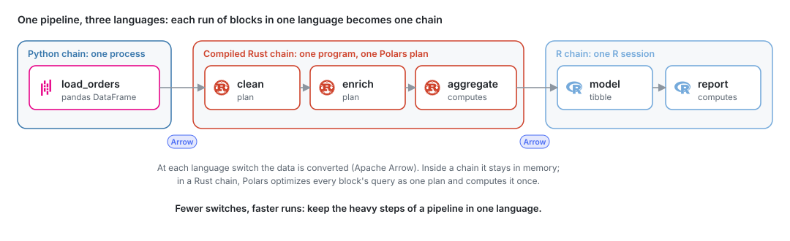
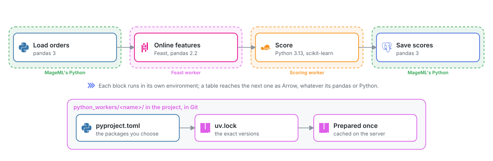

<p align="center">
  <picture>
    <source media="(prefers-color-scheme: dark)" srcset="docs/logo/mageml-dark.svg">
    
  </picture>
</p>

<p align="center">
  Data and ML pipelines in Python, R, Rust and SQL, built for ML engineers.
</p>

MageML is a platform for building, running and shipping data and machine learning
pipelines. Each step is a block, a file of Python, SQL, R or Rust that you run and inspect
in the editor, then schedule. It is based on [Mage](https://github.com/mage-ai/mage-ai)
0.9.79 and builds on the work of the Mage team and its contributors, to whom we are
grateful. It keeps Mage's `mage_ai` package and `mage` command, and runs on Python 3.12
with pandas 3, Polars 2, pyarrow 26, NumPy 2 and SQLAlchemy 2. Support for Python 3.14 is
planned.

MageML was built with machine learning engineers in mind.

MageML is a product by the community, for the community 😸 Feel free to reach out, collaborate, or share your feedback!

<picture>
  <source media="(prefers-color-scheme: dark)" srcset="docs/images/diagrams/compiled-chains.dark.svg">
  
</picture>

## Documentation

The documentation reads on GitHub in **[docs-md/](docs-md/README.md)**, with every page,
image and diagram. The same pages run as a site with search: `docs/docs.sh`, then
http://localhost:3333.

| Start here | |
| --- | --- |
| [Quickstart](docs-md/getting-started/setup.md) | Install MageML with uv, pip or Docker and create a project |
| [Tutorial: a pipeline in Python, Rust and R](docs-md/getting-started/polyglot-pipeline.md) | Build, compile, schedule and document a pipeline, and the same pipeline in Python only |
| [Tutorial: from pipeline to production](docs-md/getting-started/pipeline-to-production.md) | A data contract, a monitor, run records and an export as a service |
| [Tutorial: an ML inference service](docs-md/getting-started/inference-service.md) | Train a model, score in Python, Rust and R, and serve predictions over HTTP |
| [Tutorial: ship a live service](docs-md/getting-started/service-tutorial.md) | Package pipelines as a service in the app, chain them, check their secrets, push to a registry |
| [Machine learning tutorial](docs-md/guides/train/train-model.md) | Train a model in a pipeline |
| [Playground](docs-md/getting-started/playground.md) | Try MageML with a seeded shop database and eleven pipelines |
| [Python workers](docs-md/guides/pipelines/python-workers.md) | Give a block its own Python environment: Feast, MLflow or any SDK with the versions it needs |
| [ColumnAtlas](docs-md/guides/blocks/column-atlas.md) | Explore any block output: profiles, sort and filter over the whole table |
| [Compile pipelines](docs-md/guides/pipelines/compilation.md) | The performance optimization behind production runs |
| [Rust blocks](docs-md/guides/blocks/rust-blocks.md) and [Rust setup](docs-md/guides/blocks/rust-setup.md) | Blocks in Rust with Polars |
| [R blocks](docs-md/guides/blocks/r-blocks.md), [R setup](docs-md/guides/blocks/r-setup.md) and [R packages](docs-md/guides/blocks/r-packages.md) | Blocks in R with packages locked by rv |
| [Export pipelines as a service](docs-md/production/export-a-service.md) and the [service console](docs-md/production/service-console.md) | Run pipelines without MageML |
| [Stream services](docs-md/production/stream-services.md) | Streaming pipelines as services: connectors, guarantees, throughput |
| [Pipeline performance](docs-md/production/pipeline-performance.md) | Measurements and good practices |
| [Pipeline documentation](docs-md/guides/pipelines/documentation.md) | A README for each pipeline |
| [All pages](docs-md/README.md) | The full index |

## What MageML adds

- **Python workers**: each block can run in a Python environment of its own, with its own
  packages, versions and Python, chosen block by block. A Feast block that needs pandas 2,
  an MLflow 2 block for a legacy model and an MLflow 3 block run in one pipeline next to
  blocks on MageML's pandas 3. Any SDK whose pins clash with MageML or with each other
  (Feast, MLflow, cloud SDKs, a vendor's client) now fits in a pipeline. The **Workers**
  page creates and edits them, locks every change with uv before writing it, says when a
  package would be held at an old release, and checks them for vulnerabilities. Workers
  stay warm between blocks (5 ms per block), and exported services build each one into the
  image. ([guide](docs-md/guides/pipelines/python-workers.md))
- **Rust blocks**: loaders, transformers and exporters in Rust with Polars. Consecutive
  Rust blocks compile into one program with one optimized query.
  ([guide](docs-md/guides/blocks/rust-blocks.md))
- **R blocks** with a locked package environment (rv); consecutive R blocks share one
  session. ([guide](docs-md/guides/blocks/r-blocks.md))
- **Data pipeline compilation for better performance**: triggers and schedules fuse chains
  of blocks and compile them, and MageML checks and builds pipelines ahead of their runs.
  Single-language pipelines compile into one chain; the guide compares them with polyglot
  pipelines and their trade-offs. ([guide](docs-md/guides/pipelines/compilation.md),
  [measurements](docs-md/production/pipeline-performance.md))
- **Pipeline services**: export pipelines as a Docker image that runs them without Mage,
  with an HTTP API, schedules, pipelines that start after other runs, run history and
  metrics. The Services page checks a service's configuration and secrets, then builds it
  for amd64 and arm64 and pushes it to Docker Hub, IBM Cloud Container Registry or another
  registry; the export is a repository-ready folder for your own CI. It deploys to
  Kubernetes (EKS, GKE, AKS, OpenShift) and IBM Cloud Code Engine with the files the export
  writes, and to Google Cloud Run, Azure Container Apps and AWS ECS as a container.
  ([guide](docs-md/production/export-a-service.md),
  [in the app](docs-md/production/services-page.md),
  [tutorial](docs-md/getting-started/service-tutorial.md),
  [platforms](docs-md/production/pipeline-services.md#deploy))
- **Stream services**: streaming pipelines exported as services that run in a Rust engine,
  with Python, Rust or R blocks. Kafka, Event Hubs, webhooks, RabbitMQ, NATS JetStream, IBM
  MQ, ActiveMQ, SQS, Pub/Sub, MongoDB change streams and PostgreSQL changes in; Kafka,
  queues, databases, ClickHouse, object storage, HTTP and Feast out. A source's position
  moves only after every sink took the batch, and failing messages go to dead letters.
  Kafka to Kafka through a Rust block runs at about a million messages a second on a
  laptop. ([guide](docs-md/production/stream-services.md))
- **ML inference**: score with models in their frameworks' formats (scikit-learn, CatBoost,
  XGBoost, LightGBM, PyTorch, ONNX, R models) in Python, R or Rust blocks, and serve the
  predictions from an exported service. One pipeline reads raw data, turns it into features
  and passes them to the model, so you build an ML service quickly; it reads from a feature
  store just as well. ([guide](docs-md/guides/pipelines/model-inference.md),
  [tutorial](docs-md/getting-started/inference-service.md))
- **ML engineering**: data contracts, run records, MLflow experiments, model release checks,
  output monitoring, per-pipeline environments, resource limits and a Feast client.
- **Pipeline documentation**: a README per pipeline in Markdown or Quarto, with images.
  ([guide](docs-md/guides/pipelines/documentation.md))
- **ColumnAtlas**: profiles and charts of every block output, over the whole dataset.
  ([guide](docs-md/guides/blocks/column-atlas.md))
- **Self-contained**: MageML sends no usage statistics, and sign-in uses only the identity
  providers you configure.
- **No generative AI features pushed to you.**

## Python workers

Before workers, a block could use only the packages of MageML's own Python. A package that
pins pandas 2 (Feast), or two versions of one SDK (an MLflow 2 model and an MLflow 3 one),
could not run in a pipeline at all. Now each block names the worker it runs in:

<picture>
  <source media="(prefers-color-scheme: dark)" srcset="docs/images/diagrams/python-workers.dark.svg">
  
</picture>

A worker is a uv project in your project, so it goes into git with the pipelines:

```text
python_workers/feast/
  pyproject.toml     # feast, pandas>=2.2,<3: what its blocks import
  uv.lock            # every version, as uv resolved them
  .python-version    # optional: another Python for this worker
```

- **Made in the app.** Workers, in the left navigation: start from a template (Feast,
  MLflow, ML inference, Polars, empty), type packages as you would in `pyproject.toml`,
  pick versions from the package index, choose the Python. A block's **Runs in** menu
  picks its worker.
- **Nothing breaks on save.** Every change is locked by uv in a copy first. Versions that
  cannot go together are refused in one sentence (`feast 0.68.0 needs pandas<3, and the
  worker lists pandas==3.1.1`). When uv would fall back to an old release of a package you
  gave no version, the page asks first.
- **Fast.** A worker is prepared once from its lock and kept on the server; its blocks run
  in a warm process (5 ms per block instead of 228 ms). Tables cross between workers as
  Arrow.
- **Safe.** Each worker can have a memory limit, never sees MageML's own credentials, and
  is checked against OSV for known vulnerabilities, with the fix one click away.
- **Shipped.** An exported service builds each worker into the image, and workers that
  resolve to the same versions become one environment.

Every change from Mage 0.9.79 is in the [release notes](docs/development/release-notes.md),
including the data-type fixes needed for pandas 3, Polars 2 and pyarrow 26.

## Install

MageML installs from its own package index, with prebuilt packages for Python 3.12 on
Linux (x86_64, arm64) and macOS on Apple silicon; on Windows, use WSL 2. No Rust or
compiler is needed to install. We recommend [uv](https://docs.astral.sh/uv/):

```bash
uv init --python 3.12 my-pipelines
cd my-pipelines
uv add mage-ml --index mageml=https://jospablo777.github.io/mage-ml/simple/
uv run mage start my_project
```

Open http://localhost:6789, sign in with `admin@admin.com` and `admin`, and follow the
tutorial [a pipeline in Python, Rust and R](docs-md/getting-started/polyglot-pipeline.md).
Add connectors as extras, such as `uv add "mage-ml[postgres,duckdb]"`, and the packages your
blocks use with `uv add scikit-learn`.

Or write MageML in your `pyproject.toml` and run `uv sync`:

```toml
[project]
requires-python = ">=3.12,<3.13"
dependencies = ["mage-ml[postgres]==0.1.1"]

[[tool.uv.index]]
name = "mageml"
url = "https://jospablo777.github.io/mage-ml/simple/"
```

Other ways:

| How | Command |
| --- | --- |
| A `mage` command for your user (uv tool) | `uv tool install mage-ml --index https://jospablo777.github.io/mage-ml/simple/` |
| Try it without installing (uvx) | `uvx --from mage-ml --index https://jospablo777.github.io/mage-ml/simple/ mage start my_project` |
| Into an environment you already use (uv pip) | `uv pip install mage-ml --index https://jospablo777.github.io/mage-ml/simple/` |
| pip | `python -m pip install -r https://jospablo777.github.io/mage-ml/install/v0.3.0/base.txt` |

With pip, use the release's requirements file, which pins MageML's packages by hash, and not
`--extra-index-url`: pip takes the highest version across indexes, so a package of the same
name on PyPI would replace MageML's. Docker, Kubernetes and installing from source (for
Rust and R development of MageML itself, or macOS on Intel) are in the
[Quickstart](docs-md/getting-started/setup.md). `pip install mage-ai` installs upstream
Mage, not MageML.

## Editing the documentation

The pages are in [`docs/`](docs/), written for Mintlify. After changing them, run
`uv run python scripts/docs/export_markdown.py` to update [`docs-md/`](docs-md/README.md);
a test fails while the two differ.

## Development

```bash
make dev_env
make test
```

See [the development guide](README_dev.md) for extras, frontend development and dependency
changes.
[CI and tests](docs/development/ci.md) describes every test suite, every CI check, what makes
CI fail and how to run the same checks locally.

## License

[Apache License 2.0](LICENSE). MageML is a fork of Mage by Mage Technologies, under the
same license. Language and tool logos in the diagrams are from
[Simple Icons](https://simpleicons.org) (CC0) and belong to their owners.
