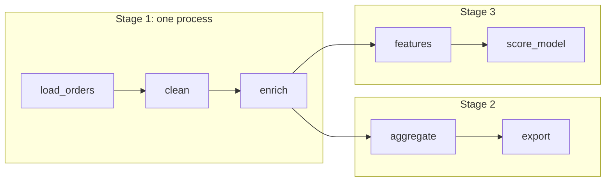
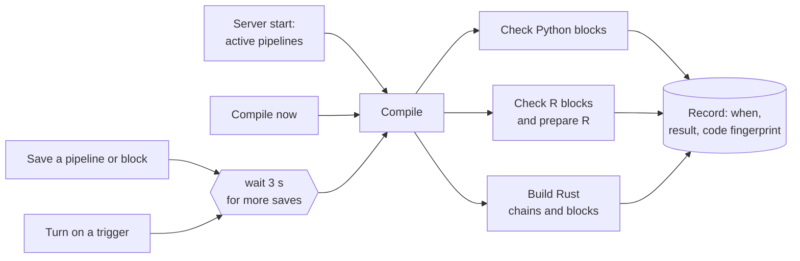

# Pipeline Management


## Setup

If you haven’t setup a project before, check out the
[setup guide](../getting-started/setup.md) before starting.

---

## Pipelines

<sub>`http://localhost:6789/pipelines`</sub>

This page will show all the pipelines in your project.

> Core abstraction: [Pipeline](core-abstractions.md#pipeline)
>
> A pipeline contains references to all the blocks of code you want to run,
> charts for visualizing data, and organizes the dependency between each block
> of code.


Learn more about
[**projects and pipelines here**](core-abstractions.md#project).

From this page, you can also create a new pipeline by clicking the

**`[+ New pipeline]`** button.

#### Creating new pipeline

Creating a new pipeline will take you to the **Pipeline edit page**; a
notebook-like experience for adding blocks, creating dependencies between
blocks, testing code, and visualizing data with charts.

<sub>
  Learn more about the [Notebook for building data
  pipelines](../about/features.md#notebook-for-building-data-pipelines)
</sub>

---

## Pipeline runs

<sub>
  [`http://localhost:6789/pipeline-runs`](http://localhost:6789/pipeline-runs)
</sub>

View all the runs for every pipeline in your current project.

> Core abstraction: [Run](core-abstractions.md#run)
>
> A run record stores information about when it was started, its status, when it
> was completed, any runtime variables used in the execution of the pipeline or
> block, etc.


---

## Pipeline detail

<sub>`http://localhost:6789/pipelines/[uuid]`</sub>

This page contains all the information and history for a single pipeline:

1. [Triggers](core-abstractions.md#trigger)
1. [Runs](core-abstractions.md#run)
1. [Logs](core-abstractions.md#log)

---

## Triggers

<sub>
  [`http://localhost:6789/pipelines/example_pipeline/triggers`](http://localhost:6789/pipelines/example_pipeline/triggers)
</sub>

This page shows all the active and inactive triggers for a single pipeline.

> Core abstraction: [Trigger](core-abstractions.md#trigger)
>
> A trigger is a set of instructions that determine when or how a pipeline
> should run.


---

#### Create trigger

<sub>`http://localhost:6789/pipelines/[uuid]/triggers/[id]/edit`</sub>

Create a new trigger for this pipeline by clicking the **`[+ Create]`** button
near the top of the page.

You can configure the trigger to run the pipeline on a schedule or when an API
is called. Event triggers are deprecated.

> Core abstraction: [Schedule](core-abstractions.md#schedule)
>
> A schedule type trigger will instruct the pipeline to run after a start date
> and on a set interval.

---

> Core abstraction: [API](core-abstractions.md#api)
>
> An API trigger will instruct the pipeline to run whenever a specific API
> is called.


<sub>
  <i>Example page for creating a schedule type trigger.</i>
</sub>

---

#### Trigger detail

On this page, you can start or pause the trigger. Starting the trigger will make
it active. Pausing the trigger will prevent it from running the pipeline.

> [!NOTE]
> If you have other triggers for this pipeline, pausing 1 trigger may not stop
> the pipeline from running since other triggers can also run the pipeline.

---


You can also edit the trigger after creating it by clicking the

**`[Edit trigger]`** button.

---

## Runs

<sub>
  [`http://localhost:6789/pipelines/example_pipeline/runs`](http://localhost:6789/pipelines/example_pipeline/runs)
</sub>

View the pipeline runs and block runs for a pipeline.

> Core abstraction: [Run](core-abstractions.md#run)
>
> A run record stores information about when it was started, its status, when it
> was completed, any runtime variables used in the execution of the pipeline or
> block, etc.


#### Retry run

See [Retrying block runs](../orchestration/pipeline-runs/retrying-block-runs.md).

---

## Logs

<sub>
  [`http://localhost:6789/pipelines/example_pipeline/logs`](http://localhost:6789/pipelines/example_pipeline/logs)
</sub>

Browse all logs for a pipeline. You can search and filter logs by log level,
block type, block UUID, and more.

> Core abstraction: [**Log**](core-abstractions.md#log)
>
> A log is a file that contains system output information.


---

## Backfill

> Core abstraction: [Backfill](core-abstractions.md#backfill)
>
> A backfill creates 1 or more pipeline runs for a pipeline.

See [Backfills](../orchestration/backfills/overview.md).

---

## Monitor

You can monitor many metrics for each of your pipelines and blocks, and aggregate
pipeline run health across the project.


Read more [here](../observability/monitoring.md). To watch a block's output across runs (drift,
missing values, row counts, freshness), see [Monitoring block outputs](../guides/pipelines/monitoring.md).

## Concurrency

You can limit the concurrency of the block execution to reduce resource consumption.

### Global concurrency
You can configure the maximum number of concurrent block runs in project’s `metadata.yaml` via `queue_config`.

```yaml
queue_config:
  concurrency: 100
```
The default value of concurrency is 20.

### Job workers on the run engine
Without the engine, the scheduler starts a new Python process for each block run, or each
fused stage, and that process imports MageML before the block starts: most of a short run.
With the engine installed, jobs run in Python workers that are already started, about three
times faster:

```bash
uv pip install "mage-ml[services]"
mage start my_project
```

The server says `Jobs run in warm workers of ...` when it starts. `MAGE_JOB_ENGINE` decides:

| `MAGE_JOB_ENGINE` | Jobs run |
| --- | --- |
| unset (`auto`) | In warm workers when the engine is installed (the `mageml-engine` wheel, `MAGE_ENGINE_PATH` or `mage-service` on `PATH`), in a process each otherwise |
| `off` | In a process each, as before the engine |
| `on` | In warm workers, with an engine a source checkout built too; a warning and processes when there is none |

The engine and its idle workers hold about 450 MB. Installing the engine is the choice to
spend it; set `MAGE_JOB_ENGINE=off` on small machines.

`queue_config.concurrency` bounds the jobs that run at once, as it bounds processes.
`MAGE_JOBS_WARM` (2) sets how many workers wait idle for the next job, and
`MAGE_JOBS_MAX_PER_WORKER` (50) after how many jobs a worker is replaced. A worker drops
the project's modules after each job, so edited code is read again, and puts back
environment variables, the working directory, `sys.path`, warning filters and NumPy error
settings that block code changed. Other process-wide settings a block changes, such as
pandas options, stay for the next job in that worker, as they do for the next block in a
fused stage. It
is replaced when a job leaves threads running or its memory passes
`MAGE_JOBS_MAX_RSS_MB` (2048). Block runs, logs, outputs, retries and timeouts work as
with processes. Without the engine, or with an engine older than 0.2.0, the scheduler
prints why and runs jobs in processes. Design and measurements:
[run engine](../development/run-engine.md).

### Pipeline level concurrency
You can edit the `concurrency_config` in each pipeline's metadata.yaml file to enforce pipeline level concurrency.
Here is the example:
```yaml
concurrency_config:
  block_run_limit: 5
  pipeline_run_limit: 3
```
The default value of `block_run_limit` and `pipeline_run_limit` can be set via environment variables: `CONCURRENCY_CONFIG_BLOCK_RUN_LIMIT` and `CONCURRENCY_CONFIG_PIPELINE_RUN_LIMIT`

* `block_run_limit`: limit the concurrent blocks runs in one pipeline run.
* `pipeline_run_limit`: limit the concurrent pipeline runs in one pipeline trigger.
* `pipeline_run_limit_all_triggers`: limit the concurrent pipeline runs across all triggers in a pipeline.
* `on_pipeline_run_limit_reached`: choose whether to `wait` or `skip` when the pipeline run limit is reached.

## Variable storage
MageML automatically persists the output of block runs on disk. You can specify the path or the storage for block output variables
in the following ways.
* Specify the data directory path via `MAGE_DATA_DIR` environment variable. In the Docker image built from the repository's
  Dockerfile, this environment variable is set to `/home/src/mage_data`.
* If the `MAGE_DATA_DIR` environment variable is not set, you can set the `variables_dir` path in project's metadata.yaml. Here is
  an example:
```yaml
  variables_dir: /home/src/mage_data
  ```
* You can also use an external storage to store the block output variables by specifying the `remote_variables_dir` path in project's
  metadata.yaml.
  * AWS S3 storage:
```yaml
    variables_dir: /home/src/mage_data
    remote_variables_dir: s3://bucket/path_prefix
    ```
  * Google Cloud Storage:
```yaml
    variables_dir: /home/src/mage_data
    remote_variables_dir: gs://bucket/path_prefix
    ```
    When using GCS for your remote variables directory, if you run into a "Your default credentials were not found"
    error, you may need to set the `GOOGLE_APPLICATION_CREDENTIALS` environment variable to the path of your
    `application_default_credentials.json` file with your Google Cloud credentials and the `GOOGLE_CLOUD_PROJECT`
    environment variable to your Google Cloud project ID.

## Variable retention
If you want to clean up the old variables in your variable storage, you can set the `variables_retention_period`
config in project's metadata.yaml. The valid period should end with "d", "h", or "w".

Example config:
```yaml
variables_retention_period: 30d
```

After configuring `variables_retention_period` in project's metadata.yaml, you can run the following command
to clean up old variables:
```bash
mage clean-cached-variables [project_path]
```

## Block fusion

Production runs (triggers, schedules, backfills, the API and `mage run`) run each chain of
blocks as one stage: one process, with each block receiving the previous block's output
from memory. This is on by default. Each block keeps its block run, status, logs, retries,
timeout and stored output, so the run page, retries and every reader of stored outputs work
as before. Branches still run in parallel, each as its own stage. Running a block in the
editor is unchanged: block by block is for developing and editing a pipeline.

To run a pipeline block by block, for example to debug it, turn off "Run chains of blocks
together" in its settings, or set it in the pipeline's metadata.yaml:

```yaml
block_fusion: 'off'
```

`MAGE_BLOCK_FUSION_DEFAULT=off` changes the default for every pipeline of the server.



Above, `enrich` has two downstream blocks, so the chain ends there and each branch runs
as its own stage, in parallel. Inside a stage, outputs pass in memory.

A chain is a path where each block has one downstream block and that block has one upstream
block. The settings show the stages of the saved pipeline. These blocks always run alone:
dynamic blocks and their children, replicated blocks, data integration blocks, sensors,
global data products, dbt blocks, blocks with a non-local executor, and blocks with
read settings (`configuration.variables`). To run another block alone, check "Run this
block alone" in its settings, or set `fusion: false` in its configuration.

- The next block gets the output from memory only when storage would give it the same
  value: a single pandas DataFrame with string column names and no object columns, or a
  Polars DataFrame. Other outputs are read from storage, as without fusion.
- Each block gets its own copy of the pipeline variables. Environment variables, the
  working directory, `sys.path`, warning filters and NumPy error settings are restored
  after each block.
- If the process dies while a block runs (out of memory, a crash in native code, a kill),
  that block runs again alone; after 3 crashes (`MAGE_BLOCK_RUN_MAX_CRASHES`) it fails.
- A stage ends early, and the next block starts a new one, when the process holds more than
  half of the machine's memory (`MAGE_STAGE_MAX_MEMORY_SHARE`) or a block leaves a thread
  running.

### Compiled chains of Rust and R blocks

Inside a stage, consecutive Rust blocks compile into one program, and Polars optimizes
their lazy queries as one plan: a filter in the third block can run while the first block
reads the file. Consecutive R blocks run in one R session, with their packages loaded once.
A block whose next block is of the same language returns a plan instead of computing its
output, and the first block that needs its output runs the whole chain.

<picture>
  <source media="(prefers-color-scheme: dark)" srcset="../../docs/images/diagrams/compiled-chains.dark.svg">
  
</picture>

`clean` and `enrich` store their plans; `aggregate` runs the three Rust blocks as one
optimized query, so the frames between them are never built. Each block still has its own block run,
log and status.

A block computes its own output, and so ends a chain, when:

- it is the last block of the chain, an exporter or a conditional;
- it has tests, a data contract or monitors;
- the pipeline keeps every block's output (below).

A planned block keeps its block run, logs and status. Its stored output is the plan, which
a retry, a later stage or the editor runs when it reads it. When a block of a compiled
chain fails, its own block run is marked failed with the error, and the block that ran the
chain names it.

To store every block's own output, for example to inspect intermediate results, turn on
"Keep every block's output" in the pipeline settings, or in metadata.yaml:

```yaml
keep_block_outputs: true
```

Runs are slower with it on: every block computes and writes its output.
`MAGE_COMPILED_CHAINS=off` turns compiled chains off for the server.

### Pipeline compilation

MageML compiles a pipeline ahead of its runs, so a scheduled run starts without building
anything:

- **Python blocks**: a syntax check, with the block and line of each error, and a warning
  for a block without its decorated function (`@transformer` and the like).
- **R blocks**: a parse check, with the line and column of each error, and the R
  environment and packages the blocks run with.
- **Rust blocks**: the binaries of the chains and blocks a run would build.
- **SQL blocks** are not compiled: the database checks their queries when they run.



Compiling starts on its own a few seconds after you save a pipeline or a block, when you
turn on a trigger, and when the server starts, for pipelines with an active trigger whose
last compilation is missing or out of date (`MAGE_COMPILE_ON_START=off` turns this off).
Builds are cached, so compiling an unchanged pipeline takes a moment. A run never waits
for a compilation: it builds whatever is missing.

In the editor, the button next to the kernel shows the state: **Compile**, **Compiling
2/4** with a progress bar, **Compiled** or **Compile failed**. Click it to see each step with
its result and error, when the pipeline last compiled and whether its code changed since,
and to compile now. When the pipeline switches language, the panel shows where: each switch
converts the data, so single-language pipelines run faster (see
[Pipeline performance](../production/pipeline-performance.md)). The pipelines list has a
**Compiled** column with the same status and a compile button, and **Compile** in each
row's right-click menu.

From the API, a POST starts a compilation and a GET returns its progress and result:

```text
POST /api/pipeline_compilations   {"pipeline_compilation": {"pipeline_uuid": "sales"}}
GET  /api/pipeline_compilations/sales
```

### Verify fusion

In the pipeline's **Settings**, under block fusion, **Verify fusion** runs the check and
shows each block's result and the full log as it runs; **Stop** ends it. From a terminal:

```bash
mage verify-fusion [project_path] [pipeline_uuid]
```

Runs the pipeline twice, block by block and fused, from the same variables and execution
date, and compares every block's stored outputs. It prints the stages and one line per
block, and names the first block whose output differs:

```
Stage 1: load_sales -> clean_sales -> summarize -> export_summary

  load_sales      same
  clean_sales     same
  summarize       close
                    output_0: revenue: 3 values differ by up to 8.2e-16 (relative)
  export_summary  same

Fusion verified: outputs are the same, except float rounding in summarize ...
```

- **same**: identical values, dtypes, column names and order, and index.
- **close**: only floats differ, by at most 1e-9 relative. Polars and NumPy sums depend on
  how the input is chunked, and an input from memory is chunked differently from one read
  back from storage. `--exact` counts this as a difference.
- **differs**: the column, how many rows differ and the first one. A common cause is state a
  block leaves in its process, such as a module attribute or a cache, which the next block
  of a stage sees and a block in its own process does not.
- **failed**: the block failed in both runs, so nothing was compared.

Each block of the block-by-block run starts in its own process, and each stage of the fused
run in one process, as on a worker. The two runs appear on the pipeline's runs page under
the triggers "Verify fusion: block by block" and "Verify fusion: fused". Both runs execute
the whole pipeline, exporters included, so the command asks before it starts (`--yes` skips
the question). `--runtime-vars` sets variables as in `mage run`, and `--report` writes the
result as JSON. The exit code is 0 when fusion is verified, 1 when an output differs or a
run fails, and 2 when fusion cannot apply to the pipeline.

## Cache block output in memory

By default, MageML persists block output on disk. In pipeline's metadata.yaml, you have the option to configure the pipeline to cache
the block output in memory instead of persisting the block output on disk. The feature is only supported in standard batch
pipeline (without dynamic blocks) for now.

Example config:
```yaml
cache_block_output_in_memory: true
run_pipeline_in_one_process: true
```

---

## Operation history

Keeps track of recently viewed pipelines so you can easily navigate back to them
in the Pipelines Dashboard (`/pipelines`). Adds a `RECENTLY VIEWED` tab to the Pipelines
Dashboard that lists these pipelines.
