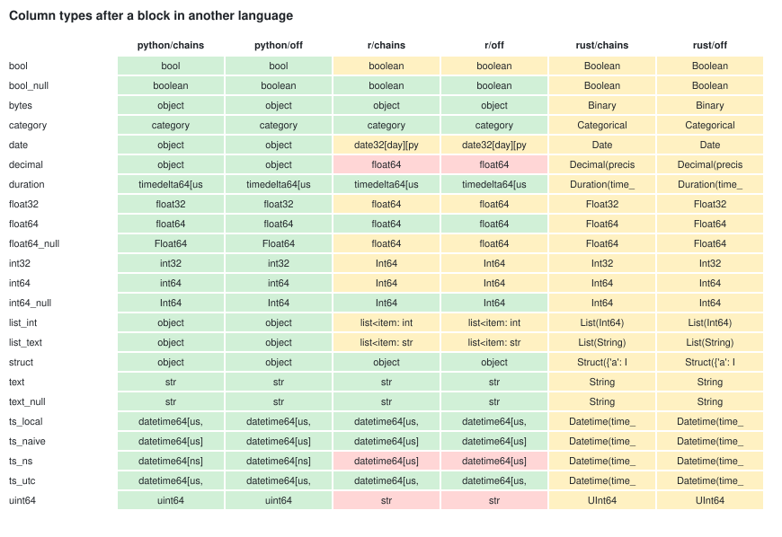
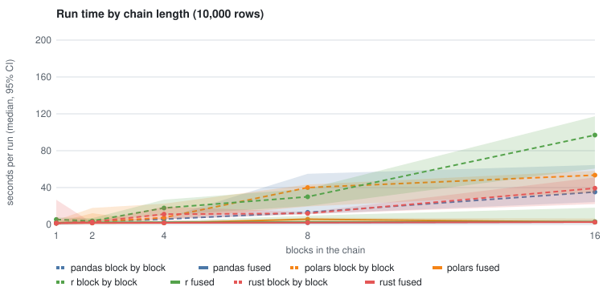
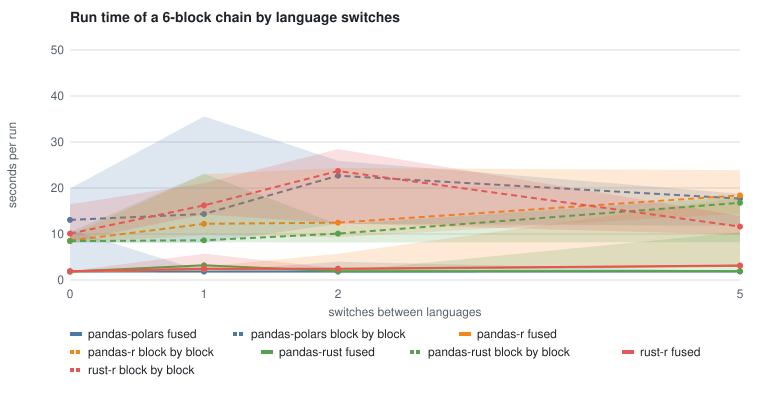
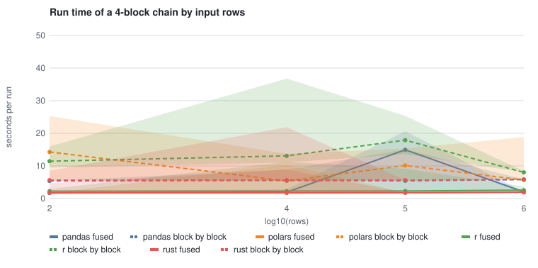
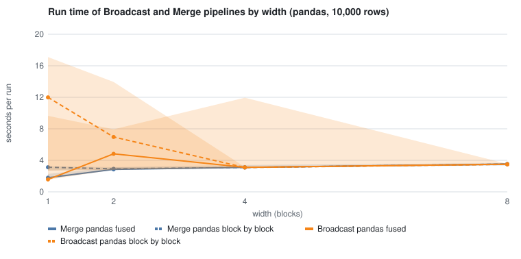
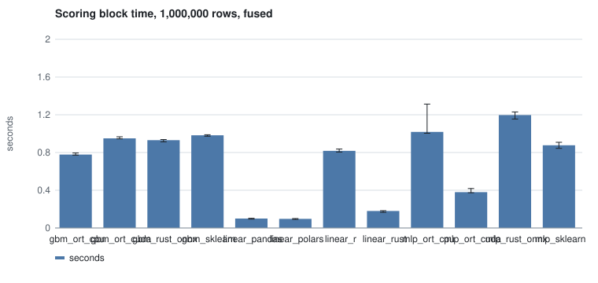
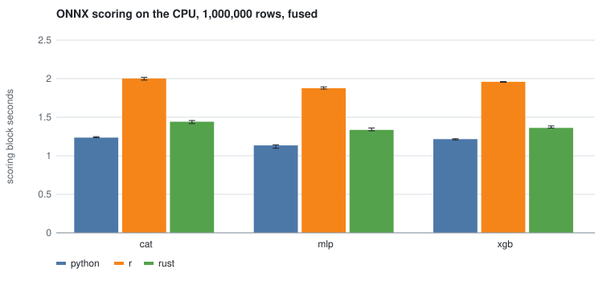
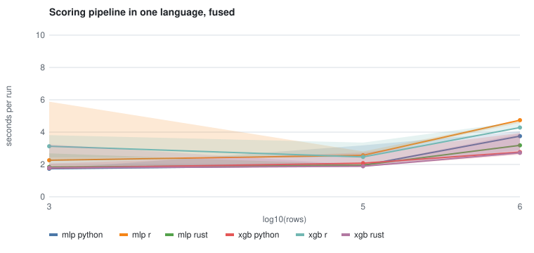

# Compilation study: how pipeline shapes, languages and failures behave

Status: measured on Linux x86-64 in October 2026. The tests, the raw data and the analysis
are in the repository, so every number here can be produced again:

| What | Where |
|---|---|
| Pipeline generator and oracle | `integration_tests/topologies/library.py` |
| Experiments | `integration_tests/topologies/test_*.py` |
| Machine guards | `integration_tests/topologies/conftest.py`, `scripts/study/run.sh` |
| Provenance (session and machine metadata) | `integration_tests/topologies/provenance.py` |
| Raw results, one JSON line per run | `integration_tests/topologies/results/` |
| Statistics, tables and charts | `scripts/study/analyze.py`, `scripts/study/charts.py` |
| Charts | `docs/images/study/` |
| R environment of the model experiments | `integration_tests/topologies/r_ml/` |

The user guide that turns these results into advice is
[Pipeline shapes](../guides/pipelines/pipeline-shapes.md).

## Why

A pipeline is compiled into a plan before it runs: blocks that form a chain run as one
stage (block fusion), consecutive Rust blocks build into one binary, consecutive R blocks
share one R session, and every boundary between languages passes data through Arrow. Each
of these is tested on its own. This study asks how they behave together, on many shapes and
language mixes, what they cost, and what that means for how pipelines should be built and
what MageML should guard against.

## Topology families

Every generated pipeline belongs to one of seven families. The names are used in the
tables below, in the results (`topology` field) and in the guide.

| Family | Generator | Shape | Examples in the study |
|---|---|---|---|
| **Line** | `chain(n)` | one path, each block feeds the next | chain1 to chain16 |
| **Parallel lines** | `chains(k, n)` | k independent lines | chains2x3, chains4x3 |
| **Diamond** | `diamond()` | one block feeds two, which meet again | diamond |
| **Broadcast** | `fan_out(w)` | one block feeds w independent blocks | fan_out3, fan_out1 to 8 |
| **Merge** | `fan_in(w)` | w roots feed one block | fan_in3, fan_in1 to 8 |
| **Lattice** | `lattice(l, w)` | l layers of w blocks, each reading the whole layer before | lattice3x2 |
| **Thicket** | `random_dag(n, p, seed)` | random edges from earlier to later blocks | random8a, random8b |

Only a Line fuses end to end. A Diamond, a Broadcast and a Merge have chains of one
block; Parallel lines fuse each line; a Lattice and a Thicket fuse the parts where a block
has one consumer that has one producer.

## Method

### One operation in four languages

Every generated pipeline uses the same operations, written in pandas, Polars, R (dplyr)
and Rust (Polars):

- a **root** (data loader) makes `rows` rows: `id` (int64), `x` (float64), `g` (int64,
  `id % 7`) and `s` (string, `k0` to `k4`);
- every other block **joins its inputs on `id`** (inner), sets
  `x = (sum of the inputs' x) * a + b` with constants from the block's position, keeps `g`
  and `s` from its first input, and on every third block drops the rows whose `id % m`
  equals a block-specific `r`.

The meaning does not depend on the language, so a pandas **oracle** computes the expected
output of every block of any pipeline. A run passes when every block completes and every
leaf's stored output equals the oracle's: same ids, same `g` and `s`, `x` within 1e-12
relative.

### Language mixes

A pattern assigns a language to each block: one language for all (`pandas`, `polars`,
`r`, `rust`); `alternate:a,b` switches at every block; `islands:N:a,b` keeps runs of N
blocks in one language; `random:seed` draws each block's language.

### Factors and experiments

| Factor | Levels |
|---|---|
| Language of each block | pandas, Polars, R, Rust |
| Language mix | one language, alternating, islands of 2 or 3, random |
| Topology | the seven families above |
| Data size | 0, 1, 100 to 1,000,000 rows |
| Execution | block by block (`block_fusion: off`), fused (`chains`) |
| Faults | a block raises, returns no rows, or drops a column its consumers read |
| pandas strings | object (default), `string[pyarrow]` |

A full factorial design would be tens of thousands of runs, so each experiment varies the
factors its question needs and holds the rest:

| Experiment | Question | Design |
|---|---|---|
| Correctness | Does every shape and mix give the right answer in both modes? | 13 topologies x 4 languages; 8 mixes on 5 topologies; 0 and 1 rows; both modes (200 cases) |
| Data types | Which column types survive a block in another language? | 23 column types through an identity block in Python, R and Rust, both modes |
| Failures | Is a failure reported the same way in every language and mode? | 3 faults x 4 languages x 2 shapes x 2 modes |
| Chain length | What does each block cost, and what does fusion save? | Lines of 1 to 16 blocks, one language, both modes, repeated |
| Language boundaries | What does a switch between languages cost? | a 6-block Line with 0 to 5 switches, 4 language pairs |
| Data size | Where does each language's per-row cost take over from its fixed cost? | 4-block Lines, 100 to 1,000,000 rows |
| Branching | Does fusion help pipelines that are not Lines? | Broadcast and Merge of width 1 to 8 |
| pandas strings | Does the object dtype stop fused stages passing data in memory? | 6-block pandas Line, object vs `string[pyarrow]` |
| Inference pipelines | What does a scoring step cost in each language and runtime? | a logistic model as arithmetic in 4 languages, trees and an MLP through ONNX on CPU and CUDA, 1 to 1,000,000 rows |
| Model scoring | What do real models cost in each language and runtime, and is it the same answer? | XGBoost, CatBoost and a torch MLP, native and ONNX runtimes, Python, R and Rust, 1,000 to 1,000,000 rows |
| End to end in one language | What does a whole scoring pipeline cost in Python, R and Rust? | features, scaling, ONNX scoring and an aggregate as 4 blocks of one language, 2 models, 1,000 to 1,000,000 rows |
| Model training | Do tidymodels in R and the Python libraries fit the same models? | logistic regression and XGBoost, 20,000 rows |

### Runs

Every run goes through the scheduler with each job in its own spawned process, as on a
worker (`fusion_verify.run_in_process`), from a project with its own metadata database.
The first run of each pipeline is **cold** (it builds the Rust binaries and fills caches)
and is reported apart; the measurements use the warm runs after it. Within a repetition
the order of the two modes is drawn from a seeded generator, so neither mode always runs
first on a warm cache.

### Keeping the machine and the results safe

The machine this ran on had shut down under load before, so the study guards it:

- `scripts/study/run.sh` runs the tests in a systemd scope with `MemoryMax=20G`,
  `MemorySwapMax=0` and `CPUQuota=1600%`: a runaway case is killed in its own cgroup.
- Before each test (`conftest.py`): at least 8 GB of free memory and 10 GB of disk, the CPU
  package below 85 °C and the GPU below 80 °C. A hot machine pauses the study up to 10
  minutes; a test that still lacks room is skipped with the reason, never run.
- Thread pools are capped at 8 (Polars, Rayon, OpenMP, BLAS, ONNX Runtime).
- Model scoring works in chunks of 65,536 rows in every language, so memory stays bounded
  whatever the batch size.
- Before each measured run, `wait_quiet` waits until the 1-minute load per CPU is below
  0.25; a run that started on a busy machine is flagged and left out of the timings.

### Provenance

Each session writes `<session>.meta.json`: the commit and the files that differed from it,
host, OS, kernel, CPU model and governor, GPU and driver, cgroup limits, thread settings,
the study's environment variables and the versions of Python, R, Rust and the libraries.
Each run appends one JSON line with its inputs, results and a machine snapshot before and
after it (load, memory, temperatures). Files are append-only, one per experiment and
session, so a rerun adds a session instead of overwriting one.

### Statistics

- Times are summarised by their **median** with a **bootstrap 95% interval** (5,000
  resamples, seed 7). Run times are skewed (a run is sometimes slowed by the system), so
  the median is the robust centre and the bootstrap needs no distribution.
- The **fused speedup** is the ratio of the block by block median to the fused median,
  with a bootstrap interval of that ratio; a **Mann-Whitney U** test tells whether the two
  modes' times differ at all.
- Costs per block and per language boundary are **least squares slopes** of time on the
  count, with a 95% interval from the t distribution; **Spearman's rho** checks that the
  relation is monotonic without assuming it is linear.

## Results

### Correctness: 200 of 200

Every topology, language and mix gave the oracle's answer in both modes, also with 0 and 1
rows: 13 topologies in each of the four languages, 8 mixes (alternating, islands, random)
on a Line, a Diamond, a Merge, a Lattice and a Thicket, and the edge sizes. Fusion and
compiled chains change how a pipeline runs, never what it computes.

### Data types



An identity block in each language received a table with 23 column types and returned it.
In the chart, green is the same type and values, amber the same values under another
type name, red changed values. Rust's cells are amber because its outputs are Polars
tables, whose type names differ from pandas'.

- **Python** keeps every column, values and dtypes, in both modes.
- **Rust** keeps every value. Its outputs are Polars tables, so the dtypes are Polars'
  (`Int64`, `Datetime(ns)`, `Decimal(38, 9)`, `Struct`, `Binary`).
- **R** changes the values of three columns and the dtypes of eight:

| Column | Sent | Back from R | Why |
|---|---|---|---|
| uint64 | 0 to 2**64 - 1 | text | R has no unsigned 64-bit integer; values over 2**63 - 1 cross as text |
| ts_ns | ...00.123456789 | ...00.123457 | R's times are doubles of seconds: microseconds, rounded |
| decimal | Decimal('1.1') | 1.1 (float64) | R has no decimal type; 15 to 17 significant digits |
| int32, int64 | int32, int64 | Int64 | R's integers come back as nullable Int64 |
| bool | bool | boolean | R's logicals are nullable |
| float32 | float32 | float64 | R has one floating point type |
| date, list_int, list_text | object | Arrow-backed dtypes | the values are the same |

R blocks now write a warning in the block's log naming each column where a value changes
(see Guardrails).

### Failures

Each fault in each language, on a Line of 5 blocks (fault at the third or fourth) and on a
Diamond, block by block and fused. The contract held in all 24 cases:

- a block that raises fails; a consumer that reads a missing column fails;
- the blocks after a failed block never complete: they are cancelled;
- blocks that do not depend on it complete;
- a block that returns no rows does not fail anything: empty tables flow through every
  language and the outputs equal the oracle's (empty) ones.

One difference was found and fixed. In a fused compiled chain of R or Rust blocks, the
last block runs the whole chain; when an earlier block of the chain failed, the last block
was marked **failed**, where block by block it is **cancelled**. Its own code never ran.
It is now cancelled (upstream failed when the trigger allows blocks to fail), so both
modes report the same status for every block, and the test requires it.

### Chain length: what a block costs



Lines of 1 to 16 blocks in one language, 10,000 rows, 5 warm runs per mode. Least squares
over the warm runs; the interval is 95%.

| Language | Block by block, s per block | Fused, s per block | 16 blocks, block by block | 16 blocks, fused | Fused speedup at 16 [95% CI] |
|---|---|---|---|---|---|
| pandas | 2.94 [2.10, 3.77] | 0.059 [0.046, 0.071] | 35.2 s | 2.51 s | 14.0 [9.7, 25.7] |
| Polars | 3.37 [2.74, 3.99] | 0.13 [-0.07, 0.33] | 53.5 s | 2.49 s | 21.5 [8.2, 23.6] |
| R | 5.62 [4.68, 6.55] | 0.25 [0.00, 0.50] | 97.0 s | 3.01 s | 32.3 [5.3, 39.1] |
| Rust | 2.26 [1.78, 2.73] | -0.10 [-0.48, 0.29] | 39.3 s | 2.48 s | 15.8 [8.3, 20.6] |

- **Block by block, every block costs seconds**: a process, the imports, a round trip
  through storage and a pass of the scheduler; an R block also starts R. Sixteen blocks
  took 35 to 97 seconds.
- **Fused, a block costs almost nothing.** A 16-block Line ran in 2.5 to 3 seconds in every
  language, 14 to 32 times faster than block by block (Mann-Whitney p = 0.008, the
  smallest 5 runs per mode allow, from 4 blocks on in every language). pandas adds 0.06 s per block, R 0.25 s (its blocks
  share one session but each crosses into R's evaluation), and Rust nothing measurable: a
  compiled chain is one program, and Polars plans its queries as one.
- A single block runs the same either way (speedup 0.94 to 0.99): fusion only removes the
  boundaries between blocks.

### Language boundaries: what a switch costs



A 6-block Line with 0, 1, 2 or 5 switches between two languages, 10,000 rows.

| Languages | Fused, s per switch [95% CI] | Spearman rho (p) |
|---|---|---|
| pandas and Polars | -0.26 [-0.78, 0.26] | -0.16 (0.51) |
| pandas and Rust | 0.31 [-0.16, 0.78] | 0.47 (0.04) |
| Rust and R | 0.18 [-0.02, 0.38] | 0.82 (9e-6) |
| pandas and R | 0.86 [0.05, 1.67] | 0.88 (4e-7) |

- **pandas and Polars switch for free**: both are Python, so they share the process and
  pass the frame in memory.
- **A switch to Rust costs about 0.3 s**: the frame crosses through Arrow into the Rust
  program.
- **A switch to R costs close to a second** from pandas: R starts again for each run of R
  blocks. Between Rust and R the cost per switch is lower (0.18 s), as both exchange Arrow
  files with no pandas conversion.

### Data size: fixed costs and per-row costs



A 4-block Line (joins, arithmetic and a filter), 100 to 1,000,000 rows.

| Language | Fused, 100 rows | Fused, 1,000,000 rows | Block by block, 1,000,000 rows |
|---|---|---|---|
| pandas | 1.69 s | 2.02 s | 5.82 s |
| Polars | 1.69 s | 1.98 s | 5.67 s |
| R | 2.26 s | 2.57 s | 8.02 s |
| Rust | 1.77 s | **1.89 s** | 5.84 s |

Up to a million rows, the fixed cost of a run (about 1.7 s: the scheduler, a process,
storing the outputs) is most of the time in every language. A million rows added 0.33 s
to pandas, 0.29 s to Polars, 0.31 s to R and 0.12 s to Rust: Rust's per-row cost is the
lowest, and it is the fastest at a million rows. The difference between languages is a
fraction of a second here; between modes it is about 4 seconds.

### Branching: Broadcast and Merge



A Broadcast (one root, w consumers) and a Merge (w roots, one consumer) of width 1 to 8,
10,000 rows. With width 1 they are Lines of 2 blocks, which fusion runs 1.7 times faster.
From width 2 on, fused and block by block take the same time: the 95% interval of the
ratio includes 1 in every language, and from width 4 on the medians are within 3% of each
other. No block has a single consumer with a single producer, so there is nothing to fuse.
Going from width 1 to 2 adds about 1.2 s (a second stage); each branch after that adds
about 0.1 s, because the branches run side by side. Shape,
not mode, decides the run time of a branched pipeline.

### pandas strings

A 6-block pandas Line of 100,000 rows, its strings as `object` or as `string[pyarrow]`.
Fused, object strings were 1.09 times slower [0.99, 1.29] (Mann-Whitney p = 0.15): not a
significant difference at this size. A fused stage reads an object-column frame back from
storage instead of passing it in memory, but with pandas 3 text columns are `str` by
default, and the round trip of 100,000 rows is short.

### Long tails

About one run in ten (92 of 860 warm scaling runs) took more than twice the 25th
percentile of its group, spread evenly over the 2.6 hours and over both modes; a block
that usually takes 0.5 s sometimes took 6 to 8 s. The medians and their intervals are
robust to them, which is why the study reports medians. The cause is examined below.

### The metadata database's journal and the tails

Block runs write their statuses to MageML's metadata database. Locally that is SQLite in
its default rollback journal, where a writer locks out readers and other writers, and an
open read transaction blocks every writer; Python's sqlite3 waits up to 5 seconds for a
lock. In WAL mode readers do not block the writer. The journal mode is stored in the
database file, so the experiment switched the study's database between the two modes and
ran the same 8-block pandas Line in both, alternating, 20 warm runs per mode and journal:

| Mode | Journal | Median s [95% CI] | 90th percentile [95% CI] | Max s |
|---|---|---|---|---|
| fused | rollback | 2.01 [1.98, 2.80] | 9.29 [2.57, 22.14] | 22.14 |
| fused | WAL | 1.93 [1.92, 1.96] | 4.54 [1.96, 6.41] | 6.41 |
| block by block | rollback | 28.77 [20.89, 32.35] | 36.02 [32.38, 43.78] | 43.78 |
| block by block | WAL | 24.84 [21.24, 31.98] | 42.87 [31.46, 97.47] | 97.47 |

Fused, WAL lowered the median by 4% (Mann-Whitney p = 0.002) and the worst run from 22 s to
6 s, but the difference in spread is not significant with 20 runs (Levene p = 0.20). Block
by block, the journal made no difference (p = 0.99): the large variance of block by block
runs (21 to 97 s for 8 blocks) has another cause, which this study did not find. MageML's
default is unchanged: WAL is unsafe on network file systems, where deployments often keep
the metadata database, and the gain is small. Production deployments should use
PostgreSQL for the metadata database, and fused runs, whose medians and tails are both
far smaller.

### Inference pipelines



A Python loader makes N rows of 8 features, a scoring block scores them, and a pandas block
aggregates the scores: 3 blocks, 1 to 1,000,000 rows, 5 warm repetitions per mode. Two
tracks: the same logistic model as arithmetic in pandas, Polars, R and Rust; and a
gradient boosted tree model (100 trees, depth 3) and a 256x256 MLP through ONNX, in
Python's ONNX Runtime on the CPU and on CUDA and in Rust's `mage::onnx`, against
scikit-learn's own `predict_proba`. Every scorer agreed with scikit-learn on every run.

Scoring block time (median of warm runs, fused) and the run time of the whole pipeline:

| Scorer | 1 row | 100,000 rows | 1,000,000 rows | rows/s at 1M | Run, 1M, fused | Run, 1M, block by block |
|---|---|---|---|---|---|---|
| logistic, pandas | 0.061 s | 0.066 s | 0.100 s | 10.0 M | 1.82 s | 4.29 s |
| logistic, Polars | 0.061 s | 0.068 s | 0.097 s | 10.3 M | 1.78 s | 4.27 s |
| logistic, Rust | 0.099 s | 0.111 s | 0.180 s | 5.6 M | 1.87 s | 4.30 s |
| logistic, R | 0.700 s | 0.701 s | 0.817 s | 1.2 M | 2.50 s | 4.97 s |
| trees, scikit-learn | 0.145 s | 0.228 s | 0.982 s | 1.0 M | 2.69 s | 5.20 s |
| trees, ONNX Runtime CPU | 0.081 s | 0.157 s | 0.779 s | 1.3 M | 2.48 s | 5.02 s |
| trees, ONNX Runtime CUDA | 0.257 s | 0.335 s | 0.950 s | 1.1 M | 2.69 s | 5.20 s |
| trees, Rust ONNX | 0.113 s | 0.201 s | 0.931 s | 1.1 M | 2.62 s | 5.06 s |
| MLP, scikit-learn | 0.107 s | 0.281 s | 0.876 s | 1.1 M | 2.59 s | 5.03 s |
| MLP, ONNX Runtime CPU | 0.079 s | 0.208 s | 1.018 s | 1.0 M | 2.70 s | 5.17 s |
| MLP, ONNX Runtime CUDA | 0.324 s | 0.327 s | 0.380 s | 2.6 M | 2.13 s | 4.59 s |
| MLP, Rust ONNX | 0.112 s | 0.246 s | 1.197 s | 0.8 M | 2.89 s | 5.28 s |

What the numbers say:

- **Fusion saves about 2.5 seconds per run** of these 3-block pipelines at every size, more
  than any choice of language or runtime. Block by block, each block pays a process, the
  imports and a round trip through storage, and its own time grows by about 0.45 s (the
  scoring block took 0.50 s for 1 row block by block against 0.06 s fused).
- **R pays about 0.7 seconds per R block or chain**, even fused: starting R and loading
  arrow and the exchange packages. Its arithmetic is fast once started (1.2 M rows/s for
  the logistic model at 1M rows). R is the right choice for a step R does best, not for
  a short step in a Python pipeline.
- **Rust does not win a single scoring step between Python blocks.** The input crosses
  from Python to Rust and the output back, through Arrow files. pandas and Polars
  computed the logistic model at 10 M rows/s against Rust's 5.6 M, because their block
  takes the frame in memory. Rust wins when it holds the whole chain (see chain length and
  data size), not one block of it.
- **The GPU wins only for dense models on large batches.** ONNX Runtime on CUDA pays about
  0.25 s to start and copy, so it loses below 100,000 rows. The MLP at 1M rows ran 2.6
  times faster than on the CPU. Tree ensembles gained nothing on the GPU (ONNX Runtime
  runs `TreeEnsembleClassifier` on the CPU and copies the data to the device and back).
- **ONNX Runtime on the CPU beat scikit-learn's own predict** for its gradient boosted
  trees (1.3 M against 1.0 M rows/s) and was even with it for the MLP. XGBoost and
  CatBoost are another matter: their own predict beats ONNX (next section).

### Model scoring in Python, R and Rust

Three models, trained once in Python on 20,000 synthetic customers made with Faker (16
numeric features, a churn label from a fixed rule plus noise) and not tuned:

| Model | Shape | Saved as |
|---|---|---|
| xgb | XGBoost, 200 trees of depth 6 | XGBoost JSON and ONNX (onnxmltools) |
| cat | CatBoost, 200 iterations of depth 6 | `.cbm` and ONNX (CatBoost's exporter, ZipMap removed) |
| mlp | torch MLP 16-512-512-1 with the feature scaling inside | TorchScript and ONNX |

A Python loader resamples the customers to 1,000, 100,000 or 1,000,000 rows with a fixed
seed, and one scoring block scores them in chunks of 65,536 rows with 8 threads:

- **native** runtimes: XGBoost, CatBoost and torch in Python (torch on the CPU and on
  CUDA); xgboost, catboost and torch (`jit_load`) in R;
- **ONNX**: ONNX Runtime 1.31 in Python (CPU and CUDA), onnxr 0.1.2 with ONNX Runtime
  1.25.1 in R, and `mage::onnx` (the `ort` crate) in Rust, all on the CPU.

Session 20261012T103936Z-95391e, at commit a04011085 and later; 4 warm runs per mode.

Scoring block time, fused, median of warm runs:

| Model | Runtime | 1,000 rows | 1,000,000 rows | rows/s at 1M |
|---|---|---|---|---|
| xgb | Python, XGBoost | 0.19 s | 0.48 s | 2.07 M |
| xgb | Python, ONNX Runtime | 0.08 s | 1.22 s | 0.82 M |
| xgb | R, xgboost | 0.87 s | 1.33 s | 0.75 M |
| xgb | R, onnxr | 0.58 s | 1.96 s | 0.51 M |
| xgb | Rust, mage::onnx | 0.12 s | 1.36 s | 0.73 M |
| cat | Python, CatBoost | 0.09 s | 0.16 s | 6.13 M |
| cat | Python, ONNX Runtime | 0.09 s | 1.24 s | 0.81 M |
| cat | R, catboost | 0.55 s | 0.87 s | 1.15 M |
| cat | R, onnxr | 2.68 s | 2.00 s | 0.50 M |
| cat | Rust, mage::onnx | 0.12 s | 1.44 s | 0.69 M |
| mlp | Python, torch CPU | 0.79 s | 1.89 s | 0.53 M |
| mlp | Python, torch CUDA | 1.08 s | 0.98 s | 1.02 M |
| mlp | Python, ONNX Runtime CPU | 0.08 s | 1.13 s | 0.88 M |
| mlp | Python, ONNX Runtime CUDA | 0.39 s | 0.34 s | 2.93 M |
| mlp | R, torch | 1.56 s | 2.94 s | 0.34 M |
| mlp | R, onnxr | 0.58 s | 1.88 s | 0.53 M |
| mlp | Rust, mage::onnx | 0.12 s | 1.34 s | 0.75 M |

Every scorer gave **the same bytes on every run**, fused or block by block (51 of 51
model, runtime and size combinations), and agreed with Python's own model: exactly for
XGBoost and CatBoost in R, within 6e-8 for torch, within 3e-7 for ONNX in every language
(float32 rounding) and within 3.4e-5 for ONNX Runtime on CUDA.

What the numbers say:

- **For tree models, keep the framework's own runtime.** XGBoost's own predict was 2.5
  times faster than its ONNX export, and CatBoost's 7.5 times (6.1 M against 0.8 M rows/s):
  CatBoost's symmetric trees are fast natively and lose that as a generic
  `TreeEnsembleClassifier`.
- **For neural networks, ONNX Runtime wins on the CPU** (0.88 M rows/s against torch's
  0.53 M) **and on the GPU** (2.9 M against 1.0 M).
- **The GPU pays off from about 100,000 rows**, and only for the dense model: CUDA set-up
  costs 0.3 to 1 s per process.

### ONNX in three languages

The same ONNX graphs ran in Python, R and Rust. At 1,000,000 rows, rows per second:

| Model | Python, ONNX Runtime | Rust, mage::onnx | R, onnxr |
|---|---|---|---|
| xgb | 0.82 M | 0.73 M | 0.51 M |
| cat | 0.81 M | 0.69 M | 0.50 M |
| mlp | 0.88 M | 0.75 M | 0.53 M |



All three agreed to float32 precision. Rust was 10 to 15% behind Python's ONNX Runtime:
the frame crosses from the Python loader into the Rust process through Arrow, and the
`ort` crate bundles an older ONNX Runtime. R was about 40% behind, with 0.5 s or more of
start-up on small batches and a conversion of R's doubles to float32. onnxr's `cuda`
backend fails ("Unknown provider name 'CUDA'"), so R has no GPU path for ONNX; Rust's
`mage::onnx` is built with ONNX Runtime's CPU binaries.

### End to end in one language



Each language ran the whole pipeline: make 16 features from the row id, scale them,
score them with the same ONNX model in chunks of 65,536 rows, and average the scores in 10
buckets. Fused, Python runs the four blocks in one process, R in one R session and Rust as
one compiled program. The three languages returned the same bucket means and counts, to
the last recorded digit, at every size.

Run time of the whole pipeline (median of warm runs):

| Model | Rows | Python, fused | R, fused | Rust, fused | Block by block (Python, R, Rust) |
|---|---|---|---|---|---|
| MLP | 1,000 | 1.73 s | 2.26 s | 1.84 s | 5.50, 7.70, 5.60 s |
| MLP | 100,000 | 1.94 s | 2.57 s | 1.96 s | 5.67, 11.35, 5.80 s |
| MLP | 1,000,000 | 3.75 s | 4.74 s | **3.18 s** | 6.75, 13.59, 6.95 s |
| XGBoost | 1,000 | 1.78 s | 3.13 s | 1.79 s | 5.56, 7.77, 8.39 s |
| XGBoost | 100,000 | 2.08 s | 2.46 s | 1.89 s | 6.18, 9.28, 6.04 s |
| XGBoost | 1,000,000 | 2.77 s | 4.28 s | 2.72 s | 6.56, 11.71, 6.70 s |

- **Holding the whole pipeline, Rust is the fastest at a million rows**: 15% faster
  than Python with the MLP, even with XGBoost, where both spend most of the time in the same
  ONNX Runtime. Up to 100,000 rows Python and Rust take the same 1.8 to 2 seconds: the cost
  of a run in MageML (scheduling, a process, storing the outputs), not of the work.
- **R is the slowest at every size**, by 0.4 to 1.3 seconds fused, and 2 to 7 seconds
  block by block, where each R block starts R again.
- **Fusion matters more than the language**: block by block took 2 to 4.7 times as long
  in every language.

### Training: tidymodels and Python

A logistic regression and an XGBoost model fitted on the same 20,000 rows, in R with
tidymodels (`workflow()`, `logistic_reg()` and `boost_tree()`, after Kuhn and Silge, *Tidy
Modeling with R*, 2023) and in Python with scikit-learn and XGBoost:

| Model | Agreement | Fit block, Python | Fit block, R |
|---|---|---|---|
| Logistic regression | coefficients equal within 3e-10 (relative) | 0.63 s | 1.96 s |
| XGBoost, same settings | predicted probabilities differ by 0.014 on average, 0.31 at most | 0.73 s | 2.07 s |

Both languages gave the same bytes on every run. The XGBoost difference is the library
version, not tidymodels: parsnip's fit equals R's own `xgb.train` (2e-7), and Python's
XGBoost 3.2.0 reproduces R's model exactly, while the Python environment has 3.4.1. CRAN's
xgboost (3.2.1.1) trails PyPI, and the same settings grow different trees across those
versions. A model meant to be reproduced in another language needs the same library
version there.

### GPU energy

The study read the GPU's energy counter (NVML) before and after each run and subtracted
the idle draw measured before the test. The result is not usable at this scale: with a
display attached, the RTX 4080 idles at about 48 W and drifts by a few watts, more than the
work of a 1 to 3 second run, and some medians came out negative. CPU energy (RAPL) needs
root to read on this machine. A sound energy comparison needs runs of minutes under steady
load, the GPU without a display, and RAPL readable
(`sudo chmod o+r /sys/class/powercap/intel-rapl:0/energy_uj`); the experiment records both
counters when they are available.

### R environment checks: a fix found by the study

R scoring blocks with XGBoost or CatBoost first took 10 to 13 seconds whatever the batch
size. The cause: before each R block, MageML ran `rv plan` to check that the library
matched `rv.lock`, in every block run, since each is a new process. In the model
experiments' R environment, CatBoost comes from its release archive (it is not on CRAN),
and rv downloads such packages again on every plan: 13 to 39 seconds, against 0.15 s for
an environment of repository packages. Since 0e7d5ac3a a passed check is remembered until
`rproject.toml`, `rv.lock`, the library or the executables change:

| Scorer | Rows | Before (s, 95% CI) | After (s, 95% CI) | Faster | Mann-Whitney p |
|---|---|---|---|---|---|
| CatBoost | 1,000 | 10.42 [10.20, 11.02] | 0.78 [0.55, 1.07] | 13.3x | 0.002 |
| CatBoost | 100,000 | 11.31 [10.16, 20.08] | 0.81 [0.59, 1.06] | 13.9x | 0.002 |
| XGBoost | 1,000 | 10.68 [10.52, 10.88] | 1.10 [0.87, 1.44] | 9.7x | 0.002 |
| XGBoost | 100,000 | 12.70 [10.68, 14.54] | 1.15 [0.93, 1.36] | 11.1x | 0.002 |
| XGBoost | 1,000,000 | 11.39 [10.80, 13.14] | 1.56 [1.33, 1.79] | 7.3x | 0.002 |

Scoring block, both modes, warm runs. "Before" is session 20261012T094950Z-337718 up to
10:15:49 UTC, when the change reached the running session (recorded in
`results/incidents.json`; later runs of that session are left out); "after" is session
20261012T103936Z-95391e.

The same session found a second R problem. R's torch failed to load ("Lantern is not
loaded") because its load check starts another R process, which did not get the block's
library paths. Since a04011085 the runner passes them in `R_LIBS`, which also fixes
parallel and future workers and callr in R blocks.

### R: the least reliable of the three languages

On every measure where the languages differed, R came last. It computes the right
answers: 200 of 200 correctness cases, logistic coefficients equal to Python's within
3e-10, byte-identical scores on every run, and models equal to Python's when the library
versions match. The problems are around the computation:

| Concern | What the study found | Python | Rust |
|---|---|---|---|
| Precision of values crossing into a block | changes the values of 3 of 23 column types: uint64 above 2^63 - 1 becomes text, nanoseconds are rounded to microseconds, decimals become doubles (15 to 17 digits) | keeps all | keeps all |
| Fixed cost | about 0.7 s per R block or chain to start R and load the exchange packages; 1 to 2 s with tidymodels or torch | 0.06 s per fused block | 0.1 s |
| Throughput | logistic arithmetic 1.2 M rows/s (pandas 10 M); ONNX 0.5 M rows/s (Python 0.8 M, Rust 0.7 M); torch MLP 0.34 M rows/s | | |
| GPU | no ONNX GPU path (onnxr's `cuda` backend fails); torch's CUDA build needs its own install | ONNX Runtime and torch on CUDA | CPU ONNX Runtime |
| Packages | CatBoost is not on CRAN (installed from its release archive); torch downloads libtorch separately and needs `TORCH_HOME` set to the library; CRAN's xgboost trails PyPI's, so models differ from Python's with the same settings | PyPI wheels | crates.io, compiled |
| Environment checks | a URL or git package made every R block run take 10 to 40 s more (`rv plan` downloads it each time); fixed in 0e7d5ac3a | | |
| Child processes | workers and torch's load check did not see the project's packages; fixed in a04011085 | | |

Use R for the steps it is best at (statistics, tidymodels, a package only R has), in
runs of R blocks so they share one session, with versions pinned in `rv.lock`, and check
the R block's log for the columns R changes. Do not use it for short steps between Python
or Rust blocks, or for GPU scoring.

## What the study changed in MageML

Each change has a test that fails without it.

| Change | Evidence | Commit |
|---|---|---|
| The block that ran a compiled chain is cancelled, not failed, when an earlier block of the chain failed, so fused and block by block runs report the same statuses | fault experiment | 1210d19d3 |
| `mage verify-fusion` runs again a block whose process died, as a worker does, instead of reporting that the run stopped making progress | a stall of the random8a Thicket in `make ci` | f78f8ce97 |
| An R environment is checked once until its files change: R blocks with a URL or git package were 7 to 14 times slower | model scoring, before and after | 0e7d5ac3a |
| Processes an R block starts get its library paths: R torch failed to load | model scoring | a04011085 |
| R blocks name the columns where R changes values (uint64 as text, nanoseconds) | data types | 6aa8744da |
| The service's run history checkpoints in the background, not on the request path | round 3 latency measurement | 9d504d2ec |
| An exported image gets MLflow only when a model needs it | round 3 export check | 9f6994802 |

The repository audit that followed the study fixed, each with a test: profiling a block's
output ran list-like text from the data with `eval` (1636cb8da); the event, event matcher
and block analysis routes answered without sign-in (2632cf49d); WebSocket connections got
every kernel output and could open terminals without sign-in (03de3bcec); an export's zip
read each file whole into memory (eb8a4a000); reproductions left folders behind
(17ac8d393).

Not changed, with the reason:

- WAL for the SQLite metadata database: small gain, unsafe on network file systems.
- A CUDA build of Rust's `mage::onnx`: only dense models on large batches gain, and Python's
  ONNX Runtime already serves them; it would tie the SDK to a CUDA version.
- Preloaded imports for block processes (forkserver): imports take about 0.6 s of a block
  run, and fused runs, the default, pay them once per stage.

## Reproduce

```bash
# The guards and the provenance apply to every command (scripts/study/run.sh).
export MAGE_STUDY_FULL=1 MAGE_STUDY_RESULTS_DIR=$PWD/integration_tests/topologies/results
scripts/study/run.sh integration_tests/topologies/test_correctness.py
scripts/study/run.sh integration_tests/topologies/test_types.py
scripts/study/run.sh integration_tests/topologies/test_faults.py
scripts/study/run.sh integration_tests/topologies/test_inference.py
scripts/study/run.sh integration_tests/topologies/test_scaling.py
scripts/study/run.sh integration_tests/topologies/test_metadata_db.py
# Model experiments: ML libraries the lock file does not have, and the R environment.
uv pip install xgboost catboost torch onnxmltools skl2onnx onnxruntime-gpu nvidia-ml-py
(cd integration_tests/topologies/r_ml && rv sync && Rscript -e 'onnxr::onnx_install(cuda = FALSE)')
scripts/study/run.sh integration_tests/topologies/test_ml_models.py
uv run python scripts/study/analyze.py
```

Without `MAGE_STUDY_FULL`, the topology tests run a small grid as part of the integration
suite (`make -C integration_tests ci`), and the model and journal experiments are skipped.
The machine of these results: Intel Core i9-14900KF (32 threads, governor `performance`),
62 GiB, NVIDIA RTX 4080, Ubuntu 24.04, kernel 6.8; each session's `meta.json` has the rest.
