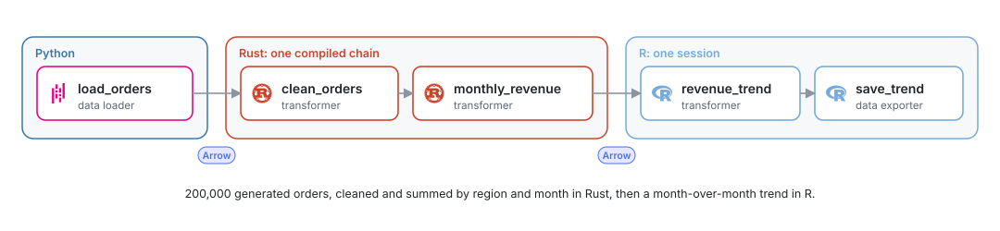
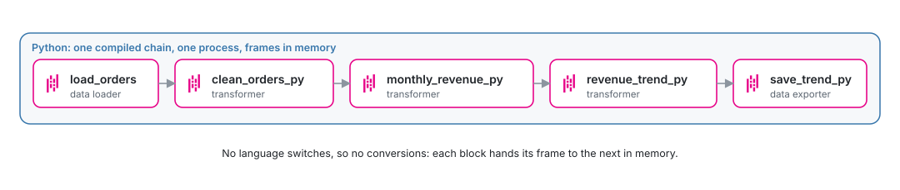

# Tutorial: a pipeline in Python, Rust and R

*Build a pipeline that loads data in Python, transforms it in Rust and analyzes it in R, then compile it, run it on a schedule and document it.*

In this tutorial you build one pipeline with three languages, each doing what it is good at:

- **Python** (pandas) loads 200,000 orders;
- **Rust** (Polars) cleans them and sums revenue by region and month;
- **R** (dplyr) computes the month-over-month trend and saves it.

<picture>
  <source media="(prefers-color-scheme: dark)" srcset="../../docs/images/diagrams/tutorial-pipeline.dark.svg">
  
</picture>

It takes about 15 minutes, plus a few minutes the first time Rust compiles Polars.

> [!NOTE]
> You need MageML running ([setup](setup.md)). In Docker, Rust and R are
> installed. Locally, see [Rust setup](../guides/blocks/rust-setup.md) and
> [R setup](../guides/blocks/r-setup.md), which ends with `mage r init path/to/project`.

## 1. Create the pipeline

1. Open **Pipelines** and click **New** > **Standard (batch)**.
2. Name it `regional_revenue`.

## 2. Load the orders in Python

Add a **Data loader** block, choose **Python** and the generic template, name it
`load_orders`, and replace its code:

```python
import numpy as np
import pandas as pd

if 'data_loader' not in globals():
    from mage_ai.data_preparation.decorators import data_loader

@data_loader
def load_orders(*args, **kwargs):
    rng = np.random.default_rng(7)
    rows = 200_000
    return pd.DataFrame({
        'order_id': np.arange(rows),
        'region': rng.choice(['north', 'south', 'east', 'west'], rows),
        'month': rng.integers(1, 13, rows),
        'amount': rng.gamma(2.0, 30.0, rows).round(2),
        'units': rng.integers(0, 6, rows),
    })
```

Run the block (**Run** or Cmd+Enter / Ctrl+Enter). The output shows the first rows, and
**ColumnAtlas** profiles every column over the whole table.

## 3. Clean and sum in Rust

Add a **Transformer** below `load_orders`, choose **Rust**, name it `clean_orders`:

```rust
use mage::prelude::*;

/// Orders with units and an amount above 1.
fn transform(orders: LazyFrame) -> Result<LazyFrame> {
    Ok(orders.filter(col("units").gt(lit(0)).and(col("amount").gt(lit(1.0)))))
}
```

Add another Rust **Transformer** below it, `monthly_revenue`:

```rust
use mage::prelude::*;

/// Revenue and order count per region and month.
fn transform(orders: LazyFrame) -> Result<LazyFrame> {
    Ok(orders
        .with_column((col("amount") * col("units").cast(DataType::Float64)).alias("revenue"))
        .group_by([col("region"), col("month")])
        .agg([col("revenue").sum(), len().alias("orders")]))
}

fn test_every_region(output: &DataFrame) -> Result<()> {
    ensure!(output.height() == 48, "expected 4 regions x 12 months, got {}", output.height());
    Ok(())
}
```

Run both. The first Rust build of a project compiles Polars and takes a few minutes; after
that a block builds in about a second. While you type, the editor underlines compile errors
on their lines.

The two blocks take and return a `LazyFrame`: in a production run they compile into one
program, and Polars plans both queries together, so the filtered table is never built on
its own.

## 4. Analyze in R

Add a **Transformer** below `monthly_revenue`, choose **R**, name it `revenue_trend`:

```r
suppressPackageStartupMessages(library(dplyr))

#* @transformer
revenue_trend <- function(df_1, ...) {
  df_1 |>
    group_by(region) |>
    arrange(month, .by_group = TRUE) |>
    mutate(growth = revenue / lag(revenue) - 1) |>
    ungroup()
}
```

Then a **Data exporter** in R, `save_trend`:

```r
# Relative paths start at the project; the folder is created.
#* @data_exporter
save_trend <- function(df_1, ...) {
  write_file(df_1, "output/revenue_trend.csv")
  message("Wrote ", nrow(df_1), " rows to output/revenue_trend.csv")
}
```

Run them. R blocks get the upstream table as a data frame, and integer columns arrive as
R integers.

## 5. Compile the pipeline

Compilation is a performance optimization: MageML checks the blocks and turns each chain of
blocks in one language into one unit, so production runs are faster. Look at the button
next to the kernel in the editor header. MageML compiled the pipeline
on its own a few seconds after your last save; the button says **Compiled**. Click it:

- each step and its result: the Python check, the R check, the Rust chain
  `clean_orders → monthly_revenue`, and the R environment;
- when the pipeline last compiled, and whether the code changed since;
- **Single-language pipelines run faster**, with the pipeline's languages in order:
  `Python → Rust ×2 → R ×2`. Each arrow is a conversion of the data between languages.

Introduce an error in `clean_orders`, such as removing a parenthesis, and save: within a
few seconds the button shows **Compile failed**, and the panel shows the compiler's message
with the file and line. Undo it, and the pipeline compiles again.

## 6. Run it on a schedule

1. Open **Triggers** and create a schedule, for example daily.
2. Turn it on, then click **Run now** to start a run.
3. Open the run. Each block has its own block run, log and status, as always.

Production runs fuse each chain of blocks into one stage and compile the chains:
`clean_orders` and `monthly_revenue` run as one compiled Rust program, and `revenue_trend`
and `save_trend` share one R session. In the editor, blocks still run one by one, so you
can inspect each output.

> [!TIP]
> To see every block's own output in production runs, for example while debugging, turn on
> **Keep every block's output** in the pipeline settings. Runs take longer with it on.

## 7. Document it

Open **Documentation** in the pipeline's left navigation, or the document button on its
row in the pipelines list, and choose **Write in Markdown**. The template already lists
`load_orders` as the input and `save_trend` as the output. Describe the pipeline and save:
the README is saved in the pipeline's folder and versions with it.

## 8. The same pipeline in Python only

Python pipelines compile too. A pipeline in one language is one chain from start to end:
its blocks run in one process, each hands its frame to the next in memory, and there is no
conversion between languages. That makes it faster.

<picture>
  <source media="(prefers-color-scheme: dark)" srcset="../../docs/images/diagrams/tutorial-pipeline-python.dark.svg">
  
</picture>

Create a second pipeline, `regional_revenue_python`. Add the existing `load_orders` block
to it: search for it in the block search bar, or drag its file from the file browser (see
[Reuse blocks](../guides/blocks/reuse-blocks.md)). Then add four Python blocks with pandas.

A **Transformer**, `clean_orders_py`:

```python
@transformer
def clean_orders(orders, *args, **kwargs):
    """Orders with units and an amount above 1."""
    return orders[(orders['units'] > 0) & (orders['amount'] > 1)]
```

A **Transformer**, `monthly_revenue_py`:

```python
@transformer
def monthly_revenue(orders, *args, **kwargs):
    """Revenue and order count per region and month."""
    return (
        orders.assign(revenue=orders['amount'] * orders['units'])
        .groupby(['region', 'month'], as_index=False)
        .agg(revenue=('revenue', 'sum'), orders=('order_id', 'size'))
    )

@test
def test_every_region(output, *args):
    assert len(output) == 48, f'expected 4 regions x 12 months, got {len(output)}'
```

A **Transformer**, `revenue_trend_py`:

```python
@transformer
def revenue_trend(monthly, *args, **kwargs):
    """Month-over-month growth of revenue in each region."""
    trend = monthly.sort_values(['region', 'month'])
    trend['growth'] = trend.groupby('region')['revenue'].pct_change()
    return trend
```

A **Data exporter**, `save_trend_py`:

```python
import os

from mage_ai.settings.repo import get_repo_path

@data_exporter
def save_trend(trend, *args, **kwargs):
    path = os.path.join(get_repo_path(), 'output', 'revenue_trend.csv')
    os.makedirs(os.path.dirname(path), exist_ok=True)
    trend.to_csv(path, index=False)
    print(f'Wrote {len(trend)} rows to output/revenue_trend.csv')
```

The Compile panel now shows one language, `Python ×5`, and no switches. Both pipelines
write the same 48 rows. Run each from a terminal, as a production run does:

```bash
mage run path/to/project regional_revenue
mage run path/to/project regional_revenue_python
```

On a laptop (Apple M4 Pro), the Python-only pipeline took 1.8 seconds and the pipeline in
three languages 3.2 seconds, the median of three runs each. At 200,000 rows, the time the
polyglot pipeline adds goes to starting an R session and converting the data between
languages; the work itself is small. On large tables the trade changes: Rust's speed on the
heavy steps can pay for a switch, as the measurements in
[Pipeline performance](../production/pipeline-performance.md) show.

## What you built, and what to take from it

| Step | Language | Why there |
| --- | --- | --- |
| Load | Python | Libraries for every source, and quick to write |
| Clean and aggregate | Rust | The heavy work on the full table, compiled and planned as one query |
| Trend and export | R | dplyr for analysis on the small aggregated table |

The aggregate is 48 rows, so handing it from Rust to R costs little. The rules of thumb:
a pipeline in one language runs fastest, because compilation turns it into one chain; when
you mix languages, switch where the data is small and keep the steps that touch the full
table in one language. [Pipeline performance](../production/pipeline-performance.md) has the measurements
behind it.

## Next steps

- [Export the pipeline as a service](../production/export-a-service.md) to run it without
  MageML.
- Add a [data contract](../guides/blocks/data-contracts.md) to `monthly_revenue`.
- Track a model trained on the output with [experiments](../guides/pipelines/experiments.md).
