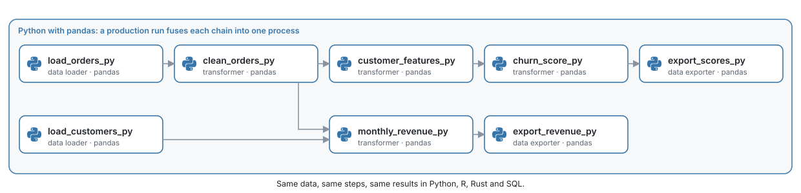

# Tutorial: retail orders in Python

*Clean a shop's orders, compute revenue by region and month, build customer features and score churn risk, in Python with pandas.*

Same tutorial in: **Python** · [R](retail-r.md) · [Rust](retail-rust.md) · [SQL (DuckDB)](retail-sql.md)

A shop exports its orders every night. The export has the problems real exports have:
some rows appear twice, some orders were cancelled or returned, some amounts are missing,
and the amounts are in three currencies. In this tutorial you build the pipeline that turns
that export into two tables the business uses:

- **monthly revenue** by region, in USD, with orders and customers;
- **customer scores**: recency, frequency and money spent per customer (RFM), and a churn
  risk score from a simple logistic model.

<picture>
  <source media="(prefers-color-scheme: dark)" srcset="../../docs/images/diagrams/retail-pipeline-python.dark.svg">
  
</picture>

The same pipeline is written in R, Rust and SQL on DuckDB, with the same data and the same
results, so you can compare the languages block by block. It takes about 15 minutes.

> [!NOTE]
> You need MageML running ([setup](setup.md)). The Python blocks use pandas and
> NumPy, which MageML installs.

## 1. Get the data

From a terminal, write the shop's data into your project:

```bash
mage examples retail path/to/project
```

It writes two Parquet files into `data/shop/`: 2,000 customers and 30,300 order rows from
July 2024 to June 2025.

| File | Columns |
| --- | --- |
| `customers.parquet` | `customer_id`, `region`, `segment`, `signed_up_on` |
| `orders.parquet` | `order_id`, `customer_id`, `ordered_at` (UTC), `status`, `currency`, `amount`, `units` |

The data is random but the same on every machine, so your numbers match the ones below.

## 2. Create the pipeline

1. Open **Pipelines** and click **New** > **Standard (batch)**.
2. Name it `retail_python`.

## 3. Load the orders and the customers

Add a **Data loader** block, choose **Python** and the generic template, name it
`load_orders_py`, and replace its code:

```python
from pathlib import Path

import pandas as pd

from mage_ai.settings.repo import get_repo_path

if 'data_loader' not in globals():
    from mage_ai.data_preparation.decorators import data_loader

@data_loader
def load_orders(*args, **kwargs):
    return pd.read_parquet(Path(get_repo_path()) / 'data' / 'shop' / 'orders.parquet')
```

Add a second **Data loader**, not connected to the first, named `load_customers_py`:

```python
from pathlib import Path

import pandas as pd

from mage_ai.settings.repo import get_repo_path

if 'data_loader' not in globals():
    from mage_ai.data_preparation.decorators import data_loader

@data_loader
def load_customers(*args, **kwargs):
    return pd.read_parquet(Path(get_repo_path()) / 'data' / 'shop' / 'customers.parquet')
```

Run both (**Run** or Cmd+Enter / Ctrl+Enter). **ColumnAtlas** under each block profiles
every column over the whole table: `amount` shows its missing values, and `status` and
`currency` their categories.

## 4. Clean the orders

Add a **Transformer** below `load_orders_py`, named `clean_orders_py`. It removes the duplicated
rows, keeps the completed orders that have an amount, and converts the amounts to USD:

```python
import pandas as pd

if 'transformer' not in globals():
    from mage_ai.data_preparation.decorators import test, transformer

# What one unit of each currency is worth in USD.
RATES_TO_USD = {'USD': 1.0, 'EUR': 1.08, 'CRC': 0.0019}

@transformer
def clean_orders(orders: pd.DataFrame, *args, **kwargs) -> pd.DataFrame:
    orders = orders.drop_duplicates()
    orders = orders[(orders['status'] == 'completed') & orders['amount'].notna()].copy()
    orders['amount_usd'] = orders['amount'] * orders['currency'].map(RATES_TO_USD)
    return orders[['order_id', 'customer_id', 'ordered_at', 'amount_usd', 'units']]

@test
def test_one_row_per_order(output: pd.DataFrame, *args) -> None:
    assert output['order_id'].is_unique, 'an order appears more than once'
    assert output['amount_usd'].notna().all(), 'an amount is missing'
```

The `@test` function runs after the block: if an order appeared twice, the run would stop
here instead of counting it twice downstream. 27,349 orders remain.

## 5. Revenue by region and month

Add a **Transformer** named `monthly_revenue_py` with two parents: `clean_orders_py` first, then
`load_customers_py` (drag a connection from `load_customers_py` to it in the graph). The block
receives the parents' outputs in that order:

```python
import pandas as pd

if 'transformer' not in globals():
    from mage_ai.data_preparation.decorators import transformer

@transformer
def monthly_revenue(orders: pd.DataFrame, customers: pd.DataFrame, *args, **kwargs):
    df = orders.merge(customers[['customer_id', 'region']], on='customer_id')
    df['month'] = df['ordered_at'].dt.strftime('%Y-%m')
    return (
        df.groupby(['region', 'month'])
        .agg(
            revenue_usd=('amount_usd', 'sum'),
            orders=('order_id', 'count'),
            customers=('customer_id', 'nunique'),
        )
        .reset_index()
        .sort_values(['region', 'month'], ignore_index=True)
    )
```

It returns 48 rows: 4 regions times 12 months.

## 6. Customer features

Add a **Transformer** below `clean_orders_py` named `customer_features_py`. For each customer it
computes the three RFM features as of July 1, 2025: days since the last order (recency),
number of orders (frequency) and money spent (monetary value):

```python
import pandas as pd

if 'transformer' not in globals():
    from mage_ai.data_preparation.decorators import transformer

AS_OF = pd.Timestamp('2025-07-01')

@transformer
def customer_features(orders: pd.DataFrame, *args, **kwargs) -> pd.DataFrame:
    by_customer = orders.groupby('customer_id')
    features = by_customer.agg(
        frequency=('order_id', 'count'),
        monetary_usd=('amount_usd', 'sum'),
    )
    last_order_day = by_customer['ordered_at'].max().dt.tz_localize(None).dt.normalize()
    features['recency_days'] = (AS_OF - last_order_day).dt.days
    return features.reset_index()[['customer_id', 'recency_days', 'frequency', 'monetary_usd']]
```

## 7. Score churn risk

Add a **Transformer** below `customer_features_py` named `churn_score_py`. The score comes from a
logistic model whose coefficients were fitted earlier; the block applies it:

```python
import numpy as np
import pandas as pd

if 'transformer' not in globals():
    from mage_ai.data_preparation.decorators import transformer

# Logistic model: more days since the last order raise the risk, more orders and more
# money spent lower it.
INTERCEPT, RECENCY, FREQUENCY, MONETARY = -1.0, 0.04, -0.35, -0.15

@transformer
def churn_score(features: pd.DataFrame, *args, **kwargs) -> pd.DataFrame:
    z = (
        INTERCEPT
        + RECENCY * features['recency_days']
        + FREQUENCY * features['frequency']
        + MONETARY * np.log1p(features['monetary_usd'])
    )
    scores = features.copy()
    scores['churn_score'] = 1 / (1 + np.exp(-z))
    scores['risk'] = np.where(scores['churn_score'] >= 0.5, 'high', 'low')
    return scores.sort_values('customer_id', ignore_index=True)
```

1,693 customers have at least one completed order; 390 of them are at high risk.

## 8. Save the results

Add a **Data exporter** below `monthly_revenue_py` named `export_revenue_py`:

```python
from pathlib import Path

import pandas as pd

from mage_ai.settings.repo import get_repo_path

if 'data_exporter' not in globals():
    from mage_ai.data_preparation.decorators import data_exporter

@data_exporter
def export_revenue(revenue: pd.DataFrame, *args, **kwargs) -> None:
    path = Path(get_repo_path()) / 'output' / 'python' / 'monthly_revenue.parquet'
    path.parent.mkdir(parents=True, exist_ok=True)
    revenue.to_parquet(path, index=False)
    print(f'Wrote {len(revenue)} rows to {path}')
```

And one below `churn_score_py` named `export_scores_py`:

```python
from pathlib import Path

import pandas as pd

from mage_ai.settings.repo import get_repo_path

if 'data_exporter' not in globals():
    from mage_ai.data_preparation.decorators import data_exporter

@data_exporter
def export_scores(scores: pd.DataFrame, *args, **kwargs) -> None:
    path = Path(get_repo_path()) / 'output' / 'python' / 'customer_scores.parquet'
    path.parent.mkdir(parents=True, exist_ok=True)
    scores.to_parquet(path, index=False)
    print(f'Wrote {len(scores)} rows to {path}')
```

## 9. Run the whole pipeline

Run it from the terminal, as a trigger would:

```bash
mage run path/to/project retail_python
```

Every block completes, and `output/python/` holds `monthly_revenue.parquet` (48 rows) and
`customer_scores.parquet` (1,693 rows).

## What you built

| Block | Input | Output |
| --- | --- | --- |
| `load_orders_py`, `load_customers_py` | Parquet files | 30,300 order rows, 2,000 customers |
| `clean_orders_py` | orders | 27,349 completed orders in USD, each once |
| `monthly_revenue_py` | orders, customers | revenue, orders and customers per region and month |
| `customer_features_py` | orders | recency, frequency and money spent per customer |
| `churn_score_py` | features | a churn risk score and label per customer |
| `export_revenue_py`, `export_scores_py` | the two tables | Parquet files in `output/python/` |

## Next steps

- The same pipeline in [R](retail-r.md), [Rust](retail-rust.md)
  and [SQL on DuckDB](retail-sql.md): the same blocks, the same results.
- [From pipeline to production](pipeline-to-production.md): add a data
  contract, a monitor and run records, then export the pipeline as a service.

Same tutorial in: **Python** · [R](retail-r.md) · [Rust](retail-rust.md) · [SQL (DuckDB)](retail-sql.md)
