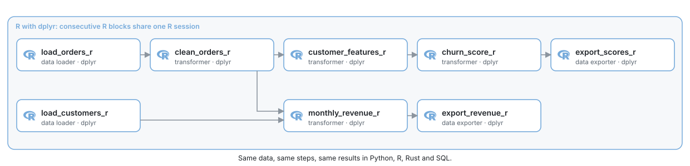

# Tutorial: retail orders in R

*Clean a shop's orders, compute revenue by region and month, build customer features and score churn risk, in R with dplyr.*

Same tutorial in: [Python](retail-python.md) · **R** · [Rust](retail-rust.md) · [SQL (DuckDB)](retail-sql.md)

A shop exports its orders every night. The export has the problems real exports have:
some rows appear twice, some orders were cancelled or returned, some amounts are missing,
and the amounts are in three currencies. In this tutorial you build the pipeline that turns
that export into two tables the business uses:

- **monthly revenue** by region, in USD, with orders and customers;
- **customer scores**: recency, frequency and money spent per customer (RFM), and a churn
  risk score from a simple logistic model.

<picture>
  <source media="(prefers-color-scheme: dark)" srcset="../../docs/images/diagrams/retail-pipeline-r.dark.svg">
  
</picture>

The same pipeline is written in Python, Rust and SQL on DuckDB, with the same data and the
same results, so you can compare the languages block by block. It takes about 15 minutes.

> [!NOTE]
> You need MageML running ([setup](setup.md)) and R blocks set up: R, rv and the
> project's R environment ([R setup](../guides/blocks/r-setup.md), which ends with
> `mage r init path/to/project`). Add `dplyr` to the environment from the project's `r`
> folder with `rv add dplyr` ([R packages](../guides/blocks/r-packages.md)).

## 1. Get the data

From a terminal, write the shop's data into your project:

```bash
mage examples retail path/to/project
```

It writes two Parquet files into `data/shop/`: 2,000 customers and 30,300 order rows from
July 2024 to June 2025.

| File | Columns |
| --- | --- |
| `customers.parquet` | `customer_id`, `region`, `segment`, `signed_up_on` |
| `orders.parquet` | `order_id`, `customer_id`, `ordered_at` (UTC), `status`, `currency`, `amount`, `units` |

The data is random but the same on every machine, so your numbers match the ones below.

## 2. Create the pipeline

1. Open **Pipelines** and click **New** > **Standard (batch)**.
2. Name it `retail_r`.

## 3. Load the orders and the customers

Add a **Data loader** block, choose **R**, name it `load_orders_r`, and replace its code.
Relative paths start at the project, the working directory of R blocks:

```r
#* @data_loader
load_orders <- function(...) {
  read_file("data/shop/orders.parquet")
}
```

Add a second **Data loader** in R, not connected to the first, named `load_customers_r`:

```r
#* @data_loader
load_customers <- function(...) {
  read_file("data/shop/customers.parquet")
}
```

Run both (**Run** or Cmd+Enter / Ctrl+Enter). **ColumnAtlas** under each block profiles
every column over the whole table: `amount` shows its missing values, and `status` and
`currency` their categories.

## 4. Clean the orders

Add a **Transformer** in R below `load_orders_r`, named `clean_orders_r`. It removes the
duplicated rows, keeps the completed orders that have an amount, and converts the amounts
to USD:

```r
library(dplyr)

# What one unit of each currency is worth in USD
rates_to_usd <- c(USD = 1.0, EUR = 1.08, CRC = 0.0019)

#* @transformer
clean_orders <- function(df_1, ...) {
  df_1 |>
    distinct() |>
    filter(status == "completed", !is.na(amount)) |>
    mutate(amount_usd = amount * unname(rates_to_usd[currency])) |>
    select(order_id, customer_id, ordered_at, amount_usd, units)
}

#* @test
one_row_per_order <- function(output) {
  stopifnot(
    "an order appears more than once" = anyDuplicated(output$order_id) == 0,
    "an amount is missing" = !anyNA(output$amount_usd)
  )
}
```

The `@test` function runs after the block: if an order appeared twice, the run would stop
here instead of counting it twice downstream. 27,349 orders remain.

## 5. Revenue by region and month

Add a **Transformer** in R named `monthly_revenue_r` with two parents: `clean_orders_r`
first, then `load_customers_r` (drag a connection from `load_customers_r` to it in the
graph). The block receives them as `df_1` and `df_2`:

```r
library(dplyr)

#* @transformer
monthly_revenue <- function(df_1, df_2, ...) {
  regions <- df_2 |>
    select(customer_id, region)

  df_1 |>
    inner_join(regions, join_by(customer_id)) |>
    mutate(month = format(ordered_at, "%Y-%m", tz = "UTC")) |>
    group_by(region, month) |>
    summarize(
      revenue_usd = sum(amount_usd),
      orders = n(),
      customers = n_distinct(customer_id),
      .groups = "drop"
    ) |>
    arrange(region, month)
}
```

It returns 48 rows: 4 regions times 12 months.

## 6. Customer features

Add a **Transformer** in R below `clean_orders_r` named `customer_features_r`. For each
customer it computes the three RFM features as of July 1, 2025: days since the last order
(recency), number of orders (frequency) and money spent (monetary value):

```r
library(dplyr)

as_of <- as.Date("2025-07-01")

#* @transformer
customer_features <- function(df_1, ...) {
  df_1 |>
    group_by(customer_id) |>
    summarize(
      last_order_day = max(as.Date(ordered_at, tz = "UTC")),
      frequency = n(),
      monetary_usd = sum(amount_usd),
      .groups = "drop"
    ) |>
    mutate(recency_days = as.integer(as_of - last_order_day)) |>
    select(customer_id, recency_days, frequency, monetary_usd)
}
```

## 7. Score churn risk

Add a **Transformer** in R below `customer_features_r` named `churn_score_r`. The score comes
from a logistic model whose coefficients were fitted earlier; the block applies it:

```r
library(dplyr)

# Logistic model: more days since the last order raise the risk, more orders
# and more money spent lower it
intercept <- -1.0
weights <- c(recency = 0.04, frequency = -0.35, monetary = -0.15)

#* @transformer
churn_score <- function(df_1, ...) {
  df_1 |>
    mutate(
      z = intercept +
        weights[["recency"]] * recency_days +
        weights[["frequency"]] * frequency +
        weights[["monetary"]] * log1p(monetary_usd),
      churn_score = 1 / (1 + exp(-z)),
      risk = if_else(churn_score >= 0.5, "high", "low")
    ) |>
    select(-z) |>
    arrange(customer_id)
}
```

1,693 customers have at least one completed order; 390 of them are at high risk.

## 8. Save the results

Add a **Data exporter** in R below `monthly_revenue_r` named `export_revenue_r`. `write_file`
picks the format from the extension and creates the folder:

```r
#* @data_exporter
export_revenue <- function(df_1, ...) {
  write_file(df_1, "output/r/monthly_revenue.parquet")
  message("Wrote ", nrow(df_1), " rows to output/r/monthly_revenue.parquet")
}
```

And one below `churn_score_r` named `export_scores_r`:

```r
#* @data_exporter
export_scores <- function(df_1, ...) {
  write_file(df_1, "output/r/customer_scores.parquet")
  message("Wrote ", nrow(df_1), " rows to output/r/customer_scores.parquet")
}
```

## 9. Run the whole pipeline

Run it from the terminal, as a trigger would:

```bash
mage run path/to/project retail_r
```

Every block completes, and `output/r/` holds `monthly_revenue.parquet` (48 rows) and
`customer_scores.parquet` (1,693 rows). In a production run, consecutive R blocks share one
R session, so the packages load once.

## What you built

| Block | Input | Output |
| --- | --- | --- |
| `load_orders_r`, `load_customers_r` | Parquet files | 30,300 order rows, 2,000 customers |
| `clean_orders_r` | orders | 27,349 completed orders in USD, each once |
| `monthly_revenue_r` | orders, customers | revenue, orders and customers per region and month |
| `customer_features_r` | orders | recency, frequency and money spent per customer |
| `churn_score_r` | features | a churn risk score and label per customer |
| `export_revenue_r`, `export_scores_r` | the two tables | Parquet files in `output/r/` |

## Next steps

- The same pipeline in [Python](retail-python.md),
  [Rust](retail-rust.md) and [SQL on DuckDB](retail-sql.md):
  the same blocks, the same results.
- [R blocks](../guides/blocks/r-blocks.md): every annotation, the helpers and how values cross
  between languages.

Same tutorial in: [Python](retail-python.md) · **R** · [Rust](retail-rust.md) · [SQL (DuckDB)](retail-sql.md)
