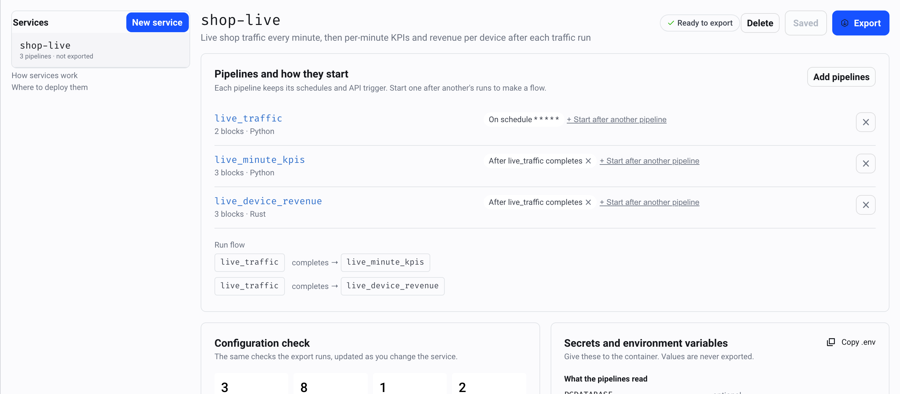

# Tutorial: ship a live service from the playground

*Package three playground pipelines as one service in the app, chain them with after-run triggers, check its secrets, then run it, watch it and push it to a registry.*

This tutorial turns three [playground](playground.md) pipelines into one
service that runs without MageML:

| Pipeline | Language | What it does |
| --- | --- | --- |
| `live_traffic` | Python | Every minute, appends new web events to `analytics.live_events` |
| `live_minute_kpis` | Python, Polars | After each traffic run, rebuilds events, purchases, conversion and revenue per minute |
| `live_device_revenue` | Rust | After each traffic run, appends revenue per device over the last 15 minutes |

One schedule drives all three: the KPIs and the revenue start when a traffic run completes.
Every step uses the app; the CLI equivalent follows each one.

## 1. Start the playground

```bash
make playground
```

Open http://localhost:6789 and sign in. The playground's database already has the shop
data.

## 2. Make the service

Open **Services** in the left menu, then **New service**.

1. **Add pipelines**, and pick `live_traffic`, `live_minute_kpis` and `live_device_revenue`.
   Each row shows its blocks and languages; `live_traffic` shows its schedule.
2. On `live_minute_kpis`, choose **Start after another pipeline**, then `live_traffic` and
   **completes**. Do the same on `live_device_revenue`. The run flow draws both chains.
3. Name it `my-live` and **Save**. The service is now in `pipeline_services.yaml` in the
   project, next to the `shop-live` service the playground ships with.

<picture>
  <source media="(prefers-color-scheme: dark)" srcset="../../docs/images/screenshots/services-workbench.dark.png">
  
</picture>

The status at the top reads **Ready to export** once the check passes. Try
**Start after another pipeline** on `live_traffic` after `live_minute_kpis`: the check
reports a loop (`live_minute_kpis -> live_traffic -> live_minute_kpis`) and the export
stays off until you remove it.

## 3. Read the check and the secrets

**Configuration check** shows what the image will hold: 8 blocks in Python and Rust, the 10
project files the blocks import or name, and the 18 Python packages they import, pinned to
the versions MageML runs with.

**Secrets and environment variables** shows what the container needs:

- the pipelines read `PGHOST`, `PGPORT`, `PGDATABASE`, `PGUSER` and `PGPASSWORD` (marked
  secret), through `io_config.yaml`;
- the service reads `MAGE_SERVICE_TOKEN`, and `MAGE_SERVICE_SCHEDULES`, which says
  **Set to on: this service has 1 schedule**.

**Copy .env** gives a template with all of them.

## 4. Export and run it

**Export** writes the build context with a progress bar, then shows the next steps. The
playground runs the same service next to its database with one command:

```bash
make playground-service
```

It exports `shop-live` (`mage export service ... --service shop-live`), builds the image
and starts it on port 8081 with `MAGE_SERVICE_SCHEDULES=on`. After a minute, the run history
shows the chain:

```bash
curl -s -H "Authorization: Bearer playground" "http://localhost:8081/v1/runs?limit=3"
```

| Started (UTC) | Pipeline | Status | Source |
| --- | --- | --- | --- |
| 22:24:14 | `live_traffic` | completed | `schedule:every_minute` |
| 22:24:15 | `live_minute_kpis` | completed | `after:live_traffic` |
| 22:24:15 | `live_device_revenue` | completed | `after:live_traffic` |

Each traffic run starts the other two a second later. `make playground-console` opens the
service's terminal dashboard, where the runs and the throughput move.

## 5. Keep the run history, logs and metrics

The service keeps runs and logs in `/var/lib/mage-service`; the playground mounts the
volume `service_data` there, so they outlive the container. The Services page shows the
equivalent for your platform: a volume, `MAGE_SERVICE_LOG_FORMAT=json` for the log
collector, and a Prometheus scrape of `/metrics`:

```bash
curl -s http://localhost:8081/metrics | grep mage_service_runs
```

## 6. Ship it to a registry

Back in the app, under **Build and ship the image**: choose `linux/amd64` and
`linux/arm64`, the registry **IBM Cloud Container Registry**, your namespace and a tag.
The app writes the commands:

```bash
ibmcloud cr login
docker buildx build --platform linux/amd64,linux/arm64 -t icr.io/ml-team/my-live:1.0 --push .
```

Run them in the unzipped folder, or press **Build and push from the server** when MageML
runs on a machine with Docker logged in to the registry. For Docker Hub, the image is
`docker.io/<user>/my-live:1.0` after `docker login`.

From a terminal, the CLI does the export, the build and the push in one command:

```bash
mage export service playground/shop_lab --service my-live --out ./my-live \
  --build --platform linux/amd64,linux/arm64 --push --tag icr.io/ml-team/my-live:1.0
```

## 7. Let your CI build it

The folder is a repository as it is:

```bash
cd my-live
git init && git add . && git commit -m "my-live service"
```

Push it to GitHub, set the repository variable `REGISTRY_IMAGE` (`icr.io/ml-team/my-live`)
and the secrets `REGISTRY_USERNAME` and `REGISTRY_PASSWORD`: `.github/workflows/build-image.yml`
builds both platforms and pushes on every push to `main`. When the pipelines change, export
again into the same folder and commit the diff; the export keeps `.git`, `.env` and `data/`.

## Next

- Deploy the image: Kubernetes with `deploy/kubernetes.yaml`, IBM Cloud Code Engine, Cloud
  Run, Azure Container Apps or ECS. See [Deploy](../production/pipeline-services.md#deploy).
- Every option of the Services page: [Services in the app](../production/services-page.md).
- After-run triggers, settings and the API: [Pipeline services](../production/pipeline-services.md).
