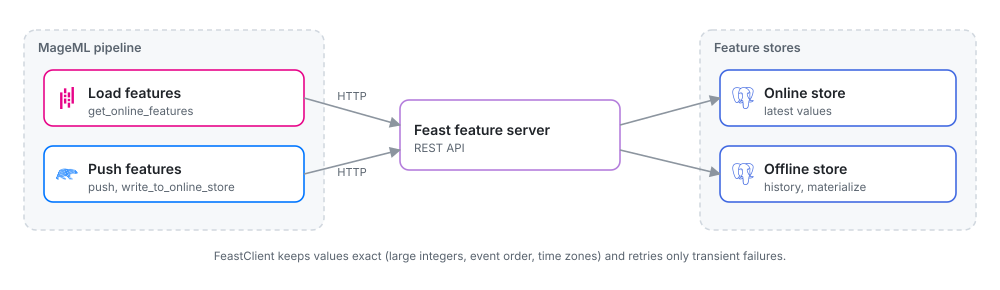

# Feast features

*Read and write features in a Feast feature server from Python blocks, with values kept exact.*

MageML talks to [Feast](https://feast.dev) through its feature server's REST API. Feast
itself cannot run in MageML's environment (it requires pandas below 3), so Feast runs as
its own service and blocks call it over HTTP with `FeastClient`.

<picture>
  <source media="(prefers-color-scheme: dark)" srcset="../../../docs/images/diagrams/feast-flow.dark.svg">
  
</picture>

The client sends what Feast stores exactly. A raw request to Feast's `/push` can change
values without an error; the client prevents each of these:

| What Feast does with a raw request | What the client does |
| --- | --- |
| Rounds integers above 2**53 when their column has a NULL in the same request | Sends those rows in requests where each such column is complete or all NULL |
| Keeps the last row written for an entity, even when it is an older event | Sends rows in event-time order, so the latest event is written last |
| Reads integer timestamps as nanoseconds (epoch seconds land in 1970) | Refuses integer timestamps |
| Reads timestamps without a time zone as UTC | Refuses them unless you pass `assume_utc=True` |
| Turns an integer column with NULLs into floats when you build a pandas frame from a read | Returns Arrow-backed pandas columns, or Polars, with integers exact |

## Connect

```python
from mage_ai.feature_stores.feast import FeastClient

feast = FeastClient()  # FEAST_URL and FEAST_TOKEN from the environment
feast = FeastClient('https://feast.internal:6566', token='...', timeout=30)
```

`FEAST_TOKEN` (or `token=`) is sent as a bearer token. `verify=` takes a CA bundle path
for servers with a private certificate.

## Read online features

```python
@data_loader
def load(*args, **kwargs):
    with FeastClient() as feast:
        return feast.get_online_features(
            entities={'driver_id': [1001, 1002, 1003]},
            features=[
                'driver_hourly_stats:conv_rate',
                'driver_hourly_stats:avg_daily_trips',
            ],
        )
```

- `entities` takes a dict of columns or a frame whose columns are the entity keys.
- Use `feature_service='driver_activity'` instead of `features` to read a feature service.
- `output='polars'`, `'arrow'` or `'dict'` changes the result type; the default is pandas.
- `with_metadata=True` adds `<feature>__status` and `<feature>__event_timestamp` columns.
  A feature Feast reports as `NOT_FOUND` is NULL. Feast also reports an entity whose
  features are all NULL as `NOT_FOUND`.

Rows follow the order of the entities you send, duplicates included.

## Write features

```python
@data_exporter
def export(features, *args, **kwargs):
    with FeastClient() as feast:
        feast.push('driver_stats_push', features)
```

`push` takes a pandas, Polars or Arrow frame with the push source's columns and its
timestamp column (`event_timestamp` by default; `timestamp_column=` for another name).
Timestamps must have a time zone. It sends the rows in batches of 1,000 (`batch_size=`)
and returns the number of requests.

`write_to_online_store('driver_hourly_stats', frame)` writes to a feature view's online
store the same way.

> [!NOTE]
> The PostgreSQL offline store does not take pushes: `to='offline'` fails, and with
> `to='online_and_offline'` Feast writes the online store and then fails. To add rows to the
> offline store, write them to its table with a PostgreSQL exporter and materialize them.

## Materialize

```python
import datetime as dt

feast.materialize(
    dt.datetime(2025, 1, 1, tzinfo=dt.timezone.utc),
    dt.datetime(2025, 1, 2, tzinfo=dt.timezone.utc),
    feature_views=['driver_hourly_stats'],
)
feast.materialize_incremental(dt.datetime.now(dt.timezone.utc))
```

## Errors and retries

Connection errors, timeouts and the answers 429, 502, 503 and 504 are retried three times
(`retries=`), waiting 0.5, 1 and 2 seconds or the server's `Retry-After`. Other errors are
not retried: Feast answers most invalid requests (an unknown feature, a wrong value type)
with 500. They raise `FeastError`, which has the `route`, the `status` and Feast's `body`.

## Rust blocks

Rust blocks have the same client in `mage::feast`, with the same rules. Turn on the SDK's
`feast` feature in the project's `rust/Cargo.toml`:

```toml
mage-block = { path = ".mage/sdk", features = ["postgres", "feast"] }
```

```rust
use mage::feast::FeastClient;
use mage::prelude::*;

fn load_data() -> Result<DataFrame> {
    let feast = FeastClient::from_env()?; // FEAST_URL, FEAST_TOKEN
    let entities = df!("driver_id" => [1001i64, 1002, 1003])?;
    feast.get_online_features(&entities, &["driver_hourly_stats:conv_rate"])
}

fn export_data(features: DataFrame) -> Result<()> {
    let feast = FeastClient::from_env()?;
    feast.push("driver_stats_push", &features, "event_timestamp")?;
    Ok(())
}
```

The timestamp column must be a datetime with a time zone; `push` refuses integer and naive
timestamps with the reason. `get_online_features_service`, `write_to_online_store` and
`materialize` work as in Python.

## Exported services

Blocks that use `FeastClient` run the same way in a [pipeline
service](../../production/pipeline-services.md). Set `FEAST_URL` and `FEAST_TOKEN` in the service's
environment, or `FEAST_TOKEN` through its secrets provider.

## Running Feast

With the PostgreSQL online store, set a connection pool in `feature_store.yaml`. With the
default single connection, concurrent requests fail with 500:

```yaml
online_store:
  type: postgres
  conn_type: pool
  min_conn: 1
  max_conn: 20
```

The behaviors above were found with Feast 0.66 and are pinned by the tests in
`integration_tests/feast`; `docs/development/feast-integration.md` has the details.
