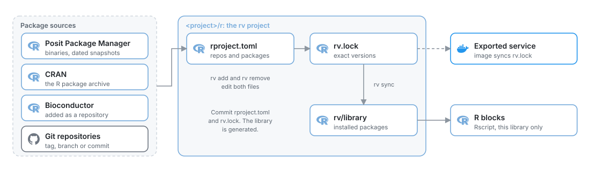

# R packages with rv

*Add CRAN, Bioconductor, Git and local packages to your R blocks with rv, keep their versions locked, and ship them to other machines and services.*

R blocks use the packages of the project's R environment. The environment is an
[rv](https://github.com/A2-ai/rv) project in `<project>/r`. You add a package with `rv add`
and it is ready in every R block of the project, with no restart.

<picture>
  <source media="(prefers-color-scheme: dark)" srcset="../../../docs/images/diagrams/r-packages.dark.svg">
  
</picture>

| File | What it holds | Commit it |
| --- | --- | --- |
| `r/rproject.toml` | The R version, the repositories and the packages you asked for | Yes |
| `r/rv.lock` | The exact version and source of every package, dependencies included | Yes |
| `r/system-packages.txt` | Optional: system libraries your packages need on Linux | Yes |
| `r/rv/library` | The installed packages | No, rv generates it |

## Create the environment

New projects have no R environment until you create one:

```bash
mage r init path/to/project
```

It installs the tidyverse, the packages MageML exchanges data with (`arrow`, `bit64`,
`jsonlite`, `tibble`) and the database drivers the templates use. To start smaller, list
the packages you want; the exchange packages are always added:

```bash
mage r init path/to/project -p dplyr -p readr
```

`mage r setup path/to/project` checks for R, rv and rig and prints how to install what is
missing. The MageML Docker image already has R 4.6 and rv.

## Where to run rv

Run rv in the `r` folder of the project.

**MageML terminal**

Open **Terminal** in the editor's sidebar (or go to `/terminal`) and run:

```bash
cd <project>/r
rv add janitor
```

The terminal opens in the folder the server started in. In the Docker image that is
`/home/src`, the folder with your project.

**Docker**

From the host, run rv inside the running container. The project is in `/home/src`:

```bash
docker exec -it <container> bash -c "cd /home/src/<project>/r && rv add janitor"
```

The files change in the mounted project folder, so they stay after the container stops.

**Local install**

```bash
cd path/to/project/r
rv add janitor
```

## Add a package from CRAN

```bash
rv add janitor
```

rv adds `janitor` to `rproject.toml`, resolves its dependencies, writes `rv.lock` and installs
them:

```text
Downloaded (2):
  + janitor      2.2.1  binary  https://packagemanager.posit.co/cran/latest     972ms
  + snakecase   0.11.1  binary  https://packagemanager.posit.co/cran/latest      1.4s

sync completed in 2.4s (8 installed, 0 removed)
```

Packages come from Posit Package Manager first, which has prebuilt binaries for macOS,
Windows and common Linux systems, then from CRAN. Add several at once with
`rv add pointblank janitor`.

Load the package in a block as usual:

```r
library(janitor)

#* @transformer
transform <- function(df_1, ...) {
  clean_names(df_1)
}

#* @test
test_output <- function(output, ...) {
  stopifnot(!any(grepl(" ", names(output))))
}
```

The next run of the block uses it. The server notices the changed library by itself.

> [!NOTE]
> Install packages with rv, not with `install.packages()` in a block. Blocks run with
> `Rscript --vanilla` and see only the rv library, R's base packages and `mageml`, so a
> pipeline runs with the same packages everywhere.

## Add a package from Git

```bash
rv add --git https://github.com/r-lib/rematch2.git --tag v2.1.2 rematch2
```

Use `--tag`, `--branch` or `--commit` to choose the revision and `--directory` when the
package is in a subfolder of the repository. Prefer a tag or a commit: a branch moves.

Pick a revision that builds with the project's R version. Old releases of packages with C
code may not compile with a newer R; `cli` 3.6.5, for example, fails with R 4.6 because R
removed a function it calls.

## Add a package from Bioconductor

Bioconductor is a package repository like CRAN. Add the release that matches your R
version (3.23 for R 4.6), then add packages from it:

```bash
rv configure repository add bioc --url https://bioconductor.org/packages/3.23/bioc
rv add BiocGenerics
```

## Install an older version

Posit Package Manager keeps a snapshot of CRAN for every date. Add a dated snapshot as a
repository and take a package from it:

```bash
rv configure repository add snapshot --url https://packagemanager.posit.co/cran/2025-06-02 --first
rv add --repository snapshot glue
```

To keep the whole project on the packages of one date, use the snapshot URL instead of
`latest` for the `PPM` repository in `rproject.toml`.

## Add a local package or an archive

```bash
rv add --path ../packages/ourtools ourtools
rv add --url https://example.com/ourtools_1.0.0.tar.gz ourtools
```

## Remove, upgrade and inspect

| Command | What it does |
| --- | --- |
| `rv remove janitor` | Removes the package and the dependencies nothing else needs |
| `rv upgrade --dry-run` | Shows what upgrading every package to its latest version would change |
| `rv upgrade` | Upgrades and writes the new versions to `rv.lock` |
| `rv tree` | Shows the packages and their dependencies |
| `rv plan` | Shows what `rv sync` would install or remove |
| `mage r status path/to/project` | Shows the R version, the library, and whether R blocks can run |

## Edit rproject.toml by hand

`rv add` writes these entries; you can also write them yourself and run `rv sync`:

```toml
dependencies = [
    "dplyr",
    "janitor",
    { name = "glue", repository = "snapshot" },
    { name = "rematch2", git = "https://github.com/r-lib/rematch2.git", tag = "v2.1.2" },
]
```

If a package fails to install, rv still writes it to `rproject.toml`. Fix the cause and run
`rv sync`, or take it out with `rv remove`.

## Share the environment

Commit `r/rproject.toml`, `r/rv.lock` and `r/system-packages.txt` if you have one. rv keeps
the library out of Git with `r/rv/.gitignore`.

On another machine, after a pull, install the locked versions:

```bash
mage r sync path/to/project
```

Until then, R blocks stop before they run and tell you what is missing:

```text
The R library in .../project/r is not synced with rv.lock: fs would change.
Run `mage r sync` or `rv sync` there, or set MAGE_R_SYNC=auto.
```

With `MAGE_R_SYNC=auto`, MageML runs `rv sync` before the first R block instead.

## System libraries on Linux

Some packages build against system libraries: `sf` needs GDAL, GEOS, PROJ and udunits, for
example. On macOS and Windows, Posit Package Manager's binaries include them. On Linux,
packages without a binary build from source and need the `-dev` packages.

The MageML image has the libraries of the default environment (the tidyverse, `arrow` and
the database drivers). For others, list the Debian packages in `r/system-packages.txt`, one
per line:

```text
# sf
libgdal-dev
libgeos-dev
libproj-dev
libudunits2-dev
```

- **Exported services** install them: `mage export service` copies the file and the image
  installs the packages before `rv sync`.
- **Your MageML container**: build an image on top of it, so the libraries stay when the
  container is recreated:

```dockerfile
  FROM <your MageML image>
  COPY r/system-packages.txt /tmp/system-packages.txt
  RUN apt-get update && \
      sed 's/#.*//' /tmp/system-packages.txt | xargs apt-get install -y --no-install-recommends && \
      rm -rf /var/lib/apt/lists/*
  ```

## Exported services

`mage export service` exports R blocks with the project's environment. The service image
installs R and the packages `rv.lock` pins, with the system packages above, and runs the
blocks as MageML does. See [Pipeline services](../../production/pipeline-services.md).

## Troubleshooting

| Message | Fix |
| --- | --- |
| `rv (rv) was not found` | Install rv (`mage r setup` prints how), or set `MAGE_RV` |
| `... is not synced with rv.lock: ... would change` | Run `mage r sync`, or set `MAGE_R_SYNC=auto` |
| `there is no package called 'x'` | Run `rv add x` in `<project>/r` |
| `ERROR: compilation failed for package 'x'` | On Linux, add the system library to `system-packages.txt`; for a Git package, try a newer tag |
| `MAGE_R_PROJECT_DIR is ..., which has no rproject.toml` | Point it at the rv project, or create one with `mage r init` |

For how R blocks run, their inputs and outputs, see [R blocks](r-blocks.md).
