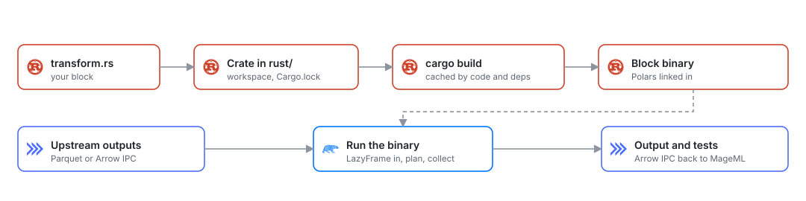

# Rust blocks

*Write data loaders, transformers, exporters and custom blocks in Rust with Polars, compiled once and run as native code.*

A Rust block is a function written in Rust. Mage compiles it into a native binary, passes it
the upstream outputs as Polars tables, and stores what it returns like any other block's
output. Downstream Python, R or SQL blocks read it as usual.

Use Rust for the parts of a pipeline where speed matters: row-wise logic that Polars
expressions do not cover, CPU-heavy scoring, large joins and aggregations, or loaders that
parse many files.

<picture>
  <source media="(prefers-color-scheme: dark)" srcset="../../../docs/images/diagrams/rust-block.dark.svg">
  
</picture>

## Requirements

- **Docker:** the Mage image has Rust installed and its dependencies prebuilt. Nothing to do.
- **Local install:** follow [Rust setup](rust-setup.md) to install Rust with
  [rustup](https://rustup.rs). The project pins its Rust version in
  `rust/rust-toolchain.toml`, and rustup installs it on the first build.

## Add a Rust block

1. Open a pipeline.
2. Add a data loader, transformer, data exporter or custom block, or a conditional from a
   block's Conditionals panel.
3. Select **Rust**, then a template.
4. Run the block. The first build of a project compiles Polars and takes a few minutes;
   after that a block compiles in about a second.

While you type, the editor checks the block with the Rust compiler and underlines errors and
warnings on their lines. Errors at run time name the block's file and line.

## Block functions

Each block type has one function, found by name:

| Block type | Function |
| --- | --- |
| Data loader | `fn load_data` |
| Transformer | `fn transform` |
| Data exporter | `fn export_data` |
| Custom | `fn custom` |
| Conditional | `fn condition`, returning `bool` |

Functions whose names start with `test_` are the block's tests. They receive the output and
fail the block when they return an error.

Every block starts with `use mage::prelude::*;`, which brings in Polars, `anyhow`
(`Result`, `bail!`, `ensure!`, `.context()`), `serde_json` (`Value`, `json!`), `Vars` and
`BlockContext`.

### Data loader

```rust
use mage::prelude::*;

fn load_data(vars: Vars) -> Result<DataFrame> {
    let rows: i64 = vars.get_or("rows", 1_000)?;
    let ids: Vec<i64> = (1..=rows).collect();
    let frame = df!(
        "id" => ids.clone(),
        "value" => ids.iter().map(|id| (*id as f64) * 1.5).collect::<Vec<f64>>(),
    )?;
    Ok(frame)
}

fn test_output(output: &DataFrame) -> Result<()> {
    ensure!(output.height() > 0, "The block returned no rows");
    Ok(())
}
```

To read files, use Polars readers such as `LazyCsvReader` or `LazyFrame::scan_parquet` and
return the `LazyFrame`.

### Transformer

```rust
use mage::prelude::*;

fn transform(data: LazyFrame) -> Result<LazyFrame> {
    Ok(data
        .filter(col("value").is_not_null())
        .with_columns([(col("value") * lit(2.0)).alias("value_doubled")]))
}
```

A `LazyFrame` parameter reads the upstream table lazily: Polars reads only the columns and
rows the query uses, and the whole query is optimized before it runs.

### Data exporter

```rust
use mage::prelude::*;

fn export_data(data: LazyFrame, vars: Vars) -> Result<()> {
    let path: String = vars.get_or("output_path", "output.parquet".to_string())?;
    let mut frame = data.collect()?;
    let file = std::fs::File::create(&path).with_context(|| format!("Creating {path}"))?;
    ParquetWriter::new(file)
        .with_compression(ParquetCompression::Zstd(None))
        .finish(&mut frame)?;
    println!("Wrote {} rows to {path}", frame.height());
    Ok(())
}
```

### Custom block

```rust
use mage::prelude::*;

fn custom(vars: Vars, context: BlockContext) -> Result<Value> {
    println!("Running {} in pipeline {:?}", context.block_uuid, context.pipeline_uuid);
    Ok(json!({ "variables": vars.raw().len() }))
}
```

### Conditional block

Add a conditional from a block's **Conditionals** panel and pick **Rust**. The condition
gets the same upstream outputs as the block it is attached to, and that block runs only
when every condition returns `true`.

```rust
use mage::prelude::*;

fn condition(data: DataFrame, vars: Vars) -> Result<bool> {
    let minimum: usize = vars.get_or("minimum", 1)?;
    Ok(data.height() >= minimum)
}
```

## Inputs

Parameters are filled in order. Each table parameter takes the next upstream block's output.

| Parameter | What it receives |
| --- | --- |
| `LazyFrame` | The next upstream table, read lazily |
| `DataFrame` | The next upstream table, in memory |
| `Option<LazyFrame>`, `Option<DataFrame>` | The next upstream table, or `None` when there is none |
| `Vec<LazyFrame>`, `Vec<DataFrame>` | All remaining upstream tables |
| `Value` | The next upstream output that is a dict, list or scalar |
| `Vars` | The pipeline's variables |
| `BlockContext` | The block and pipeline ids, the execution partition, the variables and a scratch directory that Mage removes after the run |

Upstream pandas DataFrames, Polars DataFrames and Arrow tables arrive as Polars tables with
their column types; a meaningful pandas index becomes a column. When an upstream table is
stored as one local Parquet file, the block reads that file directly, so Polars reads only
the columns and rows the block uses and the table never passes through Python. Dicts,
lists and scalars arrive as `Value`.

A parameter of another type is a compile error that lists the allowed types.

### Variables

`Vars` reads pipeline and runtime variables with their types:

```rust
let day: String = vars.get("day")?;                    // error when missing
let limit: usize = vars.get_or("limit", 10_000)?;     // default when missing
let all = vars.raw();                                  // the JSON map
```

A variable of the wrong type fails with a message that shows its value.

## Outputs

| Return type | Output |
| --- | --- |
| `LazyFrame`, `DataFrame` | One table; downstream blocks receive a Polars DataFrame |
| `Value` | A dict, list or scalar |
| `()` | No output |
| A tuple or `Vec` of tables | Several outputs, in order |
| `Option<T>` | No output when `None` |
| `Result<T>` | Any of the above; an `Err` fails the block with its message |

Tables cross between Mage and the block as Arrow IPC files, so no data is encoded or copied
row by row.

## Crates

The project's Rust environment is a Cargo workspace in `<project>/rust`:

| File | |
| --- | --- |
| `rust/Cargo.toml` | The crates every block can use, under `[workspace.dependencies]` |
| `rust/Cargo.lock` | The resolved versions |
| `rust/rust-toolchain.toml` | The Rust version |
| `rust/.mage/` | Generated: Mage's `mage` crate and one crate per block. Do not edit |

Commit the first three. To use a crate, add it under `[workspace.dependencies]` and run the
block:

```toml
[workspace.dependencies]
regex = "1"
```

New projects come with `anyhow`, `serde`, `serde_json`, `rayon` and `ureq` (HTTP with
rustls). Polars comes with the `mage` crate; to enable more Polars features, add `polars`
with the same version and the features you need.

## PostgreSQL

The `mage::postgres` module reads and writes PostgreSQL with binary `COPY`, so a pipeline
can load, transform and export entirely in Rust:

```rust
use mage::postgres::{Postgres, WritePolicy};
use mage::prelude::*;

fn load_data() -> Result<DataFrame> {
    Postgres::connect()?.query("SELECT * FROM shop.orders")
}

fn export_data(totals: DataFrame) -> Result<()> {
    let written = Postgres::connect()?.write(&totals, "analytics.totals", WritePolicy::Replace)?;
    println!("wrote {written} rows");
    Ok(())
}
```

- **Connection.** `Postgres::connect()` uses the block's io_config profile: the block's
  data provider profile, or `default`. It reads `POSTGRES_HOST`, `POSTGRES_PORT`,
  `POSTGRES_DBNAME`, `POSTGRES_USER`, `POSTGRES_PASSWORD`, `POSTGRES_SCHEMA`,
  `POSTGRES_CONNECT_TIMEOUT`, `POSTGRES_SSLMODE` and `POSTGRES_SSLROOTCERT`. `env_var()`
  and `mage_secret_var()` work as in Python blocks. `Postgres::connect_url(url)` takes a
  connection string instead, with `sslmode` and `sslrootcert` as parameters.
- **TLS** works as in libpq, so a profile connects the same way from Python and Rust
  blocks. The default is `prefer`: TLS when the server offers it. `require` encrypts
  without checking the certificate, `verify-ca` checks that it chains to a trusted root,
  and `verify-full` also checks that it names the host. Trusted roots are Mozilla's, plus
  the PEM file in `POSTGRES_SSLROOTCERT` for a private CA such as Amazon RDS's; with a
  root file, `require` checks the chain as `verify-ca` does. `PGSSLMODE` and
  `PGSSLROOTCERT` apply when the profile doesn't set them.
- **Reading.** Rows stream into typed columns. Integers, floats, booleans, text, dates,
  times, timestamps (with time zones as UTC), intervals, `uuid`, `json`, `jsonb`, `bytea`
  and arrays of these, nested arrays included, get their Polars types. `numeric` columns
  are exact: `Decimal(38, scale)` when every value fits, otherwise the exact text. Types
  without a Polars equivalent (`inet`, enums, ranges) read as text.
- **Writing.** `WritePolicy::Replace` recreates the table from the frame's types,
  `WritePolicy::Append` adds the rows to an existing table by column name, casting each
  value to the column's type, and `WritePolicy::Fail` stops when the table exists. A write
  is one transaction: a failure leaves the table as it was.
- **Other statements.** `execute(sql)` runs a statement and returns the rows it changed;
  `client()` gives the underlying `postgres::Client`.

The PostgreSQL loader and exporter templates start from these.

## MySQL

The `mage::mysql` module reads and writes MySQL and MariaDB. Turn on the `mysql` feature of
the `mage` crate in `rust/Cargo.toml`:

```toml
mage-block = { path = ".mage/sdk", features = ["postgres", "mysql"] }
```

```rust
use mage::mysql::{MySql, WritePolicy};
use mage::prelude::*;

fn load_data() -> Result<DataFrame> {
    MySql::connect()?.query("SELECT * FROM orders WHERE created_at >= CURDATE()")
}

fn export_data(totals: DataFrame) -> Result<()> {
    MySql::connect()?.write(&totals, "daily_totals", WritePolicy::Replace)?;
    Ok(())
}
```

- **Connection.** `MySql::connect()` uses the block's io_config profile: `MYSQL_HOST`,
  `MYSQL_PORT`, `MYSQL_DATABASE`, `MYSQL_USER` and `MYSQL_PASSWORD`. TLS is off unless
  `MYSQL_SSL_MODE` asks for it: `REQUIRED` encrypts without checking the certificate,
  `VERIFY_CA` checks that it chains to a trusted root (Mozilla's, or the PEM file in
  `MYSQL_SSL_CA`), and `VERIFY_IDENTITY` also checks the host name. SSH tunnels are not
  supported here.
- **Reading.** Signed and unsigned integers keep their width, `DECIMAL` is exact
  (`Decimal(p, s)` up to 38 digits, exact text past that), `DATETIME` is a naive datetime,
  `TIMESTAMP` a datetime in UTC (the session runs in UTC), `TIME` a duration and binary
  strings bytes. `BOOLEAN` is `TINYINT(1)` in MySQL and reads as an integer. Zero dates
  read as NULL.
- **Writing.** New tables get the column types of the Python client (`BIGINT`, `DOUBLE`,
  `LONGTEXT`, `DATETIME(6)`, `DECIMAL(p, s)`, ...); zoned datetimes are written in UTC.
  Rows go in batches of prepared multi-row `INSERT`s, by column name, in one transaction.
  MySQL commits `CREATE` and `DROP` on their own, so `WritePolicy::Replace` is not atomic.
- **Other statements.** `execute(sql)` runs a statement and returns the rows it changed;
  `conn()` gives the underlying `mysql::Conn`.

## MongoDB

The `mage::mongodb` module reads collections into frames and writes frames as documents,
with the rules of the Python client. Turn on the `mongodb` feature of the `mage` crate in
`rust/Cargo.toml`:

```toml
mage-block = { path = ".mage/sdk", features = ["postgres", "mongodb"] }
```

```rust
use mage::mongodb::{doc, MongoDb, OnConflict, WritePolicy};
use mage::prelude::*;

fn load_data() -> Result<DataFrame> {
    MongoDb::connect()?.load("orders", doc! { "status": "paid" })
}

fn export_data(scores: DataFrame) -> Result<()> {
    MongoDb::connect()?.write_unique(&scores, "scores", WritePolicy::Append, &["id"], OnConflict::Update)?;
    Ok(())
}
```

- **Connection.** `MongoDb::connect()` uses `MONGODB_CONNECTION_STRING`, or `MONGODB_HOST`,
  `MONGODB_PORT`, `MONGODB_USER` and `MONGODB_PASSWORD`; `MONGODB_DATABASE` names the
  database and `MONGODB_COLLECTION` the collection used when the name is empty.
- **Reading.** One column per field; a missing field is null. Integers stay integers,
  Decimal128 is an exact decimal, dates are UTC datetimes, ObjectId and UUID are text,
  embedded documents are structs and arrays lists. A field whose values have different
  types is JSON text. `load_fields` takes a projection.
- **Writing.** Integers that fit 32 bits are stored as Int32, others as Int64; decimals as
  Decimal128, dates as midnight UTC, durations as seconds. `WritePolicy::Replace` writes a
  staging collection with the target's indexes and renames it over the target, so a
  failed write leaves the target as it was. `write_unique` upserts by key fields:
  `OnConflict::Update` replaces a stored document, `OnConflict::Ignore` keeps it.

## ClickHouse

The `mage::clickhouse` module reads and writes ClickHouse over its HTTP interface, with
rows in Arrow: results arrive as an Arrow stream that Polars reads into columns, and
frames are inserted as one. Turn on the `clickhouse` feature of the `mage` crate in
`rust/Cargo.toml`:

```toml
mage-block = { path = ".mage/sdk", features = ["postgres", "clickhouse"] }
```

```rust
use mage::clickhouse::{ClickHouse, WritePolicy};
use mage::prelude::*;

fn load_data() -> Result<DataFrame> {
    ClickHouse::connect()?.query("SELECT * FROM events WHERE day = today()")
}

fn export_data(totals: DataFrame) -> Result<()> {
    ClickHouse::connect()?.write(&totals, "daily_totals", WritePolicy::Replace)?;
    Ok(())
}
```

- **Connection.** `ClickHouse::connect()` uses the block's io_config profile, with the
  keys of MageML's Python client: `CLICKHOUSE_HOST`, `CLICKHOUSE_PORT` (the HTTP port,
  8123 by default), `CLICKHOUSE_INTERFACE` (`http` or `https`), `CLICKHOUSE_USERNAME`,
  `CLICKHOUSE_PASSWORD` and `CLICKHOUSE_DATABASE`.
- **Reading.** Integers (`UInt64` included), floats, strings, `Date32`, `DateTime64` with
  its time zone, decimals up to 38 digits, booleans, arrays, maps and tuples arrive as
  they are. `Date` and `DateTime` are read as `Date32` and `DateTime64`. Types Arrow
  cannot carry are read as their exact text: `UUID`, IP addresses, enums, 128 and 256-bit
  integers, decimals of more than 38 digits, and nested values that hold any of these.
- **Writing.** `WritePolicy::Replace` recreates the table from the frame's types (each
  `Nullable`, with the `MergeTree ORDER BY tuple()` engine of the Python client),
  `WritePolicy::Append` inserts by column name, letting ClickHouse convert each value to
  its column's type, and `WritePolicy::Fail` stops when the table exists. Lists and
  structs have no column type here: create the table first, or cast them.
- **Other statements.** `execute(sql)` runs a statement; `describe(sql)` lists a query's
  columns and types.

## DuckDB

The `mage::duckdb` module builds DuckDB into the block's program and moves frames in and
out through Parquet, column by column with their types. Turn on the `duckdb` feature of
the `mage` crate in `rust/Cargo.toml` (the first build compiles DuckDB, a few minutes):

```toml
mage-block = { path = ".mage/sdk", features = ["postgres", "duckdb"] }
```

```rust
use mage::duckdb::{DuckDb, WritePolicy};
use mage::prelude::*;

fn load_data() -> Result<DataFrame> {
    DuckDb::connect()?.load("SELECT * FROM orders WHERE amount > 10")
}

fn export_data(totals: DataFrame) -> Result<()> {
    DuckDb::connect()?.write(&totals, "daily_totals", WritePolicy::Replace)?;
    Ok(())
}
```

- **Connection.** `DuckDb::connect()` uses the profile's `DUCKDB_DATABASE` (a file,
  relative to the project, `:memory:`, or `md:name` for MotherDuck with
  `MOTHERDUCK_TOKEN`) and `DUCKDB_SCHEMA` for tables named without a schema (`main` by
  default). The DuckDB is the version of the Python environment's, so Python and Rust
  blocks open the same files.
- **One writer.** DuckDB allows one writing process per file. A block waits for another
  to close the file, up to `MAGE_DUCKDB_LOCK_TIMEOUT` seconds (300), as Python blocks do.
- **Reading.** Integers, floats, decimals, text, dates, times, timestamps with their time
  zone (in microseconds, DuckDB's unit), lists, structs and maps arrive as they are.
  `HUGEINT`, `UHUGEINT`, `UUID`, `INTERVAL`, enums and `BIT` arrive as their exact text.
- **Writing.** `WritePolicy::Replace` swaps the table in one statement, so readers see the
  old rows or the new ones; `WritePolicy::Append` inserts by column name and creates the
  table if it is missing; `WritePolicy::Fail` stops when the table exists.
- **Other statements.** `execute(sql)` runs statements; `describe(sql)` lists a query's
  columns and types; `connection()` gives the DuckDB connection itself.

## Redis

The `mage::redis` module writes frames to Redis as hashes, one per row, and reads them back
by key: features a service reads in a millisecond. Turn on the `redis` feature of the
`mage` crate in `rust/Cargo.toml`:

```toml
mage-block = { path = ".mage/sdk", features = ["postgres", "redis"] }
```

```rust
use mage::prelude::*;
use mage::redis::Redis;
use std::time::Duration;

fn export_data(features: DataFrame) -> Result<()> {
    // customer:42 -> {spend_7d: "120.5", orders_7d: "3", last_seen: "2024-06-01T10:00:00"}
    Redis::connect()?.write_hashes(&features, "customer", &["customer_id"],
                                   Some(Duration::from_secs(86_400)))?;
    Ok(())
}

fn load_data(customers: DataFrame) -> Result<DataFrame> {
    Redis::connect()?.read_hashes(&customers, "customer",
        &[("spend_7d", DataType::Float64), ("orders_7d", DataType::Int64)])
}
```

- **Connection.** `Redis::connect()` uses the profile's `REDIS_URL` (`redis://host:6379/0`,
  or `rediss://` for TLS checked against Mozilla's roots) and `REDIS_PASSWORD` when the
  URL has none.
- **Writing.** `write_hashes(frame, prefix, key_columns, ttl)` writes the hash
  `prefix:key` for each row, where the key joins the key columns' values with `:`. Each
  hash is replaced whole, in transactions of 1,000 rows, so a field that is null now is not
  left over from an earlier write; `ttl` sets the keys' expiry.
- **Values.** Stored as exact text: integers as digits, floats in the shortest form that
  reads back to the same number (`0.1`, `1e-300`), booleans as `true` and `false`, dates and
  datetimes in ISO 8601 (UTC ones end in `Z`), decimals with every digit, lists and structs
  as JSON, binary columns as their bytes. Nulls are not stored.
- **Reading.** `read_hashes(keys, prefix, fields)` takes a frame of keys and returns it with
  one column per field, of the type asked for; a missing key or field is null.
- **Other commands.** `connection()` gives the Redis connection for any other command.

## Object storage

The `mage::storage` module reads and writes Parquet and CSV files on Amazon S3 and
S3-compatible stores (MinIO, IBM Cloud Object Storage, Cloudflare R2), Google Cloud
Storage and Azure Blob Storage, with Polars' own cloud readers. Turn on the `storage`
feature of the `mage` crate in `rust/Cargo.toml`:

```toml
mage-block = { path = ".mage/sdk", features = ["postgres", "storage"] }
```

```rust
use mage::prelude::*;
use mage::storage::Storage;

fn load_data(vars: Vars) -> Result<LazyFrame> {
    let day: String = vars.get("day")?;
    Ok(Storage::connect()?
        .scan_parquet("s3://events/*.parquet")?
        .filter(col("day").eq(lit(day))))
}

fn export_data(scores: DataFrame) -> Result<()> {
    Storage::connect()?.write_parquet(&scores, "s3://scores/latest.parquet")
}
```

- **Paths** are `s3://`, `gs://`, `az://` or `abfss://` URLs, or local paths, and can
  hold globs.
- **Reading.** `scan_parquet` and `scan_csv` return lazy frames: a filter or a column
  selection after them reaches the files, so a Parquet scan downloads only the row groups
  and columns it needs. `read_parquet` and `read_csv` read whole.
- **Writing.** `write_parquet` and `write_csv` replace one file; `sink_parquet` streams a
  lazy frame to the file without collecting it first. An object appears whole when its
  upload completes, or not at all.
- **Credentials** come from the block's io_config profile, with the keys of MageML's
  Python clients: `AWS_ACCESS_KEY_ID`, `AWS_SECRET_ACCESS_KEY`, `AWS_SESSION_TOKEN`,
  `AWS_REGION` and `AWS_ENDPOINT` (for S3-compatible stores; `http://` endpoints are
  allowed); `GOOGLE_SERVICE_ACC_KEY_FILEPATH` or `GOOGLE_SERVICE_ACC_KEY`;
  `AZURE_STORAGE_ACCOUNT_NAME`, `AZURE_CLIENT_ID`, `AZURE_CLIENT_SECRET` and
  `AZURE_TENANT_ID`. Without them, the provider's environment variables, files
  (`~/.aws/credentials`) and instance or workload identities apply.

The first build with the feature compiles the cloud clients, about two minutes.

## ONNX models

The `mage::onnx` module runs ONNX models with ONNX Runtime, linked into the block's
program: scikit-learn, XGBoost, LightGBM, CatBoost and PyTorch models export to ONNX. Turn
on the `onnx` feature of the `mage` crate in `rust/Cargo.toml`:

```toml
mage-block = { path = ".mage/sdk", features = ["postgres", "onnx"] }
```

```rust
let model = mage::onnx::model("models/churn.onnx")?;
let scores = model.predict(&customers, &["tenure_months", "monthly_spend"])?;
```

The first build downloads ONNX Runtime. `mage::onnx::model` loads a model once per process;
in an exported service, Rust blocks run in a resident program, so later runs score with the
session already loaded. See [Model inference](../pipelines/model-inference.md).

## Templates

| Block type | Templates |
| --- | --- |
| Data loader | Generic, local file, HTTP API (paginated JSON into a table), PostgreSQL |
| Transformer | Generic, clean, aggregate, join, window features, parallel (Rayon), ONNX model inference |
| Data exporter | Generic, local file, HTTP API (batched JSON), PostgreSQL |
| Custom | Generic |
| Conditional | Generic |

The parallel template computes a value per row on every core with Rayon, for logic Polars
expressions cannot express.

## Logs and errors

Everything the block prints with `println!` or `eprintln!` shows in the block's output as it
runs. A failed test, an `Err` or a panic fails the block with the message and the line in
your code. After a build, the block's output starts with how long it took, followed by
the compiler's warnings.

## Pipelines and services

Rust blocks run in pipeline runs, triggers and backfills like other blocks, and mix freely
with Python, R and SQL blocks. The playground's `rust_session_scores` pipeline is a working
example.

In production runs, consecutive Rust blocks compile into one program, and Polars optimizes
their lazy queries as one plan. Return a `LazyFrame` from a transformer and take
`LazyFrame` inputs to get the most from it: the chain collects once, in the block whose
output is needed. A block with tests, an exporter, or the last block of the chain computes
its own output. See [compiled chains](../../design/data-pipeline-management.md#compiled-chains-of-rust-and-r-blocks).

<picture>
  <source media="(prefers-color-scheme: dark)" srcset="../../../docs/images/diagrams/compiled-chains.dark.svg">
  
</picture>

MageML builds a pipeline's chains and blocks ahead of its runs, a few seconds after you
save and when you turn on a trigger, so a scheduled run does not wait for a build. The
**Compile** button in the editor shows the progress and any compile error, with its file
and line. See [pipeline compilation](../../design/data-pipeline-management.md#pipeline-compilation).

`mage export service` compiles a pipeline's Rust blocks into one binary in the service
image, which runs them without Mage or a Rust installation. A block's io_config profile goes with it, with
`env_var()` and `mage_secret_var()` kept as references that the service fills in from its
environment, so no password is written into the image. See
[Pipeline services](../../production/pipeline-services.md).

## Stream transformers

In a streaming pipeline, a Rust transformer runs on each batch of the stream's messages. The
stream's Rust blocks run in one program that stays up while the stream runs, so code at the
top of the file, such as a model in a `LazyLock`, loads once:

```rust
use mage::prelude::*;

fn transform(messages: Vec<Value>, vars: Vars) -> Result<Vec<Value>> {
    let rate: f64 = vars.get_or("rate", 1.0)?;
    messages
        .into_iter()
        .map(|mut message| {
            let amount = message["amount"].as_f64().context("no amount")?;
            message["total"] = json!(amount * rate);
            Ok(message)
        })
        .collect()
}
```

| Messages as | Each message is |
| --- | --- |
| `Vec<Value>` | its JSON; text that is not JSON becomes a string |
| `DataFrame` or `LazyFrame` | a row; every message must be a JSON object |
| `Vec<String>` | its text |
| `Vec<Vec<u8>>` | its bytes, for binary messages |

`Vars` and `BlockContext` can follow the messages. The block returns its messages in any of
those forms, one `Value` (an array is its messages, `null` none), `()`, or an `Option` or
`Result` of these. `Vec<String>` and `Vec<Vec<u8>>` are written as they are; the others as
JSON.

- An error or a panic is the block's error, with its message: the batch is retried, then
  stops the stream, or with a dead-letter sink only the messages that fail go there. The
  program keeps running. If it exits, the next batch starts it again.
- `serde_json` holds integers up to 64 bits; a larger one in a `Vec<Value>` becomes a float.
  Take `Vec<String>` to keep every digit.
- From a RabbitMQ source, a Rust block gets each message's body, not Mage's `Payload`.
- Rust, Python and R blocks can mix in one chain (each block reads the one before it): each
  run of blocks in one language takes the messages of the run before. Consecutive Rust
  blocks run in one program and share one io_config profile. With a dead-letter sink,
  messages that fail on their own are found in the first run; a failure in a later run fails
  the batch.
- In the editor, sample runs and **Execute pipeline** build each block's program and run it
  the same way; [exported services](../../production/stream-services.md) run
  the stream's Rust blocks in one program.

## Settings

| Variable | Default | |
| --- | --- | --- |
| `MAGE_RUST_THREADS` | every core | Threads for Polars and Rayon in a block |
| `MAGE_RUST_TIMEOUT_SECONDS` | none | Stops a block that runs longer |
| `MAGE_RUST_BUILD_TIMEOUT_SECONDS` | `1800` | Stops a build that takes longer |
| `MAGE_RUST_BINARY_CACHE_MB` | `5000` | Size of the cache of compiled blocks |
| `MAGE_RUST_TARGET_DIR` | `~/.cache/mage/rust/target` | Where compiled code goes; shared by every project on the machine |
| `MAGE_RUST_PROJECT_DIR` | `<project>/rust` | Another location for the workspace |
| `MAGE_RUST_TIMINGS` | off | `1` prints build and run times |

## Troubleshooting

| Problem | What to do |
| --- | --- |
| `Rust blocks need Rust` | Install Rust with rustup, or run Mage in Docker |
| The first run takes minutes | Polars compiles once per machine; later builds take about a second |
| `cannot be a parameter of a Mage block function` | Use one of the input types above |
| `cannot be returned by a Mage block function` | Return a table, a `Value`, `()` or a tuple of tables |
| `The pipeline has no variable X` | Pass the variable in the run or trigger, or use `vars.get_or` |
| A crate is not found | Add it under `[workspace.dependencies]` in `rust/Cargo.toml` |
| The block is slow | Return a `LazyFrame` instead of collecting, and check `MAGE_RUST_THREADS` |
