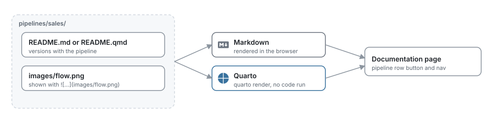

# Pipeline documentation

*Write a README for each pipeline in Markdown or Quarto, with images, beside its code.*

Each pipeline can have a README: what it does, its inputs and outputs, who owns it and how
to operate it. It is a file in the pipeline's folder, so it versions with the pipeline in
Git and travels with it.

<picture>
  <source media="(prefers-color-scheme: dark)" srcset="../../../docs/images/diagrams/documentation.dark.svg">
  
</picture>

## Open it

- In the pipelines list, the document button on the right of each row opens the pipeline's
  documentation. It is dimmed when the pipeline has none yet.
- In a pipeline, **Documentation** in the left navigation opens the same page, at
  `/pipelines/<pipeline>/docs`.

## Write it

A pipeline without documentation offers two formats:

| Format | File | Best for |
| --- | --- | --- |
| Markdown (recommended) | `README.md` | Text, tables, links, code and images, previewed as you type |
| Quarto | `README.qmd` | Reports that use Quarto features such as cross-references and callouts |

Both start from a template with sections for the purpose, inputs, outputs, schedule,
owners and operations, and list the pipeline's data loaders and exporters.

**Edit** opens the source beside a live preview. **Save** (or Cmd+S / Ctrl+S) writes the
file; **Cancel** asks before discarding changes. Switching the format renames the file.

## Images and charts

While editing, click **Add image** and choose a PNG, JPEG, GIF, WebP or SVG file. MageML
saves it in the pipeline's `images/` folder (a number is added when the name is taken) and
adds a link to it at the end of the document. For a chart, save it as PNG or SVG first, for
example with `fig.savefig("revenue.png")` in Python or `ggsave("revenue.png")` in R, and
add it the same way.

You can also put images in the pipeline's folder, `pipelines/<pipeline>/`, or a folder
inside it, and show them with a relative path:

```markdown

```

MageML serves PNG, JPEG, GIF, SVG and WebP files up to 10 MB, and only from inside the
pipeline's folder. Links to images on the web work too.

## Quarto

When the server has [Quarto](https://quarto.org) installed (or `MAGE_QUARTO` set to its
path), MageML renders `README.qmd` with it into one page with its images embedded. Code
cells are shown, not run. The rendered page opens in a sandboxed frame that cannot run
scripts, and renders are cached until the document or its images change.

Without Quarto, a `.qmd` file shows as Markdown, which covers most documents.

## Limits

- One README per pipeline, up to 1 MB.
- Rendering Quarto stops after 120 seconds.
- The documentation is plain files: edit them in any editor or in Git, and MageML shows
  the change.
