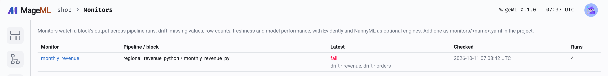

# Monitoring block outputs

*Watch a block's output across runs: drift, missing values, row counts and freshness, with alerts.*

## Overview

A pipeline run can succeed and still produce bad data: a feature whose distribution
shifted, a column that's suddenly half empty, a source that stopped updating. A monitor
watches one block's output across pipeline runs and compares each run with a baseline
run. It checks:

- **drift**: how much each column's distribution moved (Jensen–Shannon divergence);
- **missing values**: the share of missing values, and how much it grew;
- **row counts**: the number of rows, and how much it changed;
- **freshness**: how old the newest value of a timestamp column is.

The whole stored output is profiled, not a sample, by the Rust engine that ColumnAtlas
uses.

## Write a monitor

Create `monitors/<name>.yaml` in the project:

```yaml
# monitors/churn_scores.yaml
pipeline: churn_scoring
block: score
baseline: previous         # the previous run (default), or run:<pipeline run id>
columns: [score, segment]  # every column by default
drift:
  warn: 0.1                # Jensen-Shannon divergence, from 0 (same) to 0.69 (disjoint)
  fail: 0.2
missing:
  max: 0.2                 # at most 20% missing
  max_increase: 0.05       # at most 5 points more than the baseline
rows:
  min: 1000
  max_change: 0.5          # at most 50% more or fewer rows than the baseline
freshness:
  column: event_time
  max_age: 6h              # newest value at most 6 hours before the run's execution date
min_rows: 30               # fewer rows, now or in the baseline, hold the drift checks
fail_block: false          # true: a failed check fails the block run
notify: true               # a failed check sends the pipeline's notifications
```

Durations take `s`, `m`, `h`, `d` or `w`. Only the checks you configure run, except
drift, which runs with warn 0.1 and fail 0.2 by default.

### More settings

```yaml
drift:
  method: psi              # js (default) or psi, the population stability index
  warn: 0.1                # psi defaults: 0.1 warn, 0.25 fail
  fail: 0.25
columns:                   # a mapping instead of a list sets rules per column
  score:
    drift: {fail: 0.4}
  referrer:
    missing: {max: 0.9}
baseline: previous
rolling: 7                 # the baseline is the last 7 runs together
lag: 1                     # 7 for a daily pipeline: compare with the same weekday a week
                           # earlier (with rolling, the 7 runs ending there)
segments:                  # the missing-value and drift checks for each country too
  column: country
  top: 10                  # its 10 most frequent values in each run
notify: on_change          # notify when the result turns to fail, not on every failed run
```

### Model performance

When the block's output holds the labels next to the predictions, the monitor can check
the model's metrics, against bounds and against the baseline's values:

```yaml
performance:
  task: classification     # or regression
  target: label            # the true value
  prediction: prediction   # the model's prediction
  score: probability       # the positive class's probability, for roc_auc and log_loss
  positive: 1              # the positive class (default 1)
  metrics: [accuracy, f1, roc_auc]
  min: {accuracy: 0.8}
  max_drop: {roc_auc: 0.03}    # at most 0.03 worse than the baseline
```

Classification metrics are `accuracy`, `precision`, `recall`, `f1`, `roc_auc` and
`log_loss`. Regression metrics are `mae`, `rmse`, `mape` and `r2`, with `max` bounds for
errors. Rows without a label or a prediction are left out. The metrics are computed in
Rust over every labeled row of the output, as scikit-learn defines them (a test compares
the two): `precision`, `recall` and `f1` for the `positive` class when the labels have two
values, else averaged over the classes.

### Evidently and NannyML

A monitor can also run [Evidently](https://github.com/evidentlyai/evidently) and
[NannyML](https://github.com/NannyML/nannyml) on the run's output and the baseline run's
output. Their failed tests become checks of the monitor, and their HTML reports open from
the pipeline run's page.

```yaml
evidently:
  presets: [DataDriftPreset, DataSummaryPreset]   # also ClassificationPreset, RegressionPreset
  drift_share: 0.5          # DataDriftPreset fails past this share of drifted columns
  columns: [score, segment]
  # For ClassificationPreset or RegressionPreset:
  target: label
  prediction: prediction
  score: probability
  task: classification       # or regression
  severity: warn            # what a failed Evidently test counts as (default warn)
nannyml:
  problem_type: classification_binary   # classification_multiclass or regression
  timestamp: event_time
  chunk_size: 1000          # or chunk_number: 10
  y_pred: prediction
  y_pred_proba: probability
  y_true: label             # the baseline needs labels; the current run doesn't
  metrics: [roc_auc, f1]
  features: [score, tenure, segment]
  severity: fail            # what a NannyML alert counts as (default fail)
```

- **Evidently** runs its presets with their tests. Its default tests are bands around
  the baseline in both directions, so a better accuracy fails them too. That's why
  their failures count as warnings unless you set `severity: fail`.
- **NannyML** estimates the model's performance on the current run without labels:
  CBPE for classification, and DLE for regression, which needs `features`. With
  `features`, it also runs univariate drift for each feature, and multivariate drift
  (PCA reconstruction error) when there are two or more. A chunk outside the thresholds
  NannyML derives from the baseline is an alert.
- They run in a Python environment that Mage builds for them with uv, so their packages
  never enter Mage's environment. The default versions are `evidently==0.7.23` and
  `nannyml==0.13.1`, tested with this release. Set your own with
  `environment: {requirements: [...]}`. The first run builds the environment; later runs
  reuse it.
- An engine that fails (a column it needs is missing, for example) records `hold` with
  its error. It doesn't fail the monitor.

## Results

Each check gives one result:

- **pass**
- **warn**: drift past `warn`, short of `fail`.
- **fail**
- **hold**: not enough data to decide. Examples: the first run, which has no baseline;
  fewer than `min_rows` rows; a column with no values; no timestamps for freshness.

The monitor's result is its worst check. Results show:

- on the **Monitors** page (left navigation), which lists every monitor with its latest
  result; opening one shows its checks across the last 20 runs, with their values;
- on the pipeline run's page, under **Run record**, with the checks that didn't pass;
- in the block run's logs;
- in the history from `mage monitor-status <project path> <monitor> [--runs 10]`.

<picture>
  <source media="(prefers-color-scheme: dark)" srcset="../../../docs/images/screenshots/monitors.dark.png">
  
</picture>

A failed monitor sends the pipeline's notifications (Slack, email, Teams and the others
set in its notification settings), unless `notify: false`. With `fail_block: true` it
also fails the block run, so downstream blocks don't run.

While a known failure is worked on, silence the monitor: **Silence for a day** on its page
(with a reason), or `mage monitor-silence <project> <monitor> --hours 6 --reason "..."`
(at most 720 hours; `--clear` ends it). The checks still run and `fail_block` still fails
the block; only the notifications stop, and each run's record says until when.

### Segments

With `segments`, each of the column's most frequent values in the run gets the
missing-value and drift checks of its rows, against the baseline's rows of the same value,
on the whole output's bins. A drift in one country that the totals hide fails its own
check, `drift score` with segment `country=DE` and the detail `country=DE: ...`. A value
that is new has no baseline and holds. `min_rows` applies to each segment.

## How drift is measured

- **Numeric columns** are split into 20 bins (`bins:` changes it) at the quantiles of
  the monitor's reference run: the baseline run with `baseline: run:<id>`, otherwise
  the first run the monitor checked. Every run is counted in those bins, so runs compare
  and roll up. The current run is counted in the same bins, plus a bin below
  the lowest edge and a bin above the highest.
- **Text and boolean columns** compare the baseline's 20 most frequent values
  (`top:` changes it), with everything else as one group.
- Jensen–Shannon divergence is 0 for identical distributions and ln 2 (0.69) for
  distributions with nothing in common. The population stability index is 0 for identical
  distributions and has no upper bound; empty bins count as 0.0001 of their side. Missing values and NaN are counted separately, by the
  missing checks, and never as a bin.
- Thresholds depend on the data. Run the monitor for a few runs with `fail_block:
  false` and look at the values before relying on a threshold.

## Storage

Each checked run's profile and checks are stored with the pipeline variables in
`.monitoring/<monitor>/<pipeline run id>.json`. The profile is a summary (bin edges and
counts, frequent values, missing counts), not the data.

## In exported services

A [pipeline service](../../production/pipeline-services.md) runs the monitors of its blocks after
each run, with the same Rust code as MageML, so the same data gets the same checks:

- `baseline: previous` compares with the service's own earlier runs (`rolling` of them,
  ending `lag` runs back),
  kept in `<data>/monitors/<pipeline>/<monitor>/`. `baseline: run:<id>` compares with
  MageML's record of that run, taken into the service when it is exported.
- The result is in the run log, in `monitors.json` next to the block's output, and in
  `/metrics`: `mage_service_monitor_result` (0 pass, 1 hold, 2 warn, 3 fail, 4 error) and
  `mage_service_monitor_check` (each check's value, with its `segment` label for segment
  checks), for Prometheus or another alerting system. The service sends no notifications itself.
- `fail_block: true` fails the block, without retries.
- Evidently and NannyML run in MageML only.
