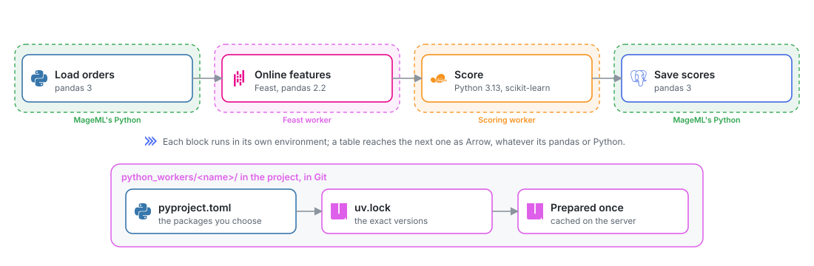
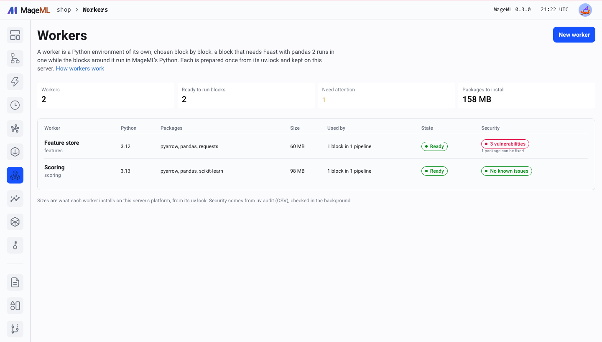
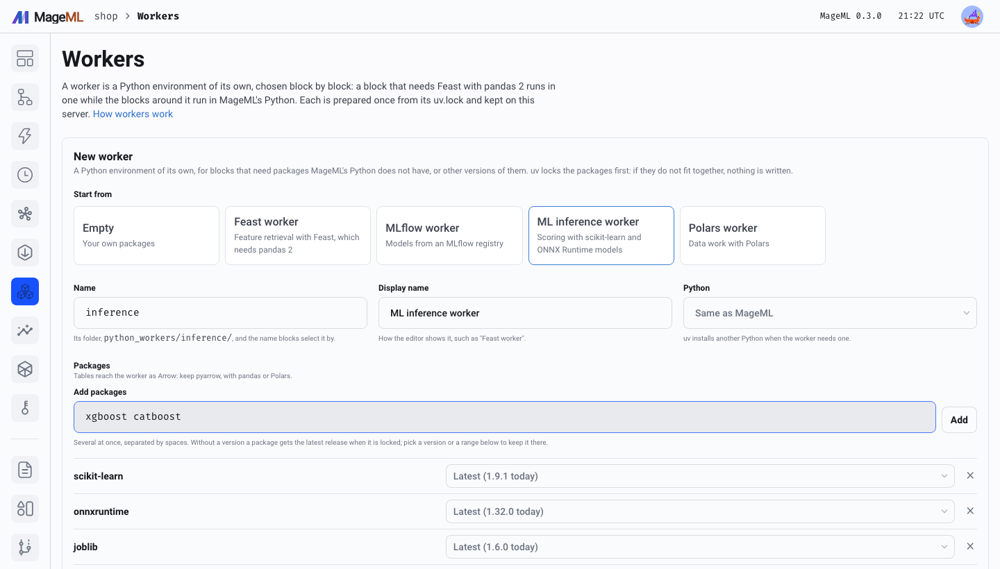
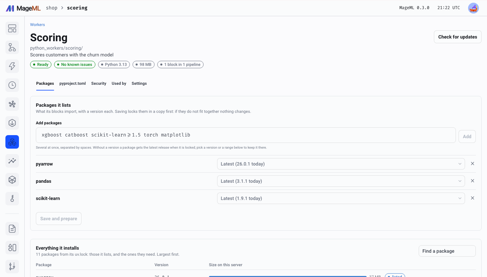
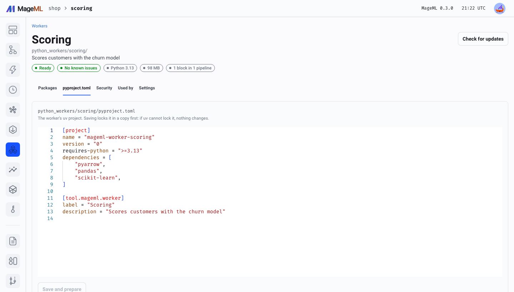
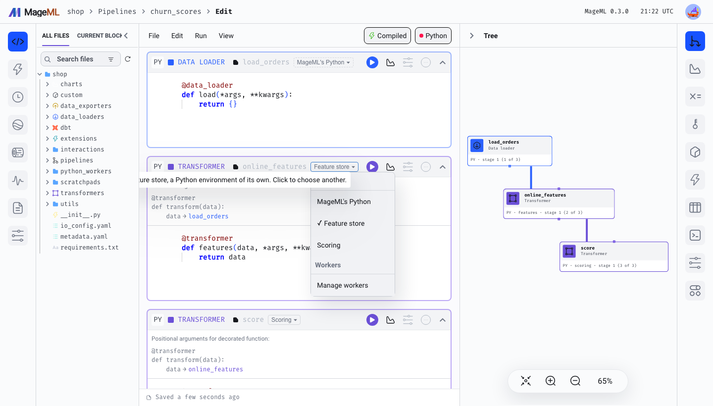
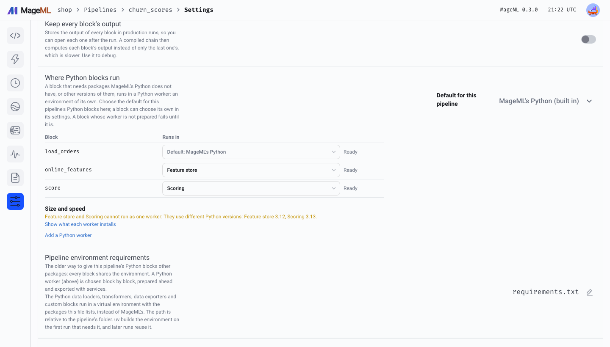
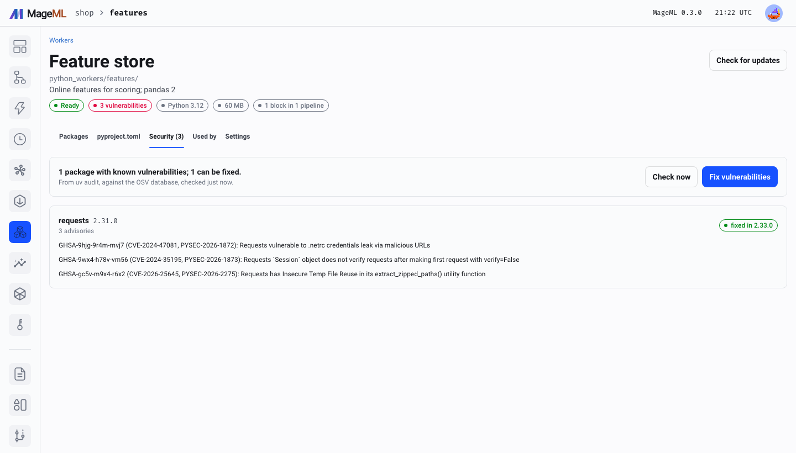
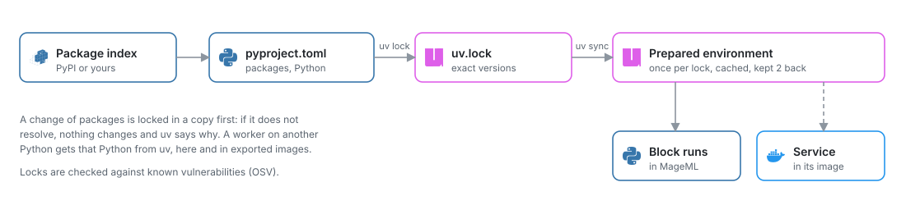
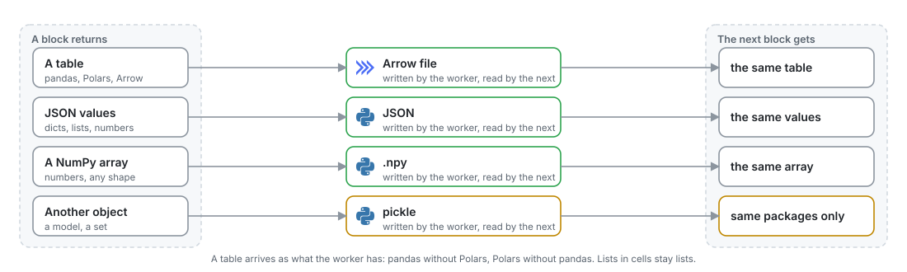

# Python workers

*Run each Python block with the packages and the Python it needs, next to blocks that need others.*

## Overview

A Python worker is a Python environment of its own that a block runs in. In one pipeline,
a block can read features with Feast, which needs pandas 2, a block can score with a model
saved by an older scikit-learn on Python 3.13, and the blocks around them run in
MageML's Python with pandas 3. Tables pass from block to block as Arrow, whatever the
pandas or Python on each side.

<picture>
  <source media="(prefers-color-scheme: dark)" srcset="../../../docs/images/diagrams/python-workers.dark.svg">
  
</picture>

A worker is a [uv](https://docs.astral.sh/uv/) project in `python_workers/<name>/`: a
`pyproject.toml` with its packages and a `uv.lock` with their exact versions, both in Git.
MageML prepares it once per lock and keeps the environment on the server, so runs start
without installing anything.

## When to use one

| Use a worker for | Example |
| --- | --- |
| A library that needs other versions than MageML's | Feast with pandas 2, a vendor client pinned to an old `requests` |
| A model that loads only with the versions it was saved with | an MLflow 2.8 model, a pickle from scikit-learn 1.3 |
| Heavy libraries kept out of MageML's Python | PyTorch, TensorFlow, CatBoost, XGBoost |
| Another Python | a library without wheels for MageML's Python yet |

A block that MageML's Python can run should stay there: it needs no process of its own
and no copy of its inputs (see [Performance](#performance)). To give one pipeline other
packages for all its blocks, a [pipeline environment](pipeline-environments.md)
is simpler.

## Tutorial

### 1. Open Workers

**Workers** is in the left navigation of every page. It lists each worker with its
Python, its packages, its size on the server, the blocks that use it, whether it can run
them, and its known vulnerabilities. A count beside **Workers** in the navigation says
how many workers need attention.

<picture>
  <source media="(prefers-color-scheme: dark)" srcset="../../../docs/images/screenshots/workers-list.dark.png">
  
</picture>

### 2. Add a worker

**New worker** starts from a template (Feast, MLflow, ML inference, Polars or empty) and
asks for:

- **Name**: the worker's folder, `python_workers/<name>/`, and the name blocks select it by.
- **Display name**: how the editor shows it, such as "Feature store".
- **Python**: MageML's by default; uv installs another one when the worker needs it.
- **Packages**: type them in **Add packages**, several at once, as you would in
  `pyproject.toml`: `mlflow==2.8.1 pandas scikit-learn>=1.5`. Each package gets a version
  picker with its releases from the package index: **Newest that fits** (the default: the
  newest release that fits the other packages, chosen when it is locked), a release, or a
  range such as `>=3.15,<4`.

<picture>
  <source media="(prefers-color-scheme: dark)" srcset="../../../docs/images/screenshots/workers-new.dark.png">
  
</picture>

**Create and prepare** locks the packages with uv first. When they do not fit together,
nothing is written and the page says why, with uv's output one click away. Then the
worker prepares, with uv's lines on its page.

Names people often type for a package are translated: `sklearn` is installed as
`scikit-learn`, `pytorch` as `torch`, `cv2` as `opencv-python`.

### 3. Change its packages

A worker's **Packages** tab lists the packages it lists, each with its version, and
everything its lock installs, largest first. **Save and prepare** locks the change in a
copy of the worker; only a change uv locks reaches the worker, and the page shows the
packages that moved. **Check for updates** shows what updating would change before
anything does.

<picture>
  <source media="(prefers-color-scheme: dark)" srcset="../../../docs/images/screenshots/workers-packages.dark.png">
  
</picture>

The **pyproject.toml** tab shows the file itself, for what the package list does not:
extras, environment markers, a `[tool.uv]` index or source. Saving it is locked in a copy
first like any change; a file that is not TOML, or that names the project like one of its
packages, is refused with the reason. **Show uv.lock** shows the lock uv wrote, read only.

#### Packages held back

A package without a version gets the newest release **that fits the other packages**, and
uv finds one by going back through older releases. An old release often lists ranges
written before today's versions existed, so it can lock and still break. For example, with
`pandas==3.1.1` and `feast`, the newest Feast (0.68.0) needs `pandas<3`, so uv locks Feast
0.20.0 from 2022, whose `pandas>=1.0.0` allows pandas 3.

Before a new worker or a change is written, the page asks when uv would lock such an old
release, and nothing changes until you say:

```text
uv would install feast 0.20.0, not the newest 0.68.0
uv would lock feast 0.20.0 from April 2022, 4 years old; the newest is 0.68.0 (November
2026). feast 0.68.0 needs pandas>=1.4.3,<3, and the worker lists pandas==3.1.1.
[Change the versions]  [Go on with feast 0.20.0]
```

Versions you chose that cannot go together are refused the same way, in one sentence:
`feast 0.68.0 needs pandas>=1.4.3,<3, and the worker lists pandas==3.1.1`, or `There is no
release six==99.0 on the package index`, with uv's full output one click away.

After that, the page checks each listed package whose lock is below its newest release by
locking a copy with the newest one required. When that does not lock, the package shows
**Held back** with what the newest release needs and the line that rules it out:

```text
Held back at 0.20.0 (April 2022), 68 releases behind 0.68.0
feast 0.68.0 needs pandas>=1.4.3,<3, and the worker lists pandas==3.1.1.
```

The worker gets a **held back** badge, and Workers in the left navigation counts it.
Change the line that rules the newest release out (here `pandas<3`), or choose **Keep
0.20.0** to pin the old release on purpose. When the newest release does lock, the package
is only behind, and **Check for updates** moves it.

<picture>
  <source media="(prefers-color-scheme: dark)" srcset="../../../docs/images/screenshots/workers-pyproject.dark.png">
  
</picture>

### 4. Choose where a block runs

Every Python block shows where it runs in its header. Click it to choose MageML's
Python, the pipeline's default, or a worker; the choice is saved at once. The dialog that
adds a block asks too.

<picture>
  <source media="(prefers-color-scheme: dark)" srcset="../../../docs/images/screenshots/block-runs-in.dark.png">
  
</picture>

A pipeline's **Settings**, under **Where Python blocks run**, sets the default for its
Python blocks and lists every one with where it runs and whether that worker is ready.

<picture>
  <source media="(prefers-color-scheme: dark)" srcset="../../../docs/images/screenshots/pipeline-workers.dark.png">
  
</picture>

### 5. Keep it secure

The **Security** tab checks the worker's lock against the OSV vulnerability database with
`uv audit`, each advisory with its link and the release that fixes it. **Fix
vulnerabilities** previews the update to the release that fixes every advisory of each
package; a package another one holds back is listed with uv's reason. Checks run in the
background and are kept for 12 hours per lock.

<picture>
  <source media="(prefers-color-scheme: dark)" srcset="../../../docs/images/screenshots/workers-security.dark.png">
  
</picture>

## MageML's own Python, the default worker

A block that chooses no worker runs in MageML's own Python: the environment MageML is
installed in, such as the uv project where you ran `uv add mage-ml`. The Workers page shows
it first, as **MageML (default)**, with its Python, its main packages and how it was
installed, but does not change it. It is the environment the server runs in: a change
while MageML runs can leave it with half of a package's files, and a version MageML cannot
start with (pandas, pyarrow, SQLAlchemy) leaves no page to undo it.

Change it with uv in a terminal, then restart MageML:

| MageML installed | Add a package |
| --- | --- |
| In a uv project (`uv add mage-ml`) | `uv add scikit-learn` in that project's folder |
| As a uv tool | `uv tool install mage-ml --with scikit-learn --reinstall` |
| From the Docker image | `RUN uv pip install --python /opt/mage/bin/python scikit-learn` in your own image built from it |
| In another environment | `uv pip install --python <its python> scikit-learn` |

Its page in the app shows the command for the way this server's MageML is installed. For
packages only some blocks need, or versions that clash with MageML's (Feast with pandas 2,
an older MLflow), add a worker instead: MageML's own packages then never change.

## How it works

<picture>
  <source media="(prefers-color-scheme: dark)" srcset="../../../docs/images/diagrams/worker-lifecycle.dark.svg">
  
</picture>

- **Files.** `python_workers/<name>/pyproject.toml`, `uv.lock` and, to fix the Python,
  `.python-version`. The folder names the worker. Its `[project].name` must not be one of
  its packages, or uv takes the project for the package; new workers are named
  `mageml-worker-<name>`.
- **Prepare.** `uv sync --locked` builds the environment from the lock, once per lock, in
  the server's environment cache. A run never installs packages: a block whose worker is
  not prepared fails, saying so and how to prepare it. Preparing keeps the last two
  environments of a worker and removes older ones.
- **Python.** Without `.python-version`, a worker runs on MageML's Python when its
  `requires-python` allows it, else on the closest version it allows.
- **Runs.** A block in a worker runs in a warm process of that environment: MageML writes
  its inputs, the worker runs the block and writes its outputs, MageML reads them. What it
  prints goes to the block's log; an error comes back with the block's traceback. A
  process that crashes is replaced, one is recycled after 500 blocks or 2 GB of memory,
  and a block that changes directory does not move the next one. `MAGE_WARM_WORKERS=0`
  starts a process per block.

### How values cross

<picture>
  <source media="(prefers-color-scheme: dark)" srcset="../../../docs/images/diagrams/worker-values.dark.svg">
  
</picture>

A block in a worker gets what it would get in MageML's Python: types, missing values,
time zones, categories, indexes and columns of lists come through, tested between pandas
2.2 and pandas 3, and between Python 3.12 and 3.13. A table arrives as what the worker
has: a Polars table reaches a worker without Polars as pandas, and the other way round.
Other Python objects (a fitted model, a set) cross as a pickle, which only Python with
the same packages reads back; return a table or JSON values between workers instead.

## Performance

A worker's blocks run in warm processes: the first block starts a process of the worker,
which stays up for the next ones (and for the editor's next run), so Python's start and
the imports of pandas and pyarrow are paid once. Blocks that run at the same time get
processes of their own; an idle process stops after 5 minutes. Measured on an M-series
Mac:

| | A process per block | Warm processes |
| --- | --- | --- |
| One block on 1,000 rows (pandas, pyarrow) | 228 ms | 5 ms |
| Twenty small blocks in one worker, through the scheduler | 3.4 s | 1.6 s |

Preparing a worker imports its packages once, so the slow first load of new native
libraries (11.6 s for pandas and pyarrow on macOS) happens there, not in the first run.
A million rows of four columns crossing three workers (pandas 2.2, Python 3.13, Polars)
take 4.0 seconds; there, copying the inputs and outputs as Arrow files is the cost, so:

- Keep consecutive blocks that need the same packages in one worker, and blocks that
  MageML's Python can run in MageML's Python.
- Return tables (pandas, Polars, Arrow) between workers, not Python objects.
- `mage compile` says where a chain of blocks moves between two workers.

## Isolation

- **Memory.** `memory = "4 GiB"` under `[tool.mageml.worker]`, or **Memory limit** in the
  worker's settings, caps what its processes use. A block over it is stopped and fails
  saying how much it used, instead of taking the server's memory; the next block runs in
  a new process. The limit counts resident memory, measured every quarter second.
- **Credentials.** A worker does not get MageML's own credentials: its metadata database
  URL, the keys that sign sessions and downloads, the first owner's password and the
  sign-in providers' secrets. The secrets blocks use, such as `MAGE_SECRET_*` and the
  project's own variables, are there.
- **Processes.** A block's code runs in the worker's process, not MageML's; a crash there
  fails the block and leaves MageML running. The protocol between them is written down in
  `docs/development/worker-protocol.md`, with a conformance suite.

## Caveats

- A block in a worker has only the worker's packages. MageML's connectors (the
  `mage_ai.io` imports of block templates) need theirs: the compile check warns, and the
  error names the package to add.
- Dynamic and replicated blocks run in MageML's Python; compiling refuses them in a worker.
- A lock that resolves is not proof the packages work together: an old release can allow
  versions it never ran with. Watch for **Held back** packages, and run the blocks.
- The run's variables reach a worker block as JSON values; others are left out.
- Checking versions and vulnerabilities reads the package index and OSV; on a server
  without the internet, set `UV_DEFAULT_INDEX` to your index.

## Reference

```toml
# python_workers/features/pyproject.toml
[project]
name = "mageml-worker-features"
version = "0"
requires-python = ">=3.12"
dependencies = [
  "feast[redis]>=0.50",
  "pandas>=2.2,<3",
  "pyarrow",
]

[tool.mageml.worker]
label = "Feature store"            # how the editor names it
description = "Online features; pandas 2"
combine = false                    # never combined with other workers
memory = "4 GiB"                   # what its processes may use
```

In `metadata.yaml`, a block selects a worker by name, and a pipeline sets the default for
its Python blocks; `mage` is MageML's own Python:

```yaml
environment:
  worker: features
blocks:
- uuid: online_features
  configuration:
    python_worker: features
- uuid: save_scores
  configuration:
    python_worker: mage
```

```bash
mage workers new features --template feast --label "Feature store"
mage workers list                     # each worker and whether it is prepared
mage workers prepare features         # uv sync --locked into the environment cache
mage workers assign features churn_scores --blocks online_features
mage workers assign features churn_scores --chain online_features   # its whole chain
```

The API behind the page: `/api/python_workers` (list, detail, create, update, delete),
`/api/python_worker_updates` (preview, then apply), `/api/python_worker_audits/<name>`,
`/api/python_worker_combinations` and `/api/python_packages/<name>` (a package's releases).

## Exported services

A [service](../../production/pipeline-services.md) exports the workers its blocks use. Each
worker becomes a virtual environment of its own in the image, built from its `uv.lock`;
a worker on another Python than the image's gets that Python from uv in the image (for a
build without the internet, set `UV_PYTHON_INSTALL_MIRROR` in the `uv-env` secret).

Workers whose packages resolve to the same versions are built as one environment: the
image holds their packages once, and the service runs their blocks in one process, so a
chain of blocks no longer stops between them. Their blocks run with the versions they
would have apart. The export's notes say which workers it combined and how much smaller
the image is. A worker with `combine = false` stays apart, and `MAGE_EXPORT_MERGE_WORKERS=0`
keeps every worker apart. In MageML runs each worker keeps its own environment; the
pipeline's settings say which of its workers could run as one.
