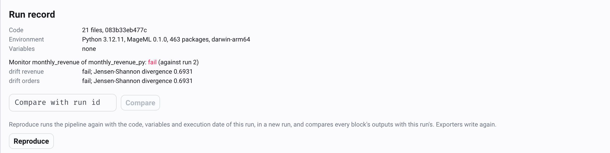

# Run records and reproducing runs

*See what a pipeline run ran with, compare two runs, and run an old run again with its own code.*

## Overview

Every pipeline run records what it ran with:

- **Code**: every source file the run could read, with its SHA-256. That covers the
  pipeline's folder, its block files, and the project's shared code and settings (Python,
  SQL, R and Rust files, YAML, TOML and lock files). Mage keeps a copy of each distinct
  set of files, so the run's exact code can be restored later.
- **Environment**: Python, Mage, the platform, every installed package with its version,
  and the pipeline environment when the pipeline has one.
- **Variables**: the names of the run's variables. The values stay with the run in the
  database.
- **Git**: the commit, the branch, and whether the project had uncommitted changes.
- **Outputs**: the SHA-256 and size of each block's stored outputs.

That answers the usual questions about a model or a report: what produced this number,
what changed since last week, and can I get the same result again.

Runs started with `mage run` are recorded too, when they end, as pipeline runs of the
pipeline's **Command line** trigger (inactive: it starts nothing). The code and
environment are those of the moment the run started. `mage run --no-record` leaves a run
unrecorded.

## See a run's record

Open a pipeline run. Below the block runs, **Run record** shows the code (number of
files and digest), the git commit, Python, Mage, the number of packages, and the
variables.

<picture>
  <source media="(prefers-color-scheme: dark)" srcset="../../../docs/images/screenshots/run-record.dark.png">
  
</picture>

## Compare two runs

On a run's page, enter another run's id under **Compare with run id** and click
**Compare**. You get:

- which files changed, were added or were removed, with a diff of each changed file;
- which packages changed version, and changes to Python, Mage or the platform;
- which variables changed;
- for each block, whether its outputs are the same, differ, or weren't recorded.

From the command line:

```bash
mage run-diff <project path> <pipeline uuid> <earlier run id> <later run id> [--json]
```

## Reproduce a run

**Reproduce** on a run's page (or `mage reproduce`) restores the code the run ran with
into a temporary copy of the project, and runs the pipeline there with the run's
variables and execution date. It then compares every block's outputs with the original
run's. The project's own files don't change.

```bash
mage reproduce <project path> <pipeline uuid> <run id> [--yes] [--report result.json]
```

The result says, for each block, whether the outputs are the same, the same within float
rounding, or different (with the first rows that differ). It also lists packages that
differ from the original run's environment, since a different version of pandas or
scikit-learn can explain a difference. The command exits with 1 when the run didn't
reproduce.

Things to know:

- The pipeline runs in full, so **exporters write again**. Point them at a test
  destination first when that matters.
- The new run uses the project's database, secrets and variables folder, and stores its
  outputs in its own partition, under a trigger named **Reproduce run N**.
- Packages aren't restored; the reproduction runs with the packages installed now. The
  result lists the differences. A pipeline environment restores its own packages,
  because its requirements are part of the code.
- Data sources aren't restored. A block that reads a table which changed since the
  original run gives different outputs; that's what the comparison shows.
- Runs started before run records existed have no record and can't be reproduced.

## Golden runs

A golden file holds what a pipeline is expected to produce. Use it to check that a run made
another way still gives the same results: on a new MageML version, another engine, another
machine, or after a refactor.

```bash
mage run <project path> <pipeline uuid>
mage golden record <project path> <pipeline uuid>     # writes golden/<pipeline uuid>.yaml
# later, after a change
mage run <project path> <pipeline uuid>
mage golden compare <project path> <pipeline uuid>
```

```text
orders_daily: run 42 against the golden file (recorded from run 17).
  load_orders    equal
  clean_orders   different  (output_0: rows 1200 -> 1180)
  daily_totals   different  (output_0: values differ)
  effect orders_written: equal (expected 1200, counted 1200)
Different.
```

The file records each output's data, not its stored bytes:

| Field | |
| --- | --- |
| `rows` | Row count (items of a list, keys of a dict) |
| `columns` | Name and kind of each column: integer, float, string, boolean, date, datetime, datetime_tz, decimal, binary, list, struct, null |
| `content` | A hash of the rows in any order |
| `order` | A hash of the rows in their order; compared only with `--ordered` |

The same data from pandas, Polars or Arrow compares equal, and so do integer columns of
different widths. Floats compare to 12 significant digits, so a different summation order
doesn't count as a change. A pandas index other than row numbers counts as columns. Outputs
that aren't tables or JSON, such as a model, compare by the SHA-256 of their stored files.

### Effect counts

Block outputs don't show what a run wrote to other systems. To check that, declare probes in
the golden file before recording. `record` fills in each probe's count, and `compare`
counts again:

```yaml
effects:
  orders_written:
    sql: select count(*) from analytics.orders
    data_provider: postgres   # bigquery, clickhouse, duckdb, mssql, mysql, redshift, snowflake, trino
    profile: default          # of io_config.yaml
  export_file:
    file: exports/orders.parquet   # rows of a Parquet or CSV file, lines of any other file
```

A probe counts the destination after the run. A run that wrote twice to an append-only
table shows a higher count.

Commit the `golden/` folder with the project, and record again when a change to the
results is intended.

## Storage and settings

Records are stored with the pipeline variables, in `.run_records/`. The code copies and
environments are stored once per distinct set of files or packages, so runs that share
code share one copy. A project with more than 5,000 source files, or a file over 1 MiB,
records the digests but keeps no copy; such runs compare but can't be reproduced.

Set `MAGE_RUN_RECORDS=0` to stop recording.
