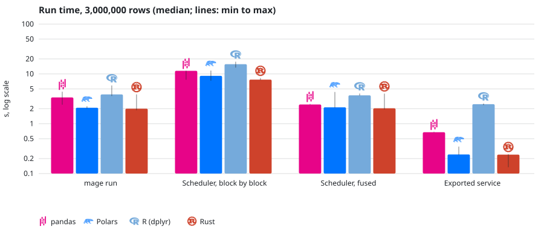
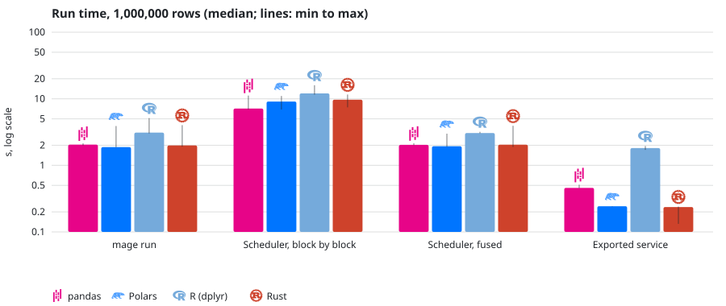
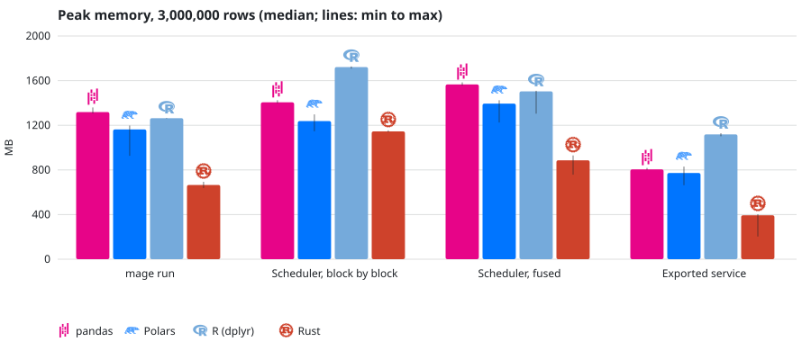
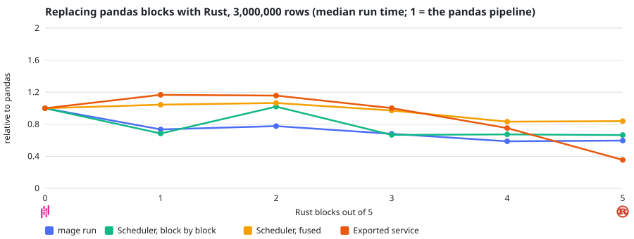

# Pipeline performance

*How fast MageML pipelines run in pandas, Polars, R and Rust, which way of running them is fastest, and how to make yours fast.*

## The short version

We ran the same data pipeline written four ways (pandas, Polars, R and Rust) and ran each
one four ways, outside the editor, as in production. On 3 million rows:

- **Production runs are fast by default.** Compilation is a performance optimization:
  triggers and schedules fuse each chain of blocks and compile chains of one language. Fused runs took 2.0 to 3.7 seconds: a third
  less than before compiled chains for pandas and Polars, half for R and Rust, and about a
  quarter of the time of running block by block.
- **Exported services are the fastest way to run.** Rust and Polars took 0.24 seconds,
  pandas 0.68 and R 2.5.
- **Rust uses the least memory.** As a service, the Rust pipeline peaked at 412 MB, about
  half of Polars (810 MB) and pandas (844 MB).
- **Single-language pipelines run fastest.** Pipelines that mixed Rust and pandas blocks
  were no faster than pandas until four of five blocks were in Rust; each switch between
  languages converts the data.
- **R costs the most per run.** It starts R and loads its packages; chains of R blocks now
  share one session, which halved its run time.

## What we measured

### The pipeline

Every version does the same five steps on the same files:

1. **Load** a table of orders (100,000, 1 million or 3 million rows).
2. **Clean** it: drop orders without an amount, with an amount of 1 or less, or without
   units (about 9% of the rows).
3. **Enrich** it: compute the revenue of each order and its month, and add the customer's
   segment from a second table (a join).
4. **Aggregate**: total revenue, number of orders and average amount per region, segment
   and month.
5. **Export** the summary to a Parquet file.

After every run we compared the summary with the one from the pandas pipeline. All 480
measured runs wrote the same numbers, so every version did the same work.

### The pipelines

| Pipeline | Blocks |
| --- | --- |
| pandas | Five Python blocks using pandas 3 |
| Polars | Five Python blocks using Polars 2 |
| R | Five R blocks using dplyr |
| Rust | Five Rust blocks using Polars from Rust |
| 1 to 4 Rust blocks | The pandas pipeline with its first 1, 2, 3 or 4 blocks written in Rust |

### Four ways to run a pipeline

| Way | What it is |
| --- | --- |
| `mage run` | The command line runs the whole pipeline in one process, in fused stages. |
| Scheduler, block by block | A trigger runs the pipeline through Mage's scheduler, each block in its own process. Only for debugging: `block_fusion: 'off'`. |
| Scheduler, fused | The same, fused and compiled: the default for production runs. See [block fusion](../design/data-pipeline-management.md#block-fusion). |
| Exported service | The pipeline exported with `mage export service` and run by the service, without Mage. See [Pipeline services](pipeline-services.md). |

## Results

Times are the median of 5 runs; the thin lines show the fastest and slowest run. The time
axes are logarithmic, because the ways of running a pipeline differ by more than ten times.

<picture>
  <source media="(prefers-color-scheme: dark)" srcset="../../docs/images/benchmarks/languages_seconds_3000000.dark.svg">
  
</picture>

*Run time on 3 million rows*

<picture>
  <source media="(prefers-color-scheme: dark)" srcset="../../docs/images/benchmarks/languages_seconds_1000000.dark.svg">
  
</picture>

*Run time on 1 million rows*

Median run time in seconds:

| Pipeline | Rows | `mage run` | Scheduler, block by block | Scheduler, fused | Exported service |
| --- | --- | --- | --- | --- | --- |
| pandas | 1,000,000 | 2.05 | 7.14 | 2.03 | 0.46 |
| Polars | 1,000,000 | 1.88 | 9.09 | 1.94 | 0.24 |
| R | 1,000,000 | 3.10 | 12.04 | 3.06 | 1.81 |
| Rust | 1,000,000 | 1.99 | 9.69 | 2.04 | 0.24 |
| pandas | 3,000,000 | 3.37 | 11.55 | 2.44 | 0.68 |
| Polars | 3,000,000 | 2.10 | 9.13 | 2.13 | 0.24 |
| R | 3,000,000 | 3.87 | 15.69 | 3.72 | 2.47 |
| Rust | 3,000,000 | 2.01 | 7.68 | 2.04 | 0.24 |

### Before and after compiled chains

The first full measurement fused stages but had no compiled chains: every block computed
and stored its own output. Fused production runs on 3 million rows, in seconds:

| Pipeline | Before | Now |
| --- | --- | --- |
| pandas | 3.71 | 2.44 |
| Polars | 3.14 | 2.13 |
| R | 7.79 | 3.72 |
| Rust | 4.18 | 2.04 |

### Memory

Peak memory is the memory of every process of the run added together, at its highest.

<picture>
  <source media="(prefers-color-scheme: dark)" srcset="../../docs/images/benchmarks/languages_peak_rss_bytes_3000000.dark.svg">
  
</picture>

*Peak memory on 3 million rows*

As an exported service, the Rust pipeline needed 65 MB on 100,000 rows, 202 MB on 1 million
and 412 MB on 3 million: less than half of pandas and Polars on small tables and about half
on large ones. Inside Mage, a run also holds Mage's own process, so the differences between
languages are smaller.

### Scheduled runs on the run engine

With `MAGE_JOB_ENGINE=on` and `mageml-engine` 0.2.0 or later, the scheduler runs each job in
a Python worker that is already started, instead of a new process that imports MageML
([job workers](../design/data-pipeline-management.md#job-workers-on-the-run-engine)). A separate
run of the benchmark (2026-10-20, 3 repeats), median seconds:

| Pipeline | Rows | Scheduler, fused | Scheduler, fused, run engine | Exported service |
| --- | --- | --- | --- | --- |
| pandas | 1,000,000 | 1.28 | 0.60 | 0.47 |
| Polars | 1,000,000 | 1.16 | 0.52 | 0.26 |
| R | 1,000,000 | 2.22 | 1.66 | 1.66 |
| Rust | 1,000,000 | 1.31 | 0.66 | 0.25 |
| pandas | 3,000,000 | 1.84 | 1.17 | 0.71 |
| Polars | 3,000,000 | 1.45 | 0.87 | 0.29 |
| R | 3,000,000 | 2.93 | 2.36 | 2.30 |
| Rust | 3,000,000 | 1.34 | 0.78 | 0.24 |

The engine and an idle worker hold about 450 MB more while the server runs. Details in
[run engine](../development/run-engine.md).

### Replacing pandas with Rust, one block at a time

<picture>
  <source media="(prefers-color-scheme: dark)" srcset="../../docs/images/benchmarks/staggered_seconds_3000000.dark.svg">
  
</picture>

*Each point is a pipeline with that many Rust blocks; 1 is the time of the pandas pipeline*

As an exported service, on 3 million rows, the pandas pipeline took 0.68 seconds. With one
or two Rust blocks it took 0.78 seconds, with three 0.68, with four 0.51 and all in Rust
0.24. Wherever a Rust block hands its table to a pandas block, the table is converted, and
while the heavy steps stay in pandas the conversions cost more than Rust saves. The gain
arrives when the blocks that touch the full table are in one language.

## Good practices

### Keep the heavy steps in one language

Production runs fuse each chain of blocks and compile chains of one language: consecutive
Rust blocks become one program with one Polars plan, consecutive R blocks share one R
session, and Python blocks share one process. Every switch between languages ends a chain
and converts the data from one language to the other.

<picture>
  <source media="(prefers-color-scheme: dark)" srcset="../../docs/images/diagrams/compiled-chains.dark.svg">
  
</picture>

- **Single-language pipelines run fastest.** The editor's Compile panel shows a pipeline's
  languages in order (for example `Python → Rust ×2 → R`) so you can see its switches.
- **Switch where the data is small.** Handing a 48-row aggregate from Rust to R costs
  nothing; handing 3 million rows back and forth costs time and memory.
- **Replace a whole chain, not one block.** One Rust block between pandas blocks converts
  the table twice and gains nothing, as the measurements above show.

### Choose the language for the step

| Step | Good choice | Why |
| --- | --- | --- |
| Most table work in Python | Polars | Fast without leaving Python; lazy plans |
| Large tables, tight memory, per-row logic | Rust | Compiled, one plan per chain, least memory |
| Statistics and reporting on prepared data | R | dplyr and the R ecosystem |
| Work the database can do | SQL | Runs where the data is |
| Existing pandas code, small tables | pandas | Nothing to rewrite |

### In production

- **Leave fusion on** (the default). Block by block is for debugging; fused production runs
  took about a quarter of its time.
- **Keep every block's output only when debugging.** `keep_block_outputs` makes every
  block compute and store its output, which undoes compiled chains.
- **Let MageML compile ahead.** Compilation runs after a save, when a trigger is turned on
  and at server start, so a scheduled run does not wait for a Rust build.
- **Run the scheduler's jobs on the run engine** (`MAGE_JOB_ENGINE=on`): scheduled runs
  take about half the time, for about 450 MB held by the engine and its idle worker.
- **For the lowest latency and memory, export a service.** It runs without the scheduler,
  database and editor.
- **R: fewer chains.** Each chain of R blocks starts one R session.

## How we measured

- **Same work, same conditions.** One machine, one run at a time, the same input files
  (generated with a fixed seed), and the output of every run checked against pandas.
- **Fixed code.** The benchmark ran from a git worktree pinned to one commit, so the code
  could not change during the run. The harness fingerprints the source before every run
  and marks any run measured after a change; none was.
- **Warm start and repeats.** A first round compiled the Rust blocks and loaded the files
  into the operating system's cache, and was not counted. Then every combination ran once
  per round, for 5 rounds, in a shuffled order so that slowdowns over time spread evenly.
  The results are medians.
- **The machine.** An Apple M4 Pro laptop (14 cores, 24 GB of memory, about 6 GB free during
  the test), macOS, Python 3.12 with pandas 3.0.6, Polars 2.0.0 and pyarrow 25.0.1, R 4.6.1
  and Rust 1.98.
- **Limits of this test.**
  - Some cells have two clusters of runs. Exported services took about 0.13 seconds when
    their binary was in memory and 0.24 when it loaded again from disk after a long
    scheduler run, as for a pipeline triggered every few minutes. `mage run` with pandas on
    3 million rows took 2.4 or 4.4 seconds, when the operating system read Python's
    libraries from disk again under memory pressure. The charts' lines show both.
  - Scheduler runs started each block's process from scratch, as macOS does. On Linux
    servers, block processes copy an already loaded process and start faster, so the block
    by block times here are pessimistic for Linux.
  - The workload is a typical table pipeline that Polars handles very well. Steps with
    custom per-row logic, where Rust compiles to machine code and pandas falls back to
    Python, would favor Rust much more.
  - Peak memory adds up the memory of every process, so memory shared between processes
    counts more than once.

## Run it yourself

The benchmark is in the repository, in `integration_tests/benchmark/pipelines`. It needs
Python, R with the test environment, and Rust:

```bash
make -C integration_tests benchmark-pipelines
# or choose the sizes and the number of rounds:
make -C integration_tests benchmark-pipelines BENCHMARK_ARGS='--rows 1000000 --repeats 3'
```

To keep working in the repository while it runs, run it from a git worktree of the commit
to measure. It writes `results.json` (every run, with the machine and the versions),
`summary.json` (medians and ranges), `report.md`, `report.html` and the charts, in light and
dark, under `integration_tests/benchmark/results/<date>/`.
